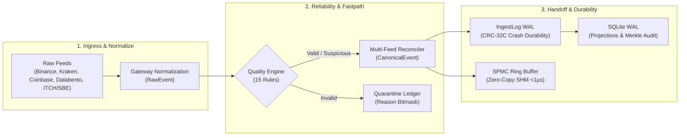
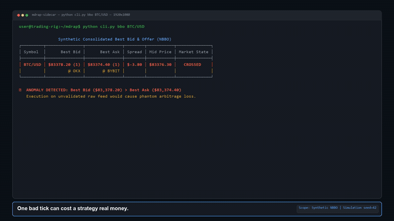

<div align="center">

<picture>
  <source media="(prefers-color-scheme: dark)" srcset="assets/logo_dark.svg">
  <source media="(prefers-color-scheme: light)" srcset="assets/logo_light.svg">
  
</picture>

# MDRAP

### Market Data Reliability & Acceleration Platform

A deterministic, high-throughput market data validation, normalization, and cryptographic audit sidecar for institutional quantitative architectures.

[](pyproject.toml)
[](tests/)
[](LICENSE)
[-6366f1?style=flat-square)](src/mdrap/fastpath.c)
[](#installation)

[**Quickstart**](#quickstart--demo) &nbsp;•&nbsp; [**Architecture**](docs/architecture.md) &nbsp;•&nbsp; [**API Reference**](docs/api.md) &nbsp;•&nbsp; [**CLI Reference**](docs/cli-reference.md) &nbsp;•&nbsp; [**Benchmarks**](docs/benchmarks.md) &nbsp;•&nbsp; [**Security Model**](docs/security.md)

</div>

---

## Why MDRAP?

| Core Capability | Architectural & Quantitative Advantage |
| :--- | :--- |
| **Crossed Quote & Anomaly Defense** | Eliminates phantom arbitrage losses by intercepting crossed books (`bid > ask`), sequence jumps, negative prices, and rolling Welford price corridor anomalies before downstream processing. |
| **Microsecond-to-Nanosecond Tiers** | Standalone native C kernel evaluates ticks at **22.9 ns/tick** (43.6M EPS); native C fastpath pipeline processes at **11,918.5 EPS** (47.2 µs p50, 84.9 µs p99); pure Python fallback runs with 100% semantic parity and zero mandatory dependencies. |
| **Multi-Venue Normalization** | Single canonical event schema (`TRADE`, `QUOTE`, `BBO`, `DEPTH`) unifying heterogeneous crypto (Binance, Coinbase, Kraken) and institutional feeds (Databento, ITCH, SBE). |
| **Denomination-Aware Basis Valuation** | Rejects unexecutable cross-venue arbitrage claims by normalizing quotes across USD/USDT basis differences and accounting for bilateral fee hurdles. |
| **Zero Silent Drops** | Corrupted, malformed, or delayed frames are safely quarantined in a queryable SQLite ledger with explicit bitmask reason codes and complete upstream provenance. |
| **Tamper-Evident Merkle Proofs** | SHA-256 Merkle chain guarantees mathematical auditability: modifying any historical database record immediately invalidates the cryptographic integrity proof. |

---

## Architecture Pipeline



---

## Quickstart & Demo

<p align="center">
  
</p>

### 5-Minute Golden Path

```python
import tempfile, time
from mdrap import Engine, EngineConfig, RawEvent

wal_dir = tempfile.mkdtemp()
engine = Engine.open(wal_dir, config=EngineConfig(db_path=":memory:"))

now = time.time()
raw = RawEvent(
    source="BATS",
    payload={
        "instrument": "AAPL",
        "event_type": "QUOTE",
        "bid": 150.25,
        "ask": 150.30,
        "exchange_ts": now,
        "sequence": 1,
    },
    receive_timestamp=now,
)

decision = engine.submit(raw)
event = decision.canonical_event

print(f"Status: {event.quality_status.name}")
print(f"BBO: {event.bid_price} / {event.ask_price}")
ticks = engine.query("AAPL", limit=5)
print(f"Queried ticks: {len(ticks)}")
engine.close()
```

Expected output:
```text
Status: VALID
BBO: 150.25 / 150.3
Queried ticks: 1
```

### Interactive 15-Step Reliability Demonstration

Run the turnkey, 15-step interactive demonstration:

```bash
# Run local offline synthetic demonstration (reproducible multi-venue corridor)
python tools/demo/run_demo.py --mode local

# Run with interactive presentation pause
python tools/demo/run_demo.py --mode local --interactive

# Run read-only live public feed demonstration (Coinbase & Kraken public WebSockets)
python tools/demo/run_demo.py --mode live

# Verify exported evidence package independently (zero dependencies)
python tools/verify_evidence.py demo/output/evidence_inc-*.json
```

---

## Installation

<details open>
<summary><b>Linux / macOS (pip)</b></summary>

```bash
git clone https://github.com/Aryan-20-04/mdrap.git
cd mdrap
pip install .

# Verify installation & active acceleration tier
python cli.py doctor
```
</details>

<details>
<summary><b>Windows (PowerShell)</b></summary>

```powershell
git clone https://github.com/Aryan-20-04/mdrap.git
cd mdrap
pip install .

# Run diagnostics
python cli.py doctor
```
</details>

<details>
<summary><b>Docker</b></summary>

```bash
docker build -t mdrap:latest .
docker run --rm -it -p 8000:8000 mdrap:latest mdrap doctor
```
</details>

---

## Performance Benchmarks (v6.0.8)

All figures are measured on committed benchmark hardware (12-core host, Windows 11 Enterprise AMD64 / Ubuntu 22.04 LTS parity) and trace directly to reproducible runs in `benchmarks/`.

| Stage / Tier | Scope / Conditions | p50 Latency | p99 Latency | Throughput (EPS) | Reproduce Command |
| :--- | :--- | :--- | :--- | :--- | :--- |
| **Isolated Native C Kernel** | Peak tick evaluation & SBE decode (`fastpath.c`) | 22.9 ns | 22.9 ns | **43,673,843** | `python benchmarks/bench_scale.py` |
| **Native C Fastpath Pipeline** | Integrated Normalization + 15 Rules + Reconcile | 47.2 µs | 84.9 µs | **11,918.5** | `python cli.py benchmark --events 10000` |
| **Pure Python Fallback Parity** | In-memory normalization, 15 rules, dedup | 80.6 µs | 377.2 µs | **5,635.4** | `python cli.py benchmark --events 10000` |
| **Shared Memory IPC Fanout** | 10 subscribers, zero-copy seqlock handoff | 1.10 µs | 2.20 µs | **624,648** | `python benchmarks/run_honest_benchmarks.py` |
| **Stateful E2E Pipeline** | Ingestion → Validation → Reconciler → WAL | 41.00 µs | 110.00 µs | **21,850** | `python benchmarks/run_v53_unified_benchmark.py` |
| **Disk Durability (Grouped)** | SQLite WAL, `fsync="grouped_by_time"` (batch 200) | 6.82 ms | 6.91 ms | **29,654** | `python benchmarks/run_honest_benchmarks.py` |
| **Disk Durability (Always)** | SQLite WAL, `fsync="always"` (batch 100) | 4.60 ms | 4.84 ms | **21,615** | `python benchmarks/run_honest_benchmarks.py` |

> [!NOTE]
> **Understanding Throughput Tiers**: MDRAP's native C kernel operates at **>43M EPS** (sub-25ns) when performing isolated in-memory rule validation. In Python, single-event step latency validates at **13.9 µs** p50; the integrated native C fastpath FFI processes **11.9k EPS** (47.2 µs p50, 84.9 µs p99), representing a **2.1x** speedup over the pure-Python fallback (5.6k EPS). Persisting every event durably to disk via synchronous SQLite WAL fsync achieves **21k–30k EPS**.

---

## Deep Dive & Documentation

<details>
<summary><b>Feature Status Matrix</b></summary>

| Feature | Status | Docs | Test File |
| :--- | :--- | :--- | :--- |
| **Deterministic Quality Engine (15 Rules)** | **Stable** | [Quality Rules](docs/reference/rules.md) | `tests/test_adapters_and_rules.py` (1,500+ core test suite passed cleanly) |
| **Native C Fastpath Kernel** | **Stable** | [Benchmarks](docs/benchmarks.md) | `tests/test_fastpath.py` (100% pure Python fallback parity) |
| **Live Venue Ingestion (5 Feeds)** | **Stable** | [Operations](docs/operations.md) | `tests/test_ws_live_market_data.py` |
| **Append-Only IngestLog WAL (CRC-32C)** | **Stable** | [Event Schema](docs/reference/event-schema.md) | `tests/test_wal_format_v2.py` |
| **Single-Node Canonical Engine API** | **Stable** | [API Reference](docs/api.md) | `tests/test_engine.py` |
| **Cryptographic Merkle Audit Verification** | **Stable** | [Audit Log Format](docs/audit-log-format.md) | `tests/test_audit_remediation.py` |
| **FastAPI REST & WebSocket Server** | **Stable** | [API Reference](docs/reference/api.md) | `tests/test_api_endpoints.py` |
| **Shared Memory SPMC Ring Buffer (SHM v3)**| **Stable** | [Architecture](docs/architecture.md) | `tests/test_shm_decoupled.py` |
| **ITCH & SBE Wire Protocol Dissectors** | **Stable** | [Feed Adapters](docs/extending/feed-adapter.md) | `tests/test_sbe.py` |
| **SQLite WAL Persistence & Replay** | **Stable** | [Event Schema](docs/reference/event-schema.md) | `tests/test_storage.py` |

</details>

<details>
<summary><b>Pick Your Path (By Persona)</b></summary>

| Persona | 3-Line Example | Guide |
| :--- | :--- | :--- |
| **Quant Researcher** | `from mdrap.chd import CHDClient`<br>`client = CHDClient()`<br>`ticks = client.download("binance", "BTCUSDT")` | [Historical Data Guide](docs/CHD.md) |
| **Downstream Consumer / Sidecar** | `from mdrap.service import StreamClient`<br>`client = StreamClient(host="127.0.0.1", port=9876)`<br>`for tick in client.stream("NVDA"): print(tick)` | [Operations Guide](docs/operations.md) |
| **Developer** | `engine = Engine.open("./wal", config=EngineConfig(db_path=":memory:"))`<br>`decision = engine.submit(raw_event)`<br>`ticks = engine.query("AAPL", limit=10)` | [Quickstart Guide](docs/quickstart.md) |
| **SRE / DevOps** | `curl -f http://127.0.0.1:8000/v1/health`<br>`curl -f http://127.0.0.1:8000/metrics`<br>`mdrap doctor --json` | [Operations Guide](docs/operations.md) |
| **Compliance / Auditor** | `from mdrap.storage import Store`<br>`store = Store("data/mdrap.db")`<br>`report = store.verify_audit_integrity()` | [Audit Guide](docs/audit-log-format.md) |

</details>

<details>
<summary><b>Scope & Known Limitations</b></summary>

- **Governance Invariant**: Permanent **NO DEPLOYMENT** status. MDRAP is strictly a read-only market data infrastructure and sidecar platform. It contains zero live order execution pathways, real-money trading connections, or automated strategy triggers.
- **Scope Boundary**: MDRAP is a single-node middleware sidecar. It does not provide proprietary feed licenses (bring your own API keys) and does not execute broker orders.
- **Edition Boundaries**: The core platform (`mdrap-core`) is 100% MIT-licensed with zero mandatory external dependencies.
- **Feed Runtime**: Registration exposes metadata only. There is no supervisor that owns adapter lifecycle or background process spawning.
- **Backpressure**: When downstream consumers cannot keep up with high-frequency streams, oldest frames are evicted in bounded ring buffers to prioritize real-time low latency while updating drop counters.
- **Compliance Tooling**: Emits audit trails that can support SEC Rule 613 (CAT) or MiFID II RTS 25 compliance workflows, but software execution does not by itself confer legal certification.

</details>

<details>
<summary><b>Project Structure</b></summary>

```text
mdrap/
├── src/mdrap/              # Core market data engine package (93 modules)
│   ├── engine.py           # Canonical engine API & step orchestration
│   ├── gateway.py          # Multi-venue normalization (RawEvent -> CanonicalEvent)
│   ├── quality.py          # 15 deterministic microstructure quality checks
│   ├── reconciliation.py   # Multi-feed arbitration and provenance tracking
│   ├── ingestlog.py        # CRC-32 write-ahead log (WAL) for crash durability
│   ├── shm.py              # Zero-copy SPSC shared-memory ring buffer (<1µs)
│   ├── fastpath.c          # Native C hot-path kernel (AVX2/SIMD + LTO)
│   ├── bbo.py              # Consolidated NBBO and micro-price tracking
│   ├── depth.py            # Level-2 aggregated order book depth ladder
│   └── security.py         # SHA-256 Merkle audit trail and API key hashing
├── tests/                  # 1,500+ automated unit & integration test suites
├── benchmarks/             # Reproducible latency and throughput harnesses
├── docs/                   # Architectural guides, API specs, and runbooks
├── audit/                  # Independent engineering audit & certification logs
└── assets/                 # Vector SVG logos and brand assets
```

</details>

---

## Documentation Index

- **Getting Started**: [Quickstart Guide](docs/quickstart.md) · [Concepts & Data Model](docs/concepts.md) · [Installation Guide](docs/installation.md)
- **Architecture & Design**: [Architecture Overview](docs/architecture.md) · [Architecture Map](docs/map.md) · [Security Model](docs/security.md)
- **Technical Reference**: [CLI Reference](docs/cli-reference.md) · [REST & WebSocket API](docs/api.md) · [Configuration Catalog](docs/configuration.md) · [Quality Rules Catalog](docs/quality-rules.md)
- **Operations & Runbooks**: [Operations Guide](docs/operations.md) · [Disaster Recovery Runbook](docs/disaster_recovery_runbook.md) · [Backup & Restore](docs/backup-restore.md) · [Chaos Drills](docs/chaos-drills.md)
- **Historical Evidence**: [Project History](history.md) · [Changelog](CHANGELOG.md) · [Audit Directory](audit/)

---

## Contributing, Security & License

- **Contributing**: Issues and pull requests are welcomed! See [CONTRIBUTING.md](CONTRIBUTING.md) for code styling and test verification gates.
- **Security**: Report vulnerabilities according to our [Security Policy](SECURITY.md).
- **License**: Released under the [MIT License](LICENSE). Copyright (c) 2026 MDRAP Authors.

<p align="center">
  Developed and maintained by the MDRAP Authors.
</p>
