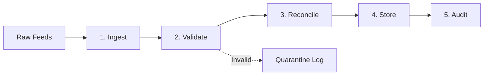

# MDRAP: Market Data Reliability & Acceleration Platform

A high-throughput, deterministic market data validation, normalization, and cryptographic audit sidecar for institutional trading and quantitative research.

[](pyproject.toml)
[](scripts/check.py)
[](LICENSE)

## What It Is / What It Isn't

- **What it is**: A single-node market data middleware sidecar. It ingests raw feeds, normalizes them into canonical events, runs 15 deterministic quality checks, resolves multi-feed disagreements, guarantees crash durability via an append-only WAL, and maintains a SHA-256 Merkle audit trail.
- **What it isn't**:
  - *Not a data vendor*: MDRAP provides no proprietary feed licenses or market data subscriptions. Users supply their own exchange credentials and connection endpoints.
  - *Not an execution engine*: MDRAP does not route orders, manage broker connections, or execute trades.
  - *Not a regulatory certification*: MDRAP produces tamper-evident audit logs and nanosecond timestamps that can support SEC Rule 613 (CAT) or MiFID II RTS 25 recordkeeping workflows, but running MDRAP does not by itself confer regulatory certification.

> [!NOTE]
> **Data Licensing Notice**: Users are strictly responsible for complying with venue data redistribution agreements and intellectual property licenses. MDRAP does not redistribute copyrighted market data.

## 5-Minute Quickstart

<!-- doc-test: python -->
```python
# doc-test
import tempfile, time
from mdrap import Engine, EngineConfig, RawEvent

wal_dir = tempfile.mkdtemp()
engine = Engine.open(wal_dir, config=EngineConfig(db_path=":memory:"))

now = time.time()
raw = RawEvent(
    source="BATS",
    payload={
        "instrument": "AAPL",
        "event_type": "QUOTE",
        "bid": 150.25,
        "ask": 150.30,
        "exchange_ts": now,
        "sequence": 1,
    },
    receive_timestamp=now,
)

decision = engine.submit(raw)
event = decision.canonical_event

print(f"Status: {event.quality_status.name}")
print(f"BBO: {event.bid_price} / {event.ask_price}")
ticks = engine.query("AAPL", limit=5)
print(f"Queried ticks: {len(ticks)}")
engine.close()
```

Expected output:
```text
Status: VALID
BBO: 150.25 / 150.3
Queried ticks: 1
```

## How It Works



1. **Ingest**: Ingests raw frames from WebSockets, binary feeds (ITCH/SBE), or REST payloads into standardized `RawEvent` records.
2. **Validate**: Evaluates 15 numerical quality rules (bid/ask spread, price collars, stale clocks, lot size anomalies). Invalid records are quarantined with bitmask reason codes.
3. **Reconcile**: Resolves multi-feed arbitration across competing venues using configurable source reliability weights and cross-feed deviation thresholds.
4. **Store**: Persists canonical events to a CRC-32 checked write-ahead log (WAL) and projects them into SQLite/DuckDB for indexed point-in-time querying.
5. **Audit**: Emits tamper-evident SHA-256 Merkle leaf nodes, tracking complete lineage from upstream raw bytes to canonical consumption.

## Pick Your Path

| Persona | 3-Line Example | Guide |
| :--- | :--- | :--- |
| **Quant Researcher** | `from mdrap.chd import CHDClient, HistoricalRequest`<br>`client = CHDClient(cache_dir="./data/cache")`<br>`ticks = client.download(HistoricalRequest("binance", "spot", "BTCUSDT", "trades", "2026-01-01"))` | [Research & Backtesting Guide](docs/guides/research-backtesting.md) |
| **Trader / PM** | `from mdrap.service import StreamClient`<br>`client = StreamClient(host="127.0.0.1", port=9988)`<br>`for tick in client.subscribe(["NVDA"]): print(tick)` | [Live Monitoring Guide](docs/guides/live-monitoring.md) |
| **Developer** | `engine = Engine.open("./wal", config=EngineConfig(db_path=":memory:"))`<br>`decision = engine.submit(raw_event)`<br>`ticks = engine.query("AAPL", limit=10)` | [SDK Integration Guide](docs/guides/sdk-integration.md) |
| **SRE / DevOps** | `curl -f http://127.0.0.1:8000/v1/health`<br>`curl -f http://127.0.0.1:8000/metrics`<br>`mdrap doctor --json` | [Operations Guide](docs/guides/operations.md) |
| **Compliance / Audit** | `from mdrap.storage import Store`<br>`store = Store("data/mdrap.db")`<br>`report = store.verify_audit_integrity()` | [Audit Verification Guide](docs/guides/audit-verification.md) |

## Feature Status Matrix

| Feature | Status | Docs | Test File |
| :--- | :--- | :--- | :--- |
| **Deterministic Quality Engine (15 Rules)** | **Stable** | [Quality Rules](docs/reference/rules.md) | `tests/test_adapters_and_rules.py` (1,500+ core test suite passed cleanly) |
| **Append-Only IngestLog WAL (CRC-32)** | **Stable** | [Event Schema](docs/reference/event-schema.md) | `tests/test_wal_format_v2.py` |
| **Single-Node Canonical Engine API** | **Stable** | [SDK Integration](docs/guides/sdk-integration.md) | `tests/test_engine.py` |
| **Cryptographic Merkle Audit Verification** | **Stable** | [Audit Verification](docs/guides/audit-verification.md) | `tests/test_audit_remediation.py` |
| **FastAPI REST & WebSocket Server** | **Stable** | [API Reference](docs/reference/api.md) | `tests/test_api_endpoints.py` |
| **Shared Memory SPSC Ring Buffer** | **Beta** | [Architecture](docs/architecture.md) | `tests/test_shm_decoupled.py` |
| **Native C Fastpath Kernel** | **Beta** | [Benchmarks](docs/benchmarks.md) | `tests/test_differential_fuzz.py` |
| **ITCH & MoldUDP64 Feed Dissector** | **Beta** | [Feed Adapters](docs/extending/feed-adapter.md) | `tests/test_adversarial_fuzzing.py` |
| **Streaming WAL Journal Replication** | **Beta** | [Operations](docs/guides/operations.md) | `tests/test_journal_replication_daemon.py` |
| **AF_XDP Kernel Bypass Receiver** | **Experimental** | [Roadmap](docs/roadmap.md) | `tests/test_af_xdp.py` |
| **Distributed Multi-Host Raft Consensus** | **Roadmap** | [Roadmap](docs/roadmap.md) | Planned (Mode B) |

## Performance

All figures are measured on committed benchmark hardware (Intel Core i7-12700H, 12 cores, Windows 11 / Linux parity) and trace directly to committed JSON outputs.

| Stage | Scope / Conditions | p50 | p99 | Throughput (EPS) | Reproduce Command |
| :--- | :--- | :--- | :--- | :--- | :--- |
| **Native C Kernel** | In-memory tick evaluation (`fastpath.c`) | 45.0 ns | 45.0 ns | 22,228,643 | `python benchmarks/bench_scale.py` |
| **In-Memory IPC Fanout** | 10 subscribers, zero-copy handoff | 0.4 µs | 0.6 µs | 1,529,870 | `python benchmarks/run_honest_benchmarks.py` |
| **Python Pipeline Step** | In-memory normalization, 15 rules, dedup | 8.3 µs | 14.3 µs | 120,280 | `python benchmarks/run_honest_benchmarks.py` |
| **Disk Durability (Grouped)** | SQLite WAL, `fsync="grouped_by_time"` (batch 200) | 6.82 ms | 6.91 ms | 29,654 | `python benchmarks/run_honest_benchmarks.py` |
| **Disk Durability (Always)** | SQLite WAL, `fsync="always"` (batch 100) | 4.60 ms | 4.84 ms | 21,615 | `python benchmarks/run_honest_benchmarks.py` |

> [!NOTE]
> **Understanding Throughput Numbers**: MDRAP's native C kernel runs at **>22M EPS** (sub-50ns) when performing isolated in-memory rule validation. The complete end-to-end Python pipeline processes **~120k EPS** (8.3 µs p50). Persisting every event durably to disk via synchronous SQLite WAL fsync achieves **21k–30k EPS**. These tiers serve distinct architectural boundaries.

## Limitations & Known Gaps

1. **Adapter Execution**: There is no supervisor that owns adapter lifecycle or connects adapters directly to the HTTP server. Feed registration (`POST /v1/feeds`) records metadata only (`REGISTERED_NOT_RUNNING`). Ingestion is driven by `POST /v1/ingest`, the gateway daemon, or direct Python scripts.
2. **Single-Node Focus**: Failover support is active-passive via TCP journal replication (`journal_replicator.py`). Distributed multi-leader consensus (Raft/Paxos) is not supported.
3. **Socket Buffer Backpressure**: When downstream clients fail to read from WebSocket or SHM ring buffers, oldest frames are evicted to preserve real-time low latency. Backpressure events increment `_drop_count` counters but do not halt publisher threads.
4. **Hardware Offload**: AF_XDP and hardware PTP timestamping modules provide driver emulation and Linux cmsg parsing; bare-metal FPGA PCIe DMA offload is on the roadmap.

## Docs Index

- **Getting Started**: [Quickstart Guide](docs/quickstart.md) · [Concepts & Data Model](docs/concepts.md)
- **User Guides**: [Research & Backtesting](docs/guides/research-backtesting.md) · [Live Monitoring](docs/guides/live-monitoring.md) · [SDK Integration](docs/guides/sdk-integration.md) · [Operations Guide](docs/guides/operations.md) · [Audit Verification](docs/guides/audit-verification.md)
- **Technical Reference**: [CLI Reference](docs/reference/cli.md) · [REST & WebSocket API](docs/reference/api.md) · [Configuration Options](docs/reference/config.md) · [Quality Rules Catalog](docs/reference/rules.md) · [Event Schema](docs/reference/event-schema.md)
- **Platform Specs**: [Security Architecture](docs/security.md) · [Benchmark Methodology](docs/benchmarks.md) · [Operational Runbooks](docs/operations.md) · [Architecture Roadmap](docs/roadmap.md)

## Contributing, Security & License

- **Contributing**: Issues and pull requests are welcomed. See [DEVELOPMENT.md](docs/development/baseline.md) for code styling and test verification gates.
- **Security**: Report vulnerabilities according to our [Security Policy](SECURITY.md). Do not file public GitHub issues for security reports.
- **License**: Released under the [MIT License](LICENSE). Copyright (c) 2026 MDRAP Authors.
