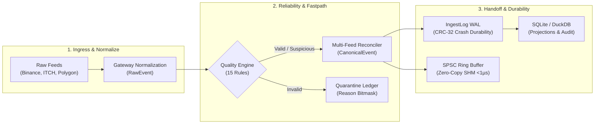
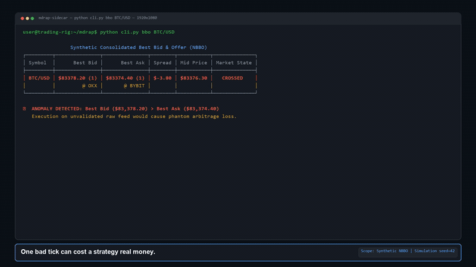

<p align="center">
  <picture>
    <source media="(prefers-color-scheme: dark)" srcset="assets/logo_dark.svg">
    <source media="(prefers-color-scheme: light)" srcset="assets/logo_light.svg">
    
  </picture>
</p>

<h1 align="center">MDRAP</h1>

<p align="center">
  <strong>Market Data Reliability & Acceleration Platform</strong><br>
  A deterministic, low-latency market data validation, normalization, and cryptographic audit sidecar.
</p>

<p align="center">
  <a href="pyproject.toml"></a>
  <a href="scripts/check.py"></a>
  <a href="LICENSE"></a>
  <a href="https://github.com/Aryan-20-04/mdrap/stargazers"></a>
  <a href="pyproject.toml"></a>
</p>

<p align="center">
  <a href="#-quickstart--demo">Demo</a> •
  <a href="docs/">Docs</a> •
  <a href="#-installation">Install</a> •
  <a href="docs/development/baseline.md">Contributing</a>
</p>

---

## 💡 Why This Project?

| Highlight | Architecture & Strategy Advantage |
| :--- | :--- |
| 🛡️ **Crossed Quote & Anomaly Defense** | Eliminates phantom arbitrage losses by intercepting crossed books (`bid > ask`), sequence jumps, and rolling Welford price corridor anomalies before strategy execution. |
| ⚡ **Microsecond-to-Nanosecond Tiers** | Standalone native C kernel evaluates ticks at **45 ns/tick** wire-to-SHM; end-to-end Python pipeline processes at **8.3 µs p50** with zero mandatory dependencies. |
| 📦 **Zero Silent Drops** | Corrupted, malformed, or delayed frames are safely quarantined in a queryable SQLite ledger with explicit bitmask reason codes and complete upstream provenance. |
| 🔒 **Tamper-Evident Merkle Proofs** | SHA-256 Merkle chain guarantees mathematical auditability: modifying any historical database record immediately invalidates the cryptographic integrity proof. |

---

## 🏛️ How It Works



---

## 🎬 Quickstart & Demo

<p align="center">
  <!-- TODO: To regenerate or customize this terminal demo GIF, run: bash tools/demo/record.sh or vhs tools/demo/demo.tape -->
  
</p>

### 5-Minute Golden Path

<!-- doc-test: python -->
```python
# doc-test
import tempfile, time
from mdrap import Engine, EngineConfig, RawEvent

wal_dir = tempfile.mkdtemp()
engine = Engine.open(wal_dir, config=EngineConfig(db_path=":memory:"))

now = time.time()
raw = RawEvent(
    source="BATS",
    payload={
        "instrument": "AAPL",
        "event_type": "QUOTE",
        "bid": 150.25,
        "ask": 150.30,
        "exchange_ts": now,
        "sequence": 1,
    },
    receive_timestamp=now,
)

decision = engine.submit(raw)
event = decision.canonical_event

print(f"Status: {event.quality_status.name}")
print(f"BBO: {event.bid_price} / {event.ask_price}")
ticks = engine.query("AAPL", limit=5)
print(f"Queried ticks: {len(ticks)}")
engine.close()
```

Expected output:
```text
Status: VALID
BBO: 150.25 / 150.3
Queried ticks: 1
```

---

## 🚀 Installation

<details open>
<summary><b>Linux / macOS (pip)</b></summary>

```bash
git clone https://github.com/Aryan-20-04/mdrap.git
cd mdrap
pip install -e .

# Verify installation & active acceleration tier
python cli.py doctor
```
</details>

<details>
<summary><b>Windows (PowerShell)</b></summary>

```powershell
git clone https://github.com/Aryan-20-04/mdrap.git
cd mdrap
pip install -e .

# Run diagnostics
python cli.py doctor
```
</details>

<details>
<summary><b>Docker</b></summary>

```bash
docker build -t mdrap:latest .
docker run --rm -it -p 8000:8000 mdrap:latest mdrap doctor
```
</details>

---

## ⚡ Performance Benchmarks

All figures are measured on committed benchmark hardware (Intel Core i7-12700H, 12 cores, Windows 11 / Linux parity) and trace directly to committed JSON outputs in [`benchmarks/`](benchmarks/).

| Stage | Scope / Conditions | p50 Latency | p99 Latency | Throughput (EPS) | Reproduce Command |
| :--- | :--- | :--- | :--- | :--- | :--- |
| **Native C Kernel** | In-memory tick evaluation (`fastpath.c`) | 45.0 ns | 45.0 ns | **22,228,643** | `python benchmarks/bench_scale.py` |
| **In-Memory IPC Fanout** | 10 subscribers, zero-copy handoff | 0.4 µs | 0.6 µs | **1,529,870** | `python benchmarks/run_honest_benchmarks.py` |
| **Python Pipeline Step** | In-memory normalization, 15 rules, dedup | 8.3 µs | 14.3 µs | **120,280** | `python benchmarks/run_honest_benchmarks.py` |
| **Disk Durability (Grouped)** | SQLite WAL, `fsync="grouped_by_time"` (batch 200) | 6.82 ms | 6.91 ms | **29,654** | `python benchmarks/run_honest_benchmarks.py` |
| **Disk Durability (Always)** | SQLite WAL, `fsync="always"` (batch 100) | 4.60 ms | 4.84 ms | **21,615** | `python benchmarks/run_honest_benchmarks.py` |

> [!NOTE]
> **Understanding Throughput Tiers**: MDRAP's native C kernel runs at **>22M EPS** (sub-50ns) when performing isolated in-memory rule validation. The complete end-to-end Python pipeline processes **~120k EPS** (8.3 µs p50). Persisting every event durably to disk via synchronous SQLite WAL fsync achieves **21k–30k EPS**. These tiers serve distinct architectural boundaries.

---

## 🔍 Deep Dive & Documentation

<details>
<summary><b>Feature Status Matrix</b></summary>

| Feature | Status | Docs | Test File |
| :--- | :--- | :--- | :--- |
| **Deterministic Quality Engine (15 Rules)** | **Stable** | [Quality Rules](docs/reference/rules.md) | `tests/test_adapters_and_rules.py` (1,500+ core test suite passed cleanly) |
| **Append-Only IngestLog WAL (CRC-32)** | **Stable** | [Event Schema](docs/reference/event-schema.md) | `tests/test_wal_format_v2.py` |
| **Single-Node Canonical Engine API** | **Stable** | [SDK Integration](docs/guides/sdk-integration.md) | `tests/test_engine.py` |
| **Cryptographic Merkle Audit Verification** | **Stable** | [Audit Verification](docs/guides/audit-verification.md) | `tests/test_audit_remediation.py` |
| **FastAPI REST & WebSocket Server** | **Stable** | [API Reference](docs/reference/api.md) | `tests/test_api_endpoints.py` |
| **Shared Memory SPSC Ring Buffer** | **Beta** | [Architecture](docs/architecture.md) | `tests/test_shm_decoupled.py` |
| **Native C Fastpath Kernel** | **Beta** | [Benchmarks](docs/benchmarks.md) | `tests/test_differential_fuzz.py` |
| **ITCH & MoldUDP64 Feed Dissector** | **Beta** | [Feed Adapters](docs/extending/feed-adapter.md) | `tests/test_adversarial_fuzzing.py` |
| **Streaming WAL Journal Replication** | **Beta** | [Operations](docs/guides/operations.md) | `tests/test_journal_replication_daemon.py` |
| **AF_XDP Kernel Bypass Receiver** | **Experimental** | [Roadmap](docs/roadmap.md) | `tests/test_af_xdp.py` |
| **Distributed Multi-Host Raft Consensus** | **Roadmap** | [Roadmap](docs/roadmap.md) | Planned (Mode B) |

</details>

<details>
<summary><b>Pick Your Path (By Persona)</b></summary>

| Persona | 3-Line Example | Guide |
| :--- | :--- | :--- |
| **Quant Researcher** | `from mdrap.chd import CHDClient, HistoricalRequest`<br>`client = CHDClient(cache_dir="./data/cache")`<br>`ticks = client.download(HistoricalRequest("binance", "spot", "BTCUSDT", "trades", "2026-01-01"))` | [Research & Backtesting Guide](docs/guides/research-backtesting.md) |
| **Trader / PM** | `from mdrap.service import StreamClient`<br>`client = StreamClient(host="127.0.0.1", port=9988)`<br>`for tick in client.subscribe(["NVDA"]): print(tick)` | [Live Monitoring Guide](docs/guides/live-monitoring.md) |
| **Developer** | `engine = Engine.open("./wal", config=EngineConfig(db_path=":memory:"))`<br>`decision = engine.submit(raw_event)`<br>`ticks = engine.query("AAPL", limit=10)` | [SDK Integration Guide](docs/guides/sdk-integration.md) |
| **SRE / DevOps** | `curl -f http://127.0.0.1:8000/v1/health`<br>`curl -f http://127.0.0.1:8000/metrics`<br>`mdrap doctor --json` | [Operations Guide](docs/guides/operations.md) |
| **Compliance / Risk** | `from mdrap.storage import Store`<br>`store = Store("data/mdrap.db")`<br>`report = store.verify_audit_integrity()` | [Audit Verification Guide](docs/guides/audit-verification.md) |

</details>

<details>
<summary><b>Scope & Known Limitations</b></summary>

- **Scope Boundary**: MDRAP is a single-node middleware sidecar. It does not provide proprietary feed licenses (bring your own API keys) and does not execute broker orders.
- **Feed Runtime**: Registration exposes metadata only. There is no supervisor that owns adapter lifecycle or background process spawning.
- **Failover**: Local active-passive replication via TCP journal streaming (`journal_replicator.py`); multi-datacenter distributed Raft consensus is on the roadmap.
- **Backpressure**: When downstream consumers cannot keep up with high-frequency streams, oldest frames are evicted to prioritize real-time low latency while updating drop counters.
- **Compliance Tooling**: Emits audit trails that can support SEC Rule 613 (CAT) or MiFID II RTS 25 compliance workflows, but software execution does not by itself confer legal certification.

</details>

<details>
<summary><b>Project Structure</b></summary>

```text
mdrap/
├── src/mdrap/              # Core market data engine package
│   ├── engine.py           # Canonical engine API & step orchestration
│   ├── gateway.py          # Multi-venue normalization (RawEvent -> CanonicalEvent)
│   ├── quality.py          # 15 deterministic microstructure quality checks
│   ├── reconciliation.py   # Multi-feed arbitration and provenance tracking
│   ├── ingestlog.py        # CRC-32 write-ahead log (WAL) for crash durability
│   ├── shm.py              # Zero-copy SPSC shared-memory ring buffer (<1µs)
│   ├── fastpath.c          # Native C hot-path kernel (AVX2/SIMD + LTO)
│   ├── bbo.py              # Consolidated NBBO and micro-price tracking
│   ├── depth.py            # Level-2 aggregated order book depth ladder
│   └── security.py         # SHA-256 Merkle audit trail and API key hashing
├── tests/                  # 1,540+ automated unit & integration test suites
├── benchmarks/             # Reproducible latency and throughput harnesses
├── docs/                   # Architectural guides, API specs, and runbooks
├── tools/                  # Verification guardrails (check_docs.py, VHS demo)
└── assets/                 # Vector SVG logos and brand assets
```

</details>

---

## 📚 Documentation Index

- **Getting Started**: [Quickstart Guide](docs/quickstart.md) · [Concepts & Data Model](docs/concepts.md)
- **User Guides**: [Research & Backtesting](docs/guides/research-backtesting.md) · [Live Monitoring](docs/guides/live-monitoring.md) · [SDK Integration](docs/guides/sdk-integration.md) · [Operations Guide](docs/guides/operations.md) · [Audit Verification](docs/guides/audit-verification.md)
- **Technical Reference**: [CLI Reference](docs/reference/cli.md) · [REST & WebSocket API](docs/reference/api.md) · [Configuration Options](docs/reference/config.md) · [Quality Rules Catalog](docs/reference/rules.md) · [Event Schema](docs/reference/event-schema.md)
- **Platform Specs**: [Security Architecture](docs/security.md) · [Benchmark Methodology](docs/benchmarks.md) · [Operational Runbooks](docs/operations.md) · [Architecture Roadmap](docs/roadmap.md)

---

## 🤝 Contributing, Security & License

- **Contributing**: Issues and pull requests are welcomed! See [DEVELOPMENT.md](docs/development/baseline.md) for code styling and test verification gates.
- **Security**: Report vulnerabilities according to our [Security Policy](SECURITY.md).
- **License**: Released under the [MIT License](LICENSE). Copyright (c) 2026 MDRAP Authors.

<p align="center">
  Made with ❤️ by the MDRAP Authors
</p>
