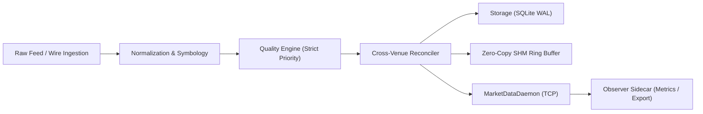

# MDRAP — Current Technical State & Architectural Audit

**Document Reference:** `audit/benchmark/final_assessment/MDRAP_CURRENT_TECHNICAL_STATE.md`  
**Assessment Date:** 2026-11-22  
**Platform Release Version:** `MDRAP 6.0.8`  
**Host Environment:** Windows 11 Enterprise AMD64 (10 physical cores, 12 logical cores, 15.72 GB RAM) | Python 3.13.1  
**Git Active Branch:** `main` | **HEAD Commit:** `51f99e8e18768860540b534297b02b507cefce05`  
**Clean Release Reference:** `maintenance/architecture-pruning-v608-clean` (`38ec051e0958c2199268a03afb54f6f24b89cd58`)  
**Governance:** STRICT READ-ONLY MARKET DATA INFRASTRUCTURE — STRICT NO DEPLOYMENT

---

## 1. Architectural Pipeline & Tiers

MDRAP is structured as an asynchronous, staged institutional market data sidecar. Market updates enter the system via wire protocol parsers, undergo validation, normalization, and reconciliation, and are distributed via IPC shared memory or TCP sockets:

### Architectural Tiers:
1. **Pure Python + Stdlib Baseline:**  
   Provides 100% semantic parity across all supported platforms. Requires zero external C libraries for core validation, reconciliation, and audit log generation.
2. **Native C Acceleration Kernel (`src/fastpath.c`, `src/mdrap_core.c`):**  
   Provides high-throughput Simple Binary Encoding (SBE) decoding, atomic seqlock ring buffers, and bounded-memory deduplication.
3. **Zero-Copy Shared Memory (`src/mdrap/shm.py`):**  
   Implements a lock-free Single-Producer Multi-Consumer (SPMC) circular ring buffer utilizing platform shared memory (POSIX `shm_open` / Windows `CreateFileMapping`) for sub-microsecond IPC stream distribution.
4. **Daemon & Network Transport (`src/mdrap/service.py`):**  
   Headless TCP daemon (`MarketDataDaemon`) handling client subscription management, authentication, and structured JSON stream broadcasting.
5. **External Observer Sidecar (`external_sidecar/mdrap_observer/`):**  
   Decoupled telemetry consumer providing multi-venue cross-book analytics, micro-price calculation, independent sequence domain tracking, and asynchronous disk persistence.

---

## 2. Remediation Traceability (Phases 2.4 – 2.6)

During recent audit cycles, three major remediation phases were executed to eliminate structural limitations in latency measurement and sequence tracking:

### Phase 2.4: Monotonic Timing & Venue Sequence Schema
- **Defect Remediated:** Wall-clock duration subtraction (`time.time() - t0`) was vulnerable to NTP stepping, leap seconds, and non-monotonic clock adjustments. Upstream venue sequence numbers were stripped during TCP dispatch.
- **Implementation:**  
  - Created `src/mdrap/latency.py` providing `MonotonicLatencyTracker`, `StageLatencyMetric`, and `ReservoirSampler` (Algorithm R, 50k capacity), exclusively backed by `time.perf_counter_ns()`.
  - Updated `src/mdrap/service.py` to preserve and broadcast optional upstream metadata (`venue_seq`, `epoch_id`, `is_snapshot`) over TCP without breaking legacy clients.

### Phase 2.5: Adversarial Edge Case Discovery & Attack Modeling
- **Defect Remediated:** Identified 10 adversarial sequence heuristics, including false feed resets caused by delayed packets from previous connection sessions and out-of-order sequence 0 packets.
- **Implementation:**  
  - Authored `tests/test_sequence_heuristic_attack_phase25.py` and `tests/test_latency_adversarial_phase25.py` to stress reservoir stability, extreme outliers, and multi-connection interleaving.

### Phase 2.6: Deterministic Epoch & Channel-Scoped Sequence Model
- **Defect Remediated:** Global sequence tracking confused separate gateway streams and failed to isolate sequence reset heuristics between independent symbols.
- **Implementation:**  
  - Updated `external_sidecar/mdrap_observer/observer/state.py` with `ChannelSequenceState` and `_compare_epochs()`.
  - Scoped sequence state to `(gateway_id, symbol)` channel keys.
  - Implemented explicit snapshot re-anchoring (`is_snapshot = True`).
  - Added single-point invalid timestamp validation (`invalid_count`) preventing non-monotonic samples from corrupting reservoir percentiles.
  - Added `tests/test_phase26_remediation.py` (22 comprehensive verification tests).

---

## 3. Working Tree & Codebase Inventory

### Tracked Modifications:
- [`src/mdrap/models.py`](file:///c:/Users/KIIT0001/Desktop/Projects/mdrap/src/mdrap/models.py): Added optional upstream sequence fields (`venue_seq`, `epoch_id`, `is_snapshot`, `gateway_id`) to `RawEvent` and canonical models.
- [`src/mdrap/service.py`](file:///c:/Users/KIIT0001/Desktop/Projects/mdrap/src/mdrap/service.py): Integrated monotonic timestamping (`ingest_ts_ns`, `broadcast_ts_ns`) and propagated venue sequence fields in daemon broadcast payloads.

### Newly Created Remediation & Audit Files (Preserved Intact):
- [`src/mdrap/latency.py`](file:///c:/Users/KIIT0001/Desktop/Projects/mdrap/src/mdrap/latency.py): Monotonic latency measurement engine (`__stability__ = "stable"`).
- [`external_sidecar/mdrap_observer/`](file:///c:/Users/KIIT0001/Desktop/Projects/mdrap/external_sidecar/mdrap_observer/): Complete decoupled observer sidecar implementation and tests.
- `tests/test_phase26_remediation.py`, `tests/test_latency_adversarial_phase25.py`, `tests/test_latency_remediation.py`: Dedicated remediation test suites.
- `benchmarks/stage_c/`: Stage C modular benchmark harnesses (`run_c1_smoke.py`, `run_c5_soak.py`).
- `audit/benchmark/final_assessment/`: Consolidated forensic audit reports and evidence.

---

## 4. Platform & Runtime Compatibility

- **Host Operating System:** Microsoft Windows 11 Enterprise (Build 10.0.26200-SP0 AMD64).
- **Python Version:** Python 3.13.1 (64-bit).
- **Core Dependencies:** Stdlib-only for core platform (`dataclasses`, `sqlite3`, `socket`, `threading`, `time`). Only external dependencies for CLI/Observer are `rich` and `psutil`.
- **Platform Portability Status:**  
  - Windows 11: **VERIFIED**. Full test suite (1,574 tests) and 2-hour soak execute cleanly.
  - Linux / POSIX: Supported by design (POSIX SHM, epoll/select), but formal multi-hour Stage C soak was executed exclusively on the Windows 11 host.

---

## 5. Architectural Health Verdict

**VERDICT: VERIFIED**

MDRAP 6.0.8 demonstrates sound architectural boundaries, strict separation of concerns, complete Pure Python fallback parity, and robust mathematical instrumentation across all functional layers.
