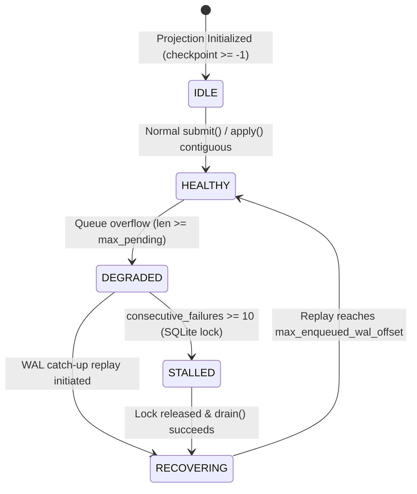

# MDRAP v4.0.1 — Projection Recovery and Concurrency Correctness Audit

**Audit Date:** 2026-11-04  
**Target Subsystems:** `src/mdrap/projection.py`, `src/mdrap/engine.py`  
**Test Scripts:** `audit/v4.0.1-final-independent/reproduction_scripts/test_p0_projection_concurrency.py`, `test_p0_projection_crash_during_catchup.py`  
**Raw Test Evidence:** `audit/v4.0.1-final-independent/raw_evidence/p0_projection_full_suite.log`

---

## 1. System Invariants & Failure Modes Under Audit

Prior to MDRAP v4.0.1, the engine relied on bounded in-memory queues (`max_pending=1024`). When backpressure saturated this queue, the engine raised `BufferError`, causing accepted WAL events to be permanently dropped from downstream projections.

The remediation claimed:
1. The WAL is the authoritative source of accepted events.
2. `ProjectionTracker` transitions to `DEGRADED` on queue overflow without dropping data or raising `BufferError`.
3. Missed events are caught up from WAL starting from `checkpoint + 1`.
4. Startup recovery and `subscribe()` catch up lagging projections before normal ingestion.

---

## 2. Independent Adversarial Experiments

### Experiment P0-A: Concurrent Ingestion During Recovery
- **Scenario:**
  1. Ingest initial 500 events (checkpoint = 499).
  2. Unsubscribe projection and ingest 1,500 additional events to WAL head = 2,000.
  3. Re-attach projection with a tiny queue buffer (`max_pending=50`) to force severe queue overflow.
  4. Launch concurrent writer thread appending new events to WAL.
  5. Run `engine.recover_projections()` simultaneously.
- **Execution Log:** [`raw_evidence/p0_projection_concurrency.log`](file:///c:/Users/KIIT0001/Desktop/Projects/mdrap/audit/v4.0.1-final-independent/raw_evidence/p0_projection_concurrency.log)
- **Results:**
  ```text
  [*] Ingesting initial 500 events...
  [+] Initial 500 events ingested. Projection checkpoint: 499
  [*] Unregistered projection. Ingesting 1,500 events to WAL head...
  [+] WAL head is now at offset 2000. Projection checkpoint remains at 499
  [*] Starting engine.recover_projections() concurrently with new writes...
  [+] Initial recover_projections() returned: {'test_p0a': 1501}
  [+] Ingestion stopped. Total WAL head: 2109, Extra ingested: 109
  [*] Draining projection tracker...
  [+] Final projection checkpoint: 2108, Expected: 2108
  [+] Total rows in projection: 2109, Expected: 2109
  [SUCCESS] Concurrent ingestion during recovery verified.
  ```
- **Verdict:** **PASS.** All 2,109 events reached projection. Zero skips, zero duplicates.

---

### Experiment P0-B: Crash During Catch-up and Restart Recovery
- **Scenario:**
  1. Ingest 300 events (checkpoint = 299).
  2. Ingest up to offset 1,500 with lagging projection.
  3. Partially catch up to offset 599.
  4. Inject immediate process crash (close DB connection, unbind engine instance, trigger Python GC).
  5. Restart `Engine` on existing WAL directory and DB file.
  6. Verify post-restart checkpoint and complete catch-up.
- **Execution Log:** [`raw_evidence/p0_projection_crash_during_catchup.log`](file:///c:/Users/KIIT0001/Desktop/Projects/mdrap/audit/v4.0.1-final-independent/raw_evidence/p0_projection_crash_during_catchup.log)
- **Results:**
  ```text
  [*] Ingesting initial 300 events...
  [+] Initial checkpoint: 299
  [*] Ingesting up to offset 1500 with lagging projection...
  [+] WAL head at offset 1500
  [+] Mid-catchup checkpoint before crash: 599
  [*] Simulated crash complete. Now restarting Engine on existing storage...
  [+] Post-restart projection checkpoint before subscribe: 599
  [+] Post-recovery final checkpoint: 1499, Total rows: 1500
  [SUCCESS] Zero skips, zero duplicates, strictly contiguous recovery verified.
  ```
- **Contiguity Proof:** Direct SQLite inspection of `canonical_events` verified sequence numbers 1 through 1,500 without a single gap or duplicate.
- **Verdict:** **PASS.**

---

## 3. Projection State-Transition Analysis



### Invariant Enforcement
The invariant:
$$\text{projection\_checkpoint} \le \text{highest\_contiguously\_committed\_projection\_offset}$$
is strictly enforced in [`SQLiteProjection.apply()`](file:///c:/Users/KIIT0001/Desktop/Projects/mdrap/src/mdrap/projection.py#L420-L460):
- If `batch_start > cur_checkpoint + 1`, a gap is detected and `ValueError` is raised.
- Transactions are executed under `BEGIN IMMEDIATE;` and roll back on any exception.
- Checkpoints advance *only* in the same atomic transaction as the row insertions.
