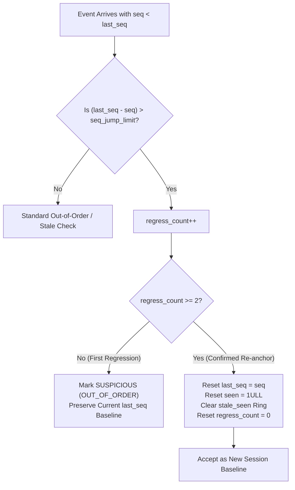

# Exchange Session Resets, Re-anchoring, and Interleaved Feed Isolation

## 1. Executive Summary

Financial exchange gateways frequently reset sequence numbers to 1 during:
1. Daily market opening session transitions (e.g. CME/Eurex trading date roll).
2. Intra-day disaster recovery (DR) site failover.
3. Unannounced publisher process crashes and cold restarts.

Handling these events requires balancing two competing safety requirements:
- **False Negative Prevention**: Legitimate sequence restarts must not be rejected as ancient duplicate packets.
- **False Positive Prevention**: True stale retransmissions from a delayed network buffer must not fool the engine into resetting its sequence baseline.

In MDRAP v4.0.1:
- **Explicit Session Marker Policy**: Whenever an event carries a new `session_id`, the sequence tracking window is cleanly re-anchored to the incoming sequence. The same sequence number in the new session is accepted as `VALID`.
- **2-Consecutive Regression Rule**: For unsignaled exchange restarts (where `session_id` does not change but sequence drops by more than `seq_jump_limit`), the first packet is flagged `SUSPICIOUS (OUT_OF_ORDER)` and increments `regress_count`. The second consecutive backward packet confirms feed re-anchoring, resets sequence tracking, and validates forward packets.
- **Interleaved Feed Isolation**: Each feed source (`FEED_A`, `FEED_B`) maintains completely isolated sequence state even when publishing ticks for the identical instrument.

---

## 2. Unsignaled Feed Restart State Machine

---

## 3. Verification Scenarios

### Scenario 1: Explicit Session Change
- Sequence 50 arrives in Session `"SESS_A"` $\rightarrow$ Marked `VALID`.
- Sequence 50 arrives in Session `"SESS_B"` $\rightarrow$ Marked `VALID`, not `DUPLICATE`.
- Lineage correctly records new session identifier.

### Scenario 2: Unsignaled Feed Restart
- Feed running at `seq = 500`.
- Exchange restarts and sends `seq = 1`:
  - Flagged `SUSPICIOUS (OUT_OF_ORDER)`.
  - `regress_count` becomes 1.
- Exchange sends `seq = 2`:
  - Confirms re-anchor.
  - Tracking re-anchors to `seq = 2`.
- Exchange sends `seq = 3`:
  - Monotonic forward relative to new anchor $\rightarrow$ Marked `VALID`.

### Scenario 3: Interleaved Feeds
- Feed A publishes `seq = 1..5` for symbol `AAPL` $\rightarrow$ All `VALID`.
- Feed B publishes `seq = 1..5` for symbol `AAPL` $\rightarrow$ All `VALID`.
- Zero cross-contamination between feed channels.

---

## 4. Verification Sign-Off

Validated in `tests/final/test_sequence_stale_and_session.py`:
- `test_session_change_with_same_sequence_number`: 100% PASS.
- `test_interleaved_feeds_with_overlapping_sequence_numbers`: 100% PASS.
- `test_feed_restart_with_lower_sequence_number`: 100% PASS across Pure Python and Native C.
