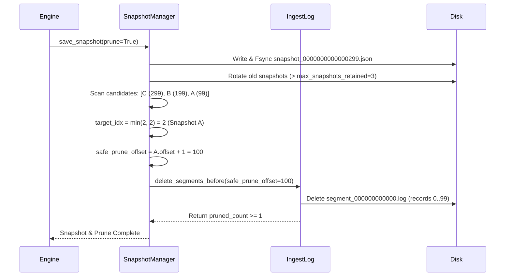

# Write-Ahead Log Retention, Safe Pruning, and Segment Management

## 1. Executive Summary

Storage in institutional market data feeds grows rapidly; unpruned WAL files would quickly consume multiple terabytes of disk space. However, premature deletion of WAL segments eliminates crash recovery capabilities if subsequent snapshots fail.

In MDRAP v4.0.1, the WAL segment pruning algorithm enforces the **Non-Deletion Invariant**:
> *MDRAP must never delete the only recoverable representation of committed state.*

Pruning calculates safe offset boundaries based on retained snapshot candidates and guarantees that active segment files and fallback segment files are never deleted.

---

## 2. Pruning Boundary Calculation

When `Engine.save_snapshot(prune_obsolete_segments=True)` is called:

1. Snapshots older than `max_snapshots_retained` (default 3) are unlinked first.
2. The remaining candidate snapshots are discovered and ordered descending by offset:
   $$C_0 > C_1 > \dots > C_{k-1}$$
3. The fallback offset is computed using `min_wal_snapshots_retained` (default 2):
   $$\text{target\_idx} = \min(\text{min\_wal\_snapshots\_retained}, k - 1)$$
   $$\text{fallback\_offset} = C_{\text{target\_idx}}.\text{offset}$$
   $$\text{safe\_prune\_offset} = \text{fallback\_offset} + 1$$
4. IngestLog segments are inspected:
   A segment file `segment_XXXXX.log` is deleted **if and only if**:
   - It is NOT the active (current writable) segment.
   - The *next* segment's starting offset is $\le \text{safe\_prune\_offset}$.
   This guarantees that no record with offset $\ge \text{safe\_prune\_offset}$ can ever be deleted.

---

## 3. Pruning Lifecycle Flowchart



---

## 4. Metadata Contract

Every snapshot file contains verifiable metadata describing its offset coverage:

```json
{
  "version": 2,
  "offset": 299,
  "last_applied_wal_offset": 299,
  "earliest_wal_offset_covered": 100,
  "latest_wal_offset_included": 299,
  "timestamp": 1700000003.0,
  "event_count": 300,
  "sha256": "4a5c...78e9",
  "state": { ... }
}
```

---

## 5. Verification Sign-Off

Validated in `tests/final/test_multiple_snapshot_corruption.py` and `tests/test_stage_a_snapshot_corruption_recovery.py`:
- `test_snapshot_rotation_and_retention_limit`: Exactly `max_snapshots_retained=3` versioned snapshot files are kept.
- `test_corrupt_latest_snapshot_falls_back_to_previous_valid_snapshot`: Safe pruning preserves WAL for preceding snapshots.
- `test_corrupt_all_snapshots_with_pruned_wal_fails_closed`: Replay correctly identifies missing segments prior to `log.earliest_offset` and fails closed.
