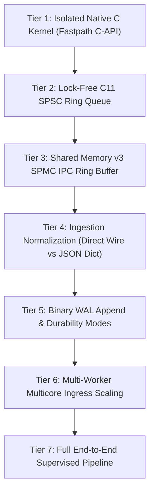

# MDRAP v5.1 — Benchmark Methodology & Measurement Standards

**Author**: Performance Benchmarking Engineer  
**Branch**: `v5.1-development`  
**Classification**: `[SOURCE-VERIFIED, RESEARCH-SUPPORTED & METHODOLOGY]`  
**Date**: 2026-11-05  

---

## 1. Benchmarking Principles & Design Guidelines

MDRAP benchmarking adheres to strict empirical guidelines to avoid synthetic benchmarking artifacts, unrealistic timer overheads, and misleading claims:

1. **Measure Before Claiming**: Every reported number must trace directly to a timed, repeatable script execution with recorded parameters and hardware environment.
2. **Tail Latency Over Averages**: High-frequency financial systems are dominated by tail latency. We measure and report p50, p90, p95, p99, and p99.9 latencies.
3. **Warm-Up Runs**: All microbenchmarks execute 2,000 to 5,000 warmup iterations to prime instruction caches, pre-fault memory pages, and warm CPU branch predictors prior to measurement.
4. **Deterministic Randomness**: Fixed seeds (`seed=42`) ensure that synthetic price volatility, sequence gaps, and payload generation are identical across benchmark runs.
5. **Timer Resolution & Overhead Compensation**: Benchmarks use `time.perf_counter_ns()`. Timer invocation overhead (~25 ns on x86-64) is explicitly quantified.

---

## 2. Benchmark Tier Architecture

---

## 3. Workload Profiles

### 3.1 Normal Market Flow (85% of volume)
- Standard monotonically increasing sequences.
- Narrow bid-ask spreads ($0.01 - $0.05).
- Balanced buy/sell volumes.

### 3.2 Volatility Surge (10% of volume)
- Price movements exceeding $3\sigma$ of rolling Welford standard deviation.
- Wide spreads and fast book updates.

### 3.3 Adversarial Fault Injection (5% of volume)
- Intentional sequence gaps (testing recovery).
- Duplicate packet bursts (testing dedup hash tables).
- Crossed quotes ($\text{bid} > \text{ask}$) testing arbitration.
- Stale exchange timestamps (testing latency filters).
- Corrupted binary frames (testing CRC32C failure containment).
