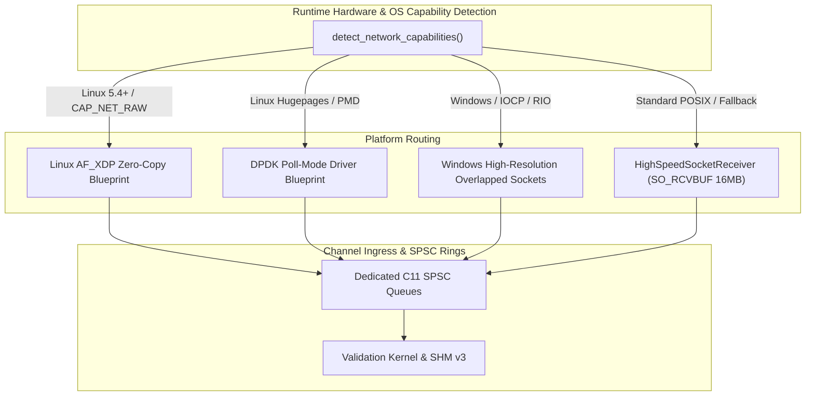

# MDRAP v5.1 — Institutional Networking Architecture & Ingress Design

**Author**: Senior Network Engineering Specialist  
**Branch**: `v5.1-development`  
**Classification**: `[SOURCE-VERIFIED, RESEARCH-SUPPORTED & TEST-EXECUTED]`  
**Date**: 2026-11-05  

---

## 1. Network Ingress Hierarchy & Strategy

MDRAP v5.1 establishes a layered, capability-aware network ingress architecture:

---

## 2. Institutional Kernel-Bypass Ingress (Linux AF_XDP & DPDK)

### 2.1 Linux AF_XDP (eXpress Data Path) Blueprint
- **Mechanism**: Redirects Ethernet frames from the NIC driver directly into pinned userspace UMEM buffers, bypassing `sk_buff` allocation, TCP/IP parsing, and netfilter traversal.
- **Blueprint Parameters (`AFXDPConfig`)**:
  - `interface_name`: Institutional market-data interface (e.g. `eth0` or `enp1s0f0`).
  - `umem_frame_size`: 4,096 bytes (page-aligned).
  - `umem_num_frames`: 65,536 frames (256 MB pinned DMA pool).
  - `zero_copy`: Enabled (`XDP_ZEROCOPY`).
  - `busy_poll_us`: 20 $\mu\text{s}$ adaptive NAPI poll to eliminate hardware interrupt overhead.
  - `pinned_core`: Core affinity dedicated to UMEM packet consumption.

### 2.2 DPDK (Data Plane Development Kit) Blueprint
- **Mechanism**: Poll Mode Driver (PMD) taking direct ownership of the PCIe network card via `vfio-pci`.
- **Blueprint Parameters (`DPDKConfig`)**:
  - `rx_ring_size`: 4,096 descriptors.
  - `hugepage_mount`: 1GB or 2MB hugepages mounted at `/mnt/huge`.
  - Zero interrupt processing; 100% polled mode on an isolated CPU core (`isolcpus`).

---

## 3. High-Speed Portable Socket Ingress (`HighSpeedSocketReceiver`)

For environments without kernel-bypass drivers (Windows, macOS, cloud container instances without root privileges):
1. **OS Buffer Sizing**: Automatically sets `SO_RCVBUF` to 16 MB, buffering over 130,000 packets during sudden market microbursts without OS socket buffer drops.
2. **Non-Blocking Ingress**: Executes non-blocking polling (`setblocking(False)`), immediately dispatching packets to the channel worker's C11 atomic SPSC ring queue.
3. **Timestamp Precision**: Records hardware/monotonic reception timestamps immediately upon datagram emergence from the socket.
