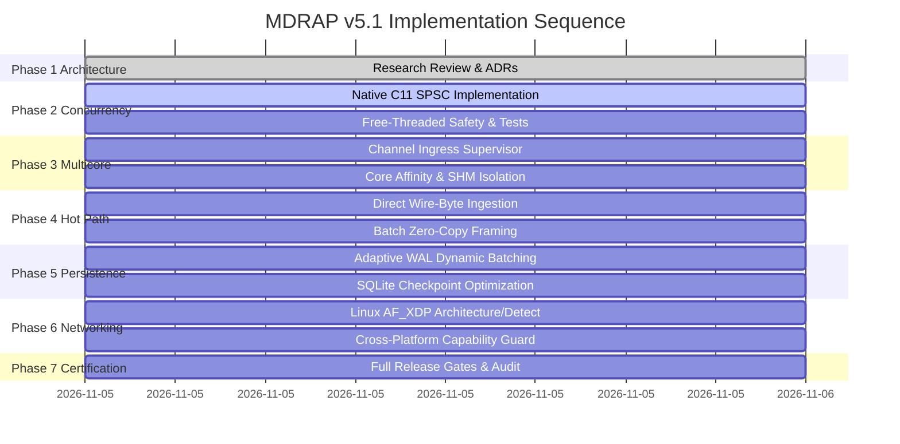

# MDRAP v5.1 — Master Implementation Plan

**Author**: Principal Systems Architect & Performance Auditor  
**Branch**: `v5.1-development`  
**Classification**: `[SOURCE-VERIFIED & SPECIFICATION]`  
**Date**: 2026-11-05  

---

## 1. Engineering Initiatives Breakdown

This plan defines the step-by-step implementation for the MDRAP v5.1 evolutionary program across 8 core engineering initiatives.

---

## 2. Detailed Initiative Specifications

### Initiative 1: Native C11 Atomic SPSC Queue
- **Files**: `src/mdrap/fastpath.c`, `src/mdrap/fastpath.py`, `src/mdrap/partition.py`.
- **Target**:
  - Implement lock-free SPSC ring buffer in C using `__atomic_store_n` and `__atomic_load_n` with `__ATOMIC_RELEASE` and `__ATOMIC_ACQUIRE`.
  - Cache-line separation (`alignas(64)`) for `head` and `tail` structures.
  - Expose Python methods: `offer(obj)`, `poll()`, `capacity()`, `size()`, `is_full()`, `is_empty()`.
  - Multi-phase module declaration with `Py_mod_gil, Py_MOD_GIL_NOT_NEEDED`.
  - Graceful fallback to pure-Python `SpscRingQueue` when fastpath is disabled or unavailable.
- **Verification**: `tests/test_fastpath_spsc_atomics.py` testing wrap-around, saturation, and concurrency.

### Initiative 2: Multicore Feed Processing
- **Files**: `src/mdrap/supervisor.py`, `src/mdrap/partition.py`.
- **Target**:
  - Implement `MultiChannelSupervisor` managing dedicated channel workers.
  - Per-channel SPSC queues and isolated SHM segments (`mdrap_binance_v3`, `mdrap_nasdaq_v3`).
  - CPU affinity assignment via `sched_setaffinity` (Linux) / `SetProcessAffinityMask` (Windows) with graceful fallback.
  - Health monitoring watchdog with heartbeat tracking and channel eviction.
- **Verification**: `tests/test_multichannel_supervisor.py`.

### Initiative 3 & 4: Direct Wire-Byte Ingestion & Native Pipeline
- **Files**: `src/mdrap/engine.py`, `src/mdrap/fastpath.c`, `src/mdrap/fastpath.py`, `src/mdrap/sbe.py`.
- **Target**:
  - Support `RawEvent.wire` passing raw binary frames directly into native decoders.
  - Avoid JSON roundtrip when raw wire bytes are present.
  - Direct wire binary append to WAL records.
- **Verification**: `tests/test_direct_wire_ingestion.py`.

### Initiative 5 & 6: Statistical Kernel & Persistence Tuning
- **Files**: `src/mdrap/fastpath.c`, `src/mdrap/storage.py`, `src/mdrap/projection.py`.
- **Target**:
  - Vectorized / optimized running variance computation (Welford).
  - Dynamic adaptive group commit: flush immediately when queue is empty, aggregate up to 1,024 events during bursts.
  - Set `PRAGMA wal_autocheckpoint=25000;` on SQLite projection store.
- **Verification**: `tests/test_welford_persistence.py`.

### Initiative 7: Native Networking & Platform Capability Detection
- **Files**: `src/mdrap/network.py`, `src/mdrap/runtime.py`.
- **Target**:
  - Hardware and OS networking capability detection (AF_XDP, DPDK, RIO, IOCP).
  - High-performance socket receiver blueprint with multimedia timer resolution.
- **Verification**: `tests/test_network_detector.py`.

### Initiative 8: Production Certification & Verification
- **Files**: Full regression suite in `tests/`, benchmark reproduction scripts in `benchmarks/`.
- **Target**:
  - 14 release gates executed without error.
  - Benchmark reproduction verifying multicore scaling and tail latency improvements.
  - All 20 required documentation artifacts completed in `audit/v5.1/`.

---

## 3. Acceptance Criteria & Invariants Checklist

- [ ] **Invariant C-01**: Quality status priority `INVALID > SUSPICIOUS > VALID` strictly preserved.
- [ ] **Invariant C-02**: Native C vs pure-Python differential parity 100% verified across random seeds.
- [ ] **Invariant C-03**: Feed sequencing and gap detection strictly monotonic per channel.
- [ ] **Invariant C-04**: Multi-venue isolation enforced across separate queues and SHM buffers.
- [ ] **Invariant C-05**: Zero silent event loss; drop counters updated on buffer overflow.
- [ ] **Invariant C-06**: Replay from WAL is deterministic.
- [ ] **Invariant C-07**: Durability contracts truthful (`always` fsyncs, `adaptive` flushes on interval/count, `never` buffered).
- [ ] **Invariant C-08**: Fail-closed recovery on corrupted log records.
- [ ] **Invariant C-09**: Shared memory seqlock integrity preserved without multi-writer collision.
- [ ] **Invariant C-10**: System operates fully with `MDRAP_DISABLE_FASTPATH=1`.
