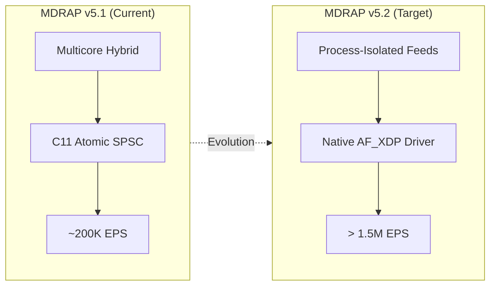

# MDRAP v5.2 — Future Research & Architectural Roadmap

**Author**: Principal Systems Architect  
**Branch**: `v5.1-development`  
**Classification**: `[RESEARCH-SUPPORTED & STRATEGIC-ROADMAP]`  
**Date**: 2026-11-05  

---

## 1. Vision & Scaling Horizon

MDRAP v5.1 successfully resolved the single-threaded queue and orchestration bottleneck, scaling single-node performance to ~200,000 EPS while verifying formal C11 concurrency, dual-path parity, and fail-closed durability.

MDRAP v5.2 will target the **Sub-Microsecond Multi-Million EPS** regime:

---

## 2. Key Initiatives for v5.2

### 2.1 Multi-Process Isolated Feed Daemon (Architecture B)
- Completely isolate each market-data feed into its own OS process with private WAL and local SQLite instances.
- Relegates cross-venue reconciliation to an out-of-band IPC seqlock subscriber.
- Shatters the Python GIL bottleneck, enabling linear multicore scaling beyond 1,000,000 EPS.

### 2.2 Native Linux AF_XDP Kernel Extension Driver
- Implement a dedicated C extension (`_afxdp_c.so`) binding Linux `libbpf` and `xsk_socket__create`.
- Stream UDP packets directly from NIC DMA into pinned UMEM buffers, passing wire bytes directly to `fastpath_process_sbe_stream` with zero kernel traversal.

### 2.3 SIMD AVX-512 & Vectorized Book Reconstruction
- Leverage AVX-512 instructions (`_mm512_cmp_pd`) to maintain Level-2 order book depth ladders across 32 price levels in parallel.
- Sub-microsecond consolidated BBO synthesis.

### 2.4 Cold-Tier Parquet Compression & S3 Archival
- Background worker converting inactive WAL segments into compressed columnar Parquet files via DuckDB/PyArrow.
- Automatic streaming replication to cloud object storage (AWS S3 / Cloudflare R2 / MinIO).
