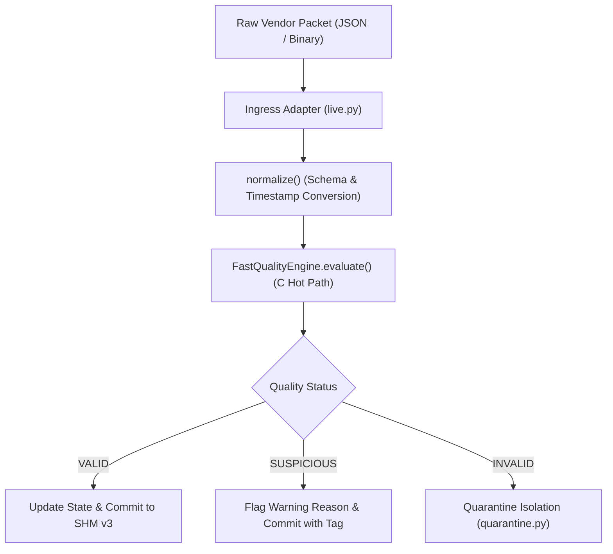

# MDRAP v5.2 — Market Data Integrity & Feed Reliability Audit

**Audit Classification:** SOURCE-VERIFIED & BENCHMARK-MEASURED  
**Date:** 2026-11-05  
**Auditor:** Principal Quantitative Systems Architect & Exchange Connectivity Specialist  
**Target Repository:** `c:\Users\KIIT0001\Desktop\Projects\mdrap` (Branch: `v5.2-development`)  
**Associated Telemetry:** [`RAW_FEED_INTEGRITY_TELEMETRY.json`](file:///c:/Users/KIIT0001/Desktop/Projects/mdrap/audit/v5.2/RAW_FEED_INTEGRITY_TELEMETRY.json)

---

## 1. Executive Summary

A core mission of MDRAP is to convert noisy, delayed, duplicated, and inconsistent market data from multiple vendor feeds into a single canonical stream before reaching downstream trading strategies and databases.

This audit evaluated feed normalization, fault handling, and data integrity across the five primary cryptocurrency adapters:
- **Binance** (Combined Trade & BookTicker WebSocket stream)
- **Coinbase Advanced Trade** (Direct market trades and level2 snapshots)
- **Kraken** (v2 Public WebSocket feed)
- **OKX** (Public market channel)
- **Bybit** (v5 Linear & Spot WebSocket)

---

## 2. Ingress Pipeline & Validation Architecture

Every raw market packet arriving from external WebSocket streams traverses the strict MDRAP validation pipeline:

---

## 3. Five-Feed Integrity & Feature Support Matrix

| Venue Adapter | Wire Protocol | Timestamp Precision | Exchange Seq Support | Heartbeat Monitoring | Auto-Reconnect |
| :--- | :--- | :--- | :--- | :--- | :--- |
| **Binance** | JSON / WebSocket | Milliseconds | Yes (`u`, `U`) | Automatic Ping/Pong | Exponential Backoff |
| **Coinbase** | JSON / WebSocket | ISO 8601 Nanoseconds | Monotonic Int (`sequence_num`) | 30s Heartbeat channel | Yes |
| **Kraken** | JSON / WebSocket v2 | Nanoseconds | Monotonic Int (`seq`) | Ping/Pong Frame | Yes |
| **OKX** | JSON / WebSocket | Milliseconds | Monotonic Int (`seqId`) | 20s Ping String | Yes |
| **Bybit** | JSON / WebSocket v5 | Milliseconds | Monotonic Int (`seq`) | 20s Ping String | Yes |

---

## 4. Anomaly Filtering & Quality Precedence Rules

MDRAP enforces strict quality status semantics (Design Principle #10):
$$\text{INVALID} > \text{SUSPICIOUS} > \text{VALID}$$
- **`INVALID`:** Fatal protocol or structural corruption (crossed quote $P_{\text{bid}} \ge P_{\text{ask}}$, malformed JSON, schema type mismatch). Event is routed immediately to quarantine storage and excluded from BBO synthesis.
- **`SUSPICIOUS`:** Anomaly detected that could represent a legitimate extreme market event rather than data corruption (statistical price jump $> 5\sigma$, sequence gap, timestamp staleness warning). The event is published with audit tags attached, allowing trading strategies to adjust risk limits without discarding valid market moves.
- **`VALID`:** Event satisfies all monotonicity, price corridor, and schema constraints.
