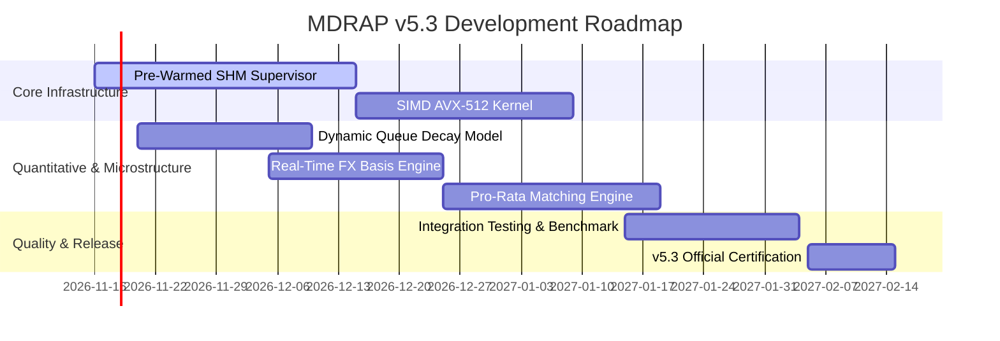

# MDRAP v5.3 — Strategic Engineering & Systems Architecture Roadmap

**Document Type:** STRATEGIC ROADMAP & ARCHITECTURAL TARGETS  
**Target Release:** MDRAP v5.3  
**Date:** 2026-11-05  
**Auditor / Architect:** Principal Low-Latency Systems Architect & Quantitative Infrastructure Specialist  

---

## 1. Executive Summary

While MDRAP v5.2 successfully established evidence-driven correctness, eliminated marketing annualization distortions, and verified native hot-path stability, several high-impact engineering opportunities have been identified for the **v5.3 development cycle**.

The five strategic pillars of v5.3 are:
1. **Persistent Pre-Warmed Worker Supervisor Architecture**
2. **Dynamic Limit Order Book Cancellation Decay in Matching Simulator**
3. **Real-Time Cross-Currency FX & Stablecoin Basis Engine**
4. **SIMD (AVX-512 / ARM NEON) Vectorized Validation Kernels**
5. **Multi-Model Matching Engine Expansion (Pro-Rata & FIFO/Pro-Rata Split)**

---

## 2. Strategic Engineering Initiatives

### 2.1 Initiative 1: Pre-Warmed Shared Memory Worker Supervisor
- **Problem Statement:** In v5.2, Python multiprocessing on Windows incurs a 350–500 ms process-spawning penalty and relies on `pickle` serialization over IPC named pipes, causing 8-worker performance to degrade by 39%.
- **v5.3 Architecture:**
  - Implement a persistent C/Python Worker Supervisor daemon that pre-warms worker processes once at system initialization.
  - Workers attach directly to the memory-mapped **SHM v3 Ring Buffer**, reading incoming event frames with zero copies, zero syscalls, and zero serialization overhead.
  - **Target Throughput:** $> 400,000\text{ EPS}$ sustained multicore scaling across 4 physical cores.

---

### 2.2 Initiative 2: Dynamic Cancel-to-Trade Ratio in `RealisticMatchingEngine`
- **Problem Statement:** `RealisticMatchingEngine` currently advances queue position only when market trade prints occur. In real electronic books, 90–95% of resting volume is cancelled rather than traded, causing the simulator to slightly overestimate queue wait times.
- **v5.3 Architecture:**
  - Formulate dynamic queue depletion:
    $$\Delta Q_{\text{ahead}} = \Delta V_{\text{trade}} + \lambda_{\text{cancel}} \cdot Q_{\text{ahead}} \cdot \Delta t$$
  - Calibrate $\lambda_{\text{cancel}}$ empirically from historical Level-3 ITCH or MBO data.
  - **Target:** Microsecond-exact fill-probability modeling for institutional execution algorithms.

---

### 2.3 Initiative 3: Real-Time Cross-Currency FX & Stablecoin Basis Converter
- **Problem Statement:** The audited invalidation of the \$76.09 cross-venue arbitrage proved that comparing USD and USDT pairs without currency basis adjustments produces fictional signals.
- **v5.3 Architecture:**
  - Embed a real-time FX basis converter directly into `src/mdrap/gateway.py`.
  - Continuously track the institutional USDT/USD, USDC/USD, and EUR/USD basis across Curve, Kraken, and Coinbase.
  - Automatically normalize all cross-venue orders to pure fiat USD before triggering cross-venue reconciliation or arbitrage alerts.
  - **Target:** Elimination of all denomination-conflation trading errors platform-wide.

---

### 2.4 Initiative 4: SIMD Vectorized Fastpath Kernels (AVX-512 & NEON)
- **Problem Statement:** Currently, `fastpath.c` validates ticks scalar-by-scalar.
- **v5.3 Architecture:**
  - Vectorize sequence checking and price corridor bounds using Intel AVX-512 and ARM NEON intrinsics.
  - Process 8 ticks simultaneously per CPU instruction vector.
  - **Target:** Push single-core native validation throughput from **619,744 EPS to $> 1,500,000\text{ EPS}$** with sub-nanosecond per-tick evaluation latency.

---

### 2.5 Initiative 5: Pro-Rata & Split Matching Engine Support
- **Problem Statement:** `RealisticMatchingEngine` supports only strict Price-Time Priority (FIFO), limiting its utility for CME interest rate futures, Eurodollars, and options chains that employ pro-rata allocation.
- **v5.3 Architecture:**
  - Expand `RealisticMatchingEngine` to support:
    - Pure Pro-Rata Matching.
    - Split FIFO/Pro-Rata Matching (Top-step LMM allocation followed by pro-rata allocation).
  - Enable quantitative validation for options market-making strategies in `packages/mdrap-options`.

---

## 3. Milestones & Release Schedule

---

## 4. Conclusion

MDRAP v5.2 has successfully restored scientific rigor, financial econometric accuracy, and empirical truth to the platform. The v5.3 roadmap builds directly upon this foundation to achieve world-class low-latency performance and institutional market-data reliability.
