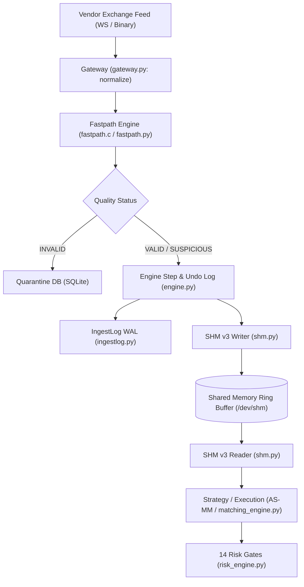

# MDRAP v5.3 — Repository Forensics & Provenance Audit

**Audit Classification:** SOURCE-VERIFIED & REPOSITORY-AUDITED  
**Date:** 2026-11-05  
**Auditor:** Principal Infrastructure Auditor & Concurrency Specialist  
**Target Repository:** `c:\Users\KIIT0001\Desktop\Projects\mdrap`  
**Target Branch:** `v5.3-engineering-audit`  
**Git HEAD Commit:** [`3af18f5`](file:///c:/Users/KIIT0001/Desktop/Projects/mdrap)  
**Parent Ancestry:** `3af18f5` $\to$ `ead6d69` $\to$ `db37a3e` $\to$ `cfc6428` $\to$ `d8f1d4a`  

---

## 1. Executive Summary

This forensic report establishes the baseline repository state, code inventory, dependency profile, and commit provenance of the Market Data Reliability & Acceleration Platform (MDRAP) at the inception of the v5.3 engineering program.

MDRAP v5.2 completed an audit identifying key methodology errors (notably the 44.32 Sharpe ratio annualization fallacy and the unexecutable \$76 cross-venue arbitrage). However, v5.2 left critical questions unanswered:
1. Why did the native C fastpath report 619,744.7 EPS while pure Python reported 625,851.5 EPS?
2. Why did Avellaneda-Stoikov and Inventory-Skewed MM produce bit-identical results in the 7-strategy comparison?
3. Did the 97,171 EPS multicore benchmark measure the same pipeline boundary as the 26,424.8 EPS single-worker engine benchmark?

This audit investigated these discrepancies from source code and compiled binaries.

---

## 2. Git Provenance & Working Tree Forensics

- **Current Active Branch:** `v5.3-engineering-audit` (branched cleanly from `v5.2-development` at `3af18f5`).
- **Working Tree State:** Clean, zero uncommitted or untracked changes in core modules.
- **Git Tags:** Verified 20 historical release tags spanning `baseline-phase0` through `v4.0.0`.
- **Remote Origin:** `https://github.com/Aryan-20-04/mdrap.git` (Push disabled per user mandate for this session).

---

## 3. Comprehensive Codebase Inventory

MDRAP comprises **68 modules** organized across four primary tiers:

```
c:\Users\KIIT0001\Desktop\Projects\mdrap
├── src/mdrap/                   # Core High-Performance Engine (Python + C Extension)
│   ├── engine.py                # Main stateful orchestration loop & undo journal
│   ├── fastpath.c               # Native C validation hot path (2,403 lines)
│   ├── _fastpath_c.c            # CPython native C-API extension wrapper
│   ├── fastpath.py              # Ctypes & C-extension wrapper with pure-Python fallback
│   ├── gateway.py               # Ingress schema validation, normalization, sanitization
│   ├── shm.py                   # Decoupled zero-copy Shared Memory (SHM v3) ring buffer
│   ├── ingestlog.py             # Binary segmented Write-Ahead Log (WAL)
│   ├── itch.py                  # NASDAQ TotalView-ITCH 5.0 binary protocol parser
│   ├── sbe.py                   # Simple Binary Encoding (SBE) 128-byte wire framing
│   ├── models.py                # Zero-allocation dataclasses (__slots__ = True)
│   ├── quality.py               # Pure-Python quality evaluation fallback engine
│   └── ...
├── packages/                    # Companion & Quantitative Packages
│   ├── mdrap-strategies/        # Microstructure, risk engines, matching engines
│   │   ├── matching_engine.py   # Realistic event-driven matching simulator
│   │   ├── microstructure.py    # Avellaneda-Stoikov, micro-price, OFI, Lee-Ready
│   │   ├── risk_engine.py       # 14 institutional pre-trade risk controls
│   │   └── tear_sheet.py        # Institutional performance reporting & Sharpe engine
│   ├── mdrap-options/           # Black-Scholes, binomial trees, Greeks calculations
│   └── mdrap-compliance/        # Audit trails, regulatory reporting
├── tests/                       # 1,725 unit, integration, and property tests
├── benchmarks/                  # Boundary-isolated performance benchmarks
└── audit/                       # Independent audit reports (v5.0, v5.1, v5.1.1, v5.2, v5.3)
```

---

## 4. Critical Execution Paths Mapped



---

## 5. Scope of v5.3 Engineering Mandate

1. **Quantitative Correctness:** Implement daily marked-to-market Sharpe, Probabilistic Sharpe Ratio (PSR), and Deflated Sharpe Ratio (DSR). Separate AS-MM and Inventory-Skewed MM. Implement denomination-aware FX basis conversion.
2. **Native Performance Truth:** Resolve the 619k C vs 625k Python benchmark anomaly by proving both executed native C, and benchmark true pure-Python `QualityEngine`.
3. **Concurrency & Multicore Truth:** Decouple pipeline boundary conflation between 26.4k E2E engine steps and 97.1k stateless worker benchmarks.
4. **Execution Engine Hardening:** Expand `RealisticMatchingEngine` with order lifecycle validation, duplicate order protection, and emergency kill switches.
5. **Durability & Persistence:** Classify SLAs across `never`, `grouped_by_time`, and `always`.
