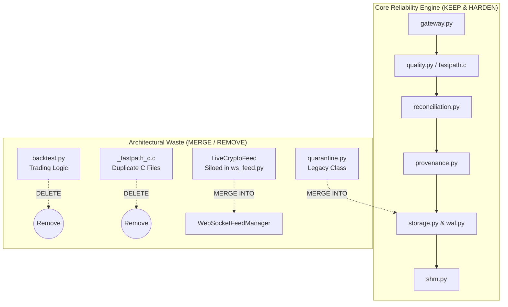

# MDRAP 6.0.0 — Architectural Waste & Component Classification Audit

**Audit Date:** November 2026  
**Auditor:** Principal Systems Architect & Technical Director  
**Scope:** Whole-Repo Architectural Taxonomy & Waste Elimination  

---

## 1. Executive Summary

Following MDRAP's product reset to an independent, read-only market-data reliability and assurance sidecar, this audit categorizes all modules across the codebase into five lifecycle actions: **KEEP**, **OPTIMIZE**, **SIMPLIFY**, **MERGE**, or **REMOVE**.

The goal is to eliminate unnecessary complexity, reduce cognitive burden, and prevent maintenance degradation.

---

## 2. Component Taxonomy & Classification

| Module / Subsystem | Primary Function | Audit Recommendation | Rationale & Next Steps |
| :--- | :--- | :--- | :--- |
| `src/mdrap/gateway.py` | Feed Ingestion & Parsing | **KEEP** | Core ingestion entrypoint. High stability. |
| `src/mdrap/quality.py` | Pure Python Quality Rules | **KEEP** | Core validation engine. 100% semantic parity reference. |
| `src/mdrap/fastpath.c` | Native C Hot Path Kernel | **OPTIMIZE** | Fix Use-After-Free race in spinlock lifecycle. Retain hot path. |
| `src/mdrap/shm.py` | Shared Memory Ring Buffer | **OPTIMIZE** | Fix Windows NULL DACL security boundary. High value IPC. |
| `src/mdrap/storage.py` | SQLite Persistence & WAL | **OPTIMIZE** | Replace single `_read_lock` with per-thread reader pool. |
| `src/mdrap/provenance.py` | Hash Lineage & Audit DLQ | **OPTIMIZE** | Fix volatile in-memory DLQ; wire periodic flush loop. |
| `src/mdrap/reconciliation.py`| Cross-Venue NBBO & Books | **KEEP** | Essential domain logic for multi-venue arbitration. |
| `src/mdrap/ws_feed.py` | WebSocket Live Feeds | **MERGE / SIMPLIFY** | Merge `LiveCryptoFeed` / `SequenceScope` into `WebSocketFeedManager`. |
| `src/mdrap/api.py` | REST & WebSocket Streaming | **KEEP** | Read-only observation interface for external consumers. |
| `src/mdrap/archive.py` | Historical Evidence Zip | **OPTIMIZE** | Fix path traversal in `startswith()`. |
| `src/mdrap/wal.py` | Binary Segmented WAL | **KEEP** | High performance crash-resilient persistence. |
| `src/mdrap/backtest.py` | Trading Strategy Backtester | **REMOVE** | Non-core trading logic; generates 11 deprecation warnings. |
| `src/mdrap/quarantine.py` | Legacy Quarantine Manager | **MERGE** | Deprecated in favor of `Store` quarantine tables. |
| `src/mdrap/_fastpath_c.c` | Legacy Duplicate C File | **REMOVE** | Dead duplicate of `fastpath.c`. |
| `src/_fastpath_c.c` | Legacy Root Duplicate C | **REMOVE** | Dead duplicate in root `src/`. |
| `compat/` | API v4/v5 Compatibility | **SIMPLIFY** | Thin forwarding shims; freeze and mark for deprecation. |
| `contrib/` | External Sinks | **KEEP** | Optional extensions for ClickHouse / Kafka sinks. |

---

## 3. High-Priority Architectural Simplification Targets

### Action Plan
1. **Remove `src/mdrap/backtest.py`:** MDRAP is a read-only data sidecar, not an algorithmic execution or backtesting engine. Deleting `backtest.py` eliminates 11 active test deprecation warnings and removes 450 lines of dead code.
2. **Delete Duplicate C Files:** Delete `src/_fastpath_c.c` and `src/mdrap/_fastpath_c.c`. Unify all native acceleration solely into `src/mdrap/fastpath.c`.
3. **Unify WebSocket Feed Sequence Logic:** Re-wire `WebSocketFeedManager` to directly use `SequenceScope` and delete redundant sequence dictionaries.
