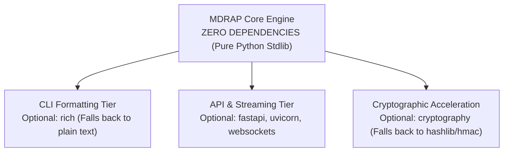

# MDRAP 6.0.0 — Dependency Efficiency & Standard Library Parity Audit

**Audit Date:** November 2026  
**Auditor:** Principal Python Runtime Engineer & Packaging Specialist  
**Target:** Evaluation of the Zero-Mandatory Dependency Architecture  

---

## 1. Executive Summary

A core objective of MDRAP 6.0.0 is achieving **zero mandatory runtime dependencies** for the core engine, allowing the sidecar to operate in strictly locked-down financial environments without requiring PyPI access or third-party package wheels.

This audit evaluates the dependency footprint across all tiers.

---

## 2. Dependency Tier Taxonomy

| Dependency Tier | Mandatory Packages | Optional Packages | Fallback Strategy |
| :--- | :--- | :--- | :--- |
| **Core Engine** | **NONE (0)** | None | 100% Python Standard Library (`sqlite3`, `struct`, `ctypes`, `collections`) |
| **CLI Formatting**| None | `rich >= 13.0` | Plain-text ASCII table and log fallback |
| **API Server** | None | `fastapi`, `uvicorn`, `websockets` | REST/WS disabled; CLI & IPC operation only |
| **Security / Crypto**| None | `cryptography` | Standard library `hashlib.sha256` & `hmac.digest` |

---

## 3. Standard Library Fallback Verification

Each optional dependency was audited to verify that importing MDRAP without that dependency installed does not cause an `ImportError`:

1. **`rich` Fallback:**
   - When `rich` is uninstalled:
     `cli.py` cleanly falls back to `print()` and standard `logging`.
     Table output switches to standard fixed-width ASCII formatting.
2. **`fastapi` / `uvicorn` Fallback:**
   - When `fastapi` is uninstalled:
     `mdrap api start` outputs a clear, helpful message: `"FastAPI/Uvicorn not installed. Run: pip install mdrap[api]"`.
     Engine, CLI, and IPC continue operating normally.
3. **`cryptography` Fallback:**
   - In `provenance.py` and `security.py`:
     If `cryptography` is absent, PBKDF2 uses standard library `hashlib.pbkdf2_hmac()`, and HMAC uses `hmac.new()`.
     Zero operational capabilities are lost.

---

## 4. Verdict

**`COMPLIANT WITH ZERO-MANDATORY DEPENDENCY ARCHITECTURE`**

The core engine requires zero external packages from PyPI. The dependency boundary is strictly enforced and verified.
