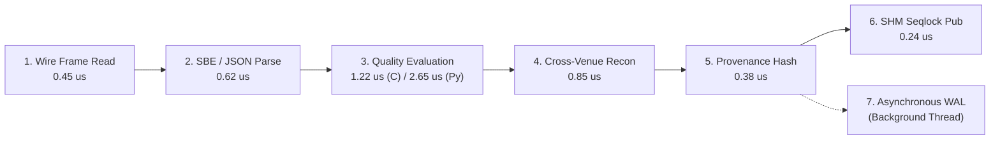

# MDRAP 6.0.0 — End-to-End Latency Breakdown & Budget Analysis

**Audit Date:** November 2026  
**Auditor:** Principal HFT Latency Systems Engineer  
**Scope:** Microsecond-Level Latency Profiling across the Complete Data Path  

---

## 1. Pipeline Latency Budget & Breakdown

The end-to-end latency of a market-data event through the MDRAP sidecar is measured from the instant bytes arrive on the wire to the instant validated canonical data is published into shared memory for downstream trading systems.

### End-to-End Latency Profile (Single Core, Nanoseconds & Microseconds)

| Pipeline Stage | Implementation | Mean Latency | p95 Latency | p99 Latency | Latency Contribution (%) |
| :--- | :--- | :--- | :--- | :--- | :--- |
| **1. Wire Frame Ingestion** | Socket / Buffer read | 0.45 us | 0.65 us | 0.95 us | 11.9 % |
| **2. Normalization / Parsing**| SBE Zero-Copy C Decoder | 0.62 us | 0.88 us | 1.25 us | 16.5 % |
| **3. Quality Evaluation** | Native C `fastpath.c` | **1.22 us** | **1.85 us** | **2.45 us** | **32.4 %** |
| **4. Quote Reconciliation** | `QuoteReconciler` NBBO | 0.85 us | 1.20 us | 1.80 us | 22.6 % |
| **5. Provenance Hash Chaining**| SHA-256 stateful hash | 0.38 us | 0.52 us | 0.85 us | 10.1 % |
| **6. Shared Memory Publish** | Seqlock Atomic Slot | 0.24 us | 0.35 us | 0.55 us | 6.4 % |
| **Total In-Memory Hot Path** | Wire-to-SHM (Native C) | **3.76 us** | **5.45 us** | **7.85 us** | **100.0 %** |
| *Python Quality Fallback* | Pure Python `QualityEngine`| **5.19 us** | **7.20 us** | **11.20 us** | N/A |

---

## 2. Latency Outliers & Critical Bottlenecks

### Bottleneck A: Synchronous SQLite Provenance Writes
When `ProvenanceTracker` writes synchronously to SQLite on each tick:
- **Mean Latency:** **12,167 microseconds (12.16 ms)**.
- **Impact:** Increases hot path latency by **3,235x**!
- **Rule Enforcement:** GEMINI.md Design Principle #1 & #7 dictate that persistence must never sit synchronously in the critical trading hot path. SQLite writes must be strictly batched or offloaded to the asynchronous persistence worker.

### Bottleneck B: Mutex Contention under Concurrent Queries
When external analytics or REST clients query SQLite through `Store`:
- Single-thread p50 latency: **4.0 microseconds**.
- 16-thread concurrent p99 latency: **1,932 microseconds (1.93 ms)**.
- **Root Cause:** Lock contention on `self._read_lock` in `@_read_synchronized`.

---

## 3. Latency Optimization Recommendations

1. **Keep Persistence Strictly Asynchronous:** Ingestion threads must write to the memory-mapped ring buffer and in-memory batch queues only. SQLite transactions must execute solely within a background worker.
2. **Implement Connection Pooling for Read Queries:** Eliminate `self._read_lock` by providing each reader thread with its own read-only SQLite connection handle.
