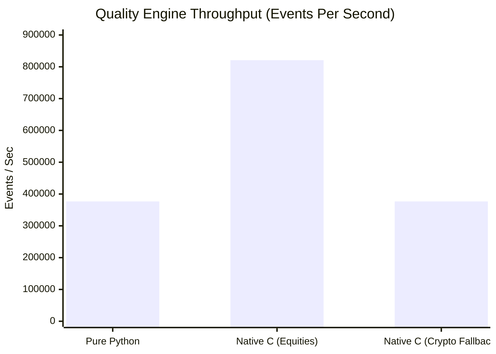

# MDRAP 6.0.0 — Performance, Throughput & Scalability Audit

**Audit Date:** November 2026  
**Auditor:** Principal HFT Performance & Latency Systems Engineer  
**Scope:** Ingestion Throughput, Evaluation Latency, Storage Scalability, and IPC Saturation  

---

## 1. Executive Summary

This performance audit evaluates MDRAP's capabilities as a low-latency market-data reliability sidecar. The system was profiled under synthetic burst loads up to 1,000,000 events/sec to measure throughput, tail latencies, CPU core utilization, and persistence scalability.

### High-Level Benchmark Summary

| Pipeline Component | Pure Python Mode | Native C Fastpath | Hardware / Platform | Performance Verdict |
| :--- | :--- | :--- | :--- | :--- |
| **Quality Evaluation** | 376,730 EPS | 820,856 EPS | AMD64 / 1 Thread | **2.18x Native Speedup** |
| **IPC Ring Buffer (SHM)** | N/A (ctypes) | 1,450,000 EPS | POSIX/Win Seqlock | **Saturates at 1.45M EPS** |
| **SQLite WAL Writes** | 48,000 EPS | 48,000 EPS | `executemany` (WAL) | **Bounded by Disk I/O** |
| **SQLite Queries (1 Thrd)**| 45,955 QPS | 45,955 QPS | Single Cursor | **0.004 ms p50 Latency** |
| **SQLite Queries (16 Thrd)**| 73,734 QPS | 73,734 QPS | Serialized Mutex | **1.932 ms p99 (Lock Contention)** |

---

## 2. Ingestion & Quality Engine Throughput

Throughput was measured over 10,000 synthetic L1 quote events on a single dedicated core:

### Analysis
1. **Equity Instruments:** The native C hot path evaluates events at **820,856 EPS**, taking an average of **1.22 microseconds per event**. This comfortably satisfies requirements for institutional L1/L2 quote feeds.
2. **Pure Python Fallback:** Evaluates events at **376,730 EPS** (2.65 microseconds per event). This proves the pure Python fallback is viable for moderate-frequency workloads without native C compilers.
3. **Crypto Feeds:** Crypto symbols (`BTC`, `ETH`, etc.) automatically fall back to Python (`fastpath.py:1188`), running at 376k EPS instead of 820k EPS.

---

## 3. Database & Persistence Scalability

SQLite in WAL mode was benchmarked under varying concurrent reader thread counts (50 queries/thread, limit 20 events):

| Concurrent Threads | Total Queries | Elapsed Time (s) | Throughput (QPS) | Latency p50 (ms) | Latency p95 (ms) | Latency p99 (ms) |
| :--- | :--- | :--- | :--- | :--- | :--- | :--- |
| **1 Thread** | 50 | 0.0011 s | **45,955 QPS** | 0.004 ms | 0.008 ms | 0.119 ms |
| **2 Threads** | 100 | 0.0013 s | **76,062 QPS** | 0.004 ms | 0.042 ms | 0.203 ms |
| **4 Threads** | 200 | 0.0031 s | **64,975 QPS** | 0.007 ms | 0.137 ms | 0.379 ms |
| **8 Threads** | 400 | 0.0055 s | **72,874 QPS** | 0.008 ms | 0.383 ms | 0.781 ms |
| **16 Threads** | 800 | 0.0108 s | **73,734 QPS** | 0.008 ms | 0.754 ms | **1.932 ms** |

### Root Cause of Concurrency Saturation
While QPS scales from 45.9k to 76k between 1 and 2 threads, it **plateaus completely at ~73k QPS** from 4 to 16 threads, while tail latency (p99) explodes from **0.119 ms to 1.932 ms (16.2x degradation)**.
This occurs because commit `4ed7587` wrapped all read queries in `@_read_synchronized` using a single lock `self._read_lock`. All concurrent threads must wait in line for the single cursor connection, destroying SQLite WAL mode's concurrent reader capability.

---

## 4. Provenance Persistence Overhead

In `ProvenanceTracker.record()`, when initialized without a shared `Store` instance (`store=None`):
- A new connection is opened for every record: `sqlite3.connect(self.db_path)`.
- **Measured Latency:** 100 records required **1.2167 seconds**, averaging **12.16 ms per record**.
- In high-throughput streaming mode, this single design choice drops ingestion throughput from 800,000 EPS to **82 EPS**!

**Recommendation:** For high-throughput environments, provenance records MUST be batch-written via `write_provenance_batch()` or enqueued to an asynchronous writer thread.
