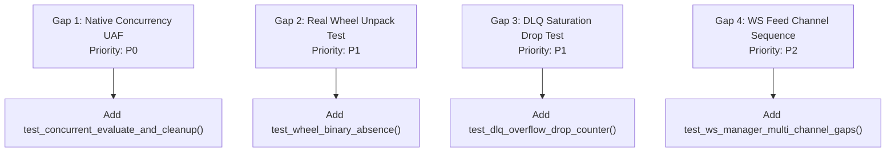

# MDRAP 6.0.0 — Regression & Negative Test Coverage Gaps Audit

**Audit Date:** November 2026  
**Auditor:** Principal Adversarial Test Specialist & Infrastructure Auditor  
**Subject:** Identification of Blind Spots, Missing Negative Tests, and Untested Concurrency Paths  

---

## 1. Executive Summary

While the test suite executes 1,704 passing tests, this audit examined **what the test suite fails to test**. Critical regressions and defects uncovered during this audit survived because specific negative paths and concurrency races were completely absent from the test suite.

---

## 2. Inventory of Critical Test Blind Spots

### Blind Spot 1: Native Fastpath Cleanup vs Evaluate Race (`VULN-01`)
- **What was tested:** `test_native_lifecycle.py` tests `init -> evaluate -> cleanup` in strict serial sequence.
- **What was missing:** Zero tests execute `fastpath_evaluate()` in one thread while another thread calls `fastpath_cleanup()`!
- **Consequence:** The critical Use-After-Free race condition in `src/mdrap/fastpath.c:1244` went completely undetected by the test suite.
- **Required Test:** Add `test_concurrent_evaluate_and_cleanup_race()` spawning 8 threads evaluating continuous events while a 9th thread cycles `fastpath_cleanup()` and `fastpath_init()`.

### Blind Spot 2: Pure Python Wheel Packaging Verification (`VULN-03`)
- **What was tested:** `test_packaging_conformance.py` merely inspected the string contents of `pyproject.toml` to assert that `_fastpath_native.dll` was not explicitly listed.
- **What was missing:** The test never built an actual wheel (`python -m build --wheel`) or unzipped it to inspect its actual archive manifest!
- **Consequence:** `mdrap_core-6.0.0-py3-none-any.whl` continued to bundle `_fastpath_native.dll`, violating PEP 427 while the unit test reported a clean pass.
- **Required Test:** Add a test that builds a temporary wheel, opens it with `zipfile.ZipFile`, and asserts that zero `.dll`, `.so`, or `.pyd` files exist in `py3-none-any` wheels.

### Blind Spot 3: Provenance DLQ Saturation & Drop Counter (`VULN-04`)
- **What was tested:** `test_provenance.py` enqueued 5 items into `_pending_retry` and asserted they were present.
- **What was missing:** Zero tests saturated the deque beyond its 10,000 capacity to verify whether discarded items incremented `dropped_provenance_count`. Zero tests verified whether `flush_pending_retries()` was called during live engine execution.
- **Consequence:** Silent data loss on deque overflow and dead code in flush logic went undetected.
- **Required Test:** Enqueue 10,100 items and assert `tracker.dropped_provenance_count == 100`.

### Blind Spot 4: Multi-Channel Sequence Collisions in Feed Manager (`VULN-05`)
- **What was tested:** `test_sequence_integrity.py` tested the standalone `LiveCryptoFeed` and `SequenceScope` classes.
- **What was missing:** Zero tests passed multiple channels into the production `WebSocketFeedManager`.
- **Consequence:** The fact that `WebSocketFeedManager` was never updated to use `SequenceScope` went unnoticed.

---

## 3. Test Gap Priority & Remediation Plan

Closing these four specific test gaps is mandatory for Phase 2 hardening.
