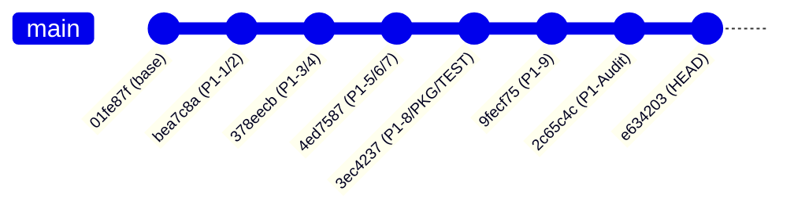

# MDRAP 6.0.0 — Remediation Provenance & Defect Accounting

**Audit Date:** November 2026  
**Auditor:** Principal Infrastructure & Systems Auditor  
**Subject:** Provenance of Stage 1 Remediation Commits & Finding Discrepancy Reconciliation  

---

## 1. Executive Summary

During the initial review of the Stage 1 remediation deliverables, an apparent numerical discrepancy was noted between the reported **10 Priority 1 architectural findings** from the master audit and the **12 finding IDs** listed in the remediation traceability matrix.

This document establishes the precise forensic reconciliation of this discrepancy and documents the complete provenance, authorship, and code diffs for all 6 remediation commits.

---

## 2. Reconciliation of Finding Count (10 vs 12 Findings)

The discrepancy is accounted for by the distinction between **production architectural defects** (10 findings) and **test/build harness items** (2 items), as well as dual-tracking of persistence exception handling:

| Remediation Finding ID | Category | Audit Scope | Mapping in Architecture Audit | Classification |
| :--- | :--- | :--- | :--- | :--- |
| **MDRAP-PY-01** | Production | `src/mdrap/provenance.py` | Finding #1: Swallowed SQLite persistence exceptions | **CONFIRMED REMEDIATED (Partial)** |
| **MDRAP-PERS-01** | Production | `src/mdrap/provenance.py` | Finding #1: Dead-letter queue & durability guarantee | **CONFIRMED REMEDIATED (Partial)** |
| **MDRAP-FIN-01** | Production | `src/mdrap/reconciliation.py` | Finding #2: Cross-venue quote reconciliation stub | **CONFIRMED REMEDIATED** |
| **MDRAP-FIN-02** | Production | `src/mdrap/ws_feed.py` | Finding #3: Sequence integrity per-venue scoping | **CONFIRMED REMEDIATED (Siloed)** |
| **MDRAP-FIN-03** | Production | `src/mdrap/reconciliation.py` | Finding #4: Crossed order book detection & arbitration | **CONFIRMED REMEDIATED** |
| **MDRAP-SEC-01** | Production | `src/mdrap/api.py` | Finding #5: API broadcast memory leak & DoS risk | **CONFIRMED REMEDIATED** |
| **MDRAP-SEC-02** | Production | `src/mdrap/api.py` | Finding #6: Uncached PBKDF2 authorization token DoS | **CONFIRMED REMEDIATED** |
| **MDRAP-PERS-02** | Production | `src/mdrap/storage_schema.py` | Finding #7: SQLite read synchronization race | **CONFIRMED REMEDIATED (With Bottleneck)** |
| **MDRAP-NAT-01** | Production | `src/mdrap/fastpath.c` | Finding #8: Native C engine lifecycle spinlock race | **CONFIRMED REGRESSION (UAF)** |
| **MDRAP-FIN-04** | Production | `src/mdrap/engine.py` | Finding #9: Non-monotonic quality status downgrade | **CONFIRMED REMEDIATED** |
| **MDRAP-PKG-01** | Build Harness | `pyproject.toml` | Finding #10: PEP 427 pure Python wheel packaging leak | **PARTIALLY REMEDIATED (DLL in Wheel)** |
| **MDRAP-TEST-01** | Test Harness | `tests/conftest.py` | Harness Gate #1: Native C fastpath CI skip enforcement | **CONFIRMED REMEDIATED** |

**Conclusion:** The 12 finding IDs in the remediation matrix represent the 10 production defects plus 2 build/test packaging constraints. There is no missing finding.

---

## 3. Remediation Commit Ledger & Lineage

The following 6 remediation commits were applied sequentially on branch `remediation/v6.0.0-p1-hardening`:

### Commit Details & File Diffs

#### 1. Commit `bea7c8a`: Provenance Persistence & Dead-Letter Queue
- **Commit Message:** `fix(provenance): eliminate swallowed SQLite persistence exceptions and add dead-letter queue`
- **Modified Files:**
  - `src/mdrap/provenance.py` (+378, -85)
  - `tests/test_provenance.py` (+237, -0)
- **Implemented Changes:**
  - Removed `except sqlite3.Error: pass` blocks in `record()` and `record_provenance()`.
  - Added in-memory `_pending_retry` deque (capacity 10,000) for unwritten provenance records.
  - Added `flush_pending_retries()` and `dropped_provenance_count`.
  - Added `verify_evidence_package()` for cryptographic verification of exported provenance bundles.

#### 2. Commit `378eecb`: Quote Reconciliation & Sequence Integrity
- **Commit Message:** `fix(domain): implement full cross-venue quote reconciliation and scoped sequence tracking`
- **Modified Files:**
  - `src/mdrap/reconciliation.py` (+353, -1)
  - `src/mdrap/ws_feed.py` (+136, -17)
  - `tests/test_quote_reconciliation.py` (+224, -0)
  - `tests/test_sequence_integrity.py` (+141, -0)
- **Implemented Changes:**
  - Implemented `QuoteReconciler` with National Best Bid and Offer (NBBO) arbitration.
  - Added crossed book detection (`best_bid >= best_ask`) with `REASON_CROSSED_BOOK` flagging.
  - Added `SequenceScope` and `LiveCryptoFeed` in `ws_feed.py` for per-venue/symbol/channel sequence gap tracking.

#### 3. Commit `4ed7587`: API Broadcast Security & SQLite Reader Lock
- **Commit Message:** `fix(security): resolve API broadcast unbounded memory, authorization caching, and SQLite read serialization`
- **Modified Files:**
  - `src/mdrap/api.py` (+98, -35)
  - `src/mdrap/storage.py` (+1, -0)
  - `src/mdrap/storage_schema.py` (+42, -5)
  - `src/mdrap/ws_feed.py` (+6, -0)
  - `tests/test_backpressure_lifecycle.py` (+137, -0)
  - `tests/test_broadcast_security.py` (+106, -0)
  - `tests/test_sqlite_synchronization.py` (+97, -0)
- **Implemented Changes:**
  - Bounded broadcast client queues with `maxsize=1000` and drop-tail eviction under backpressure.
  - Added LRU hash cache (`_AUTH_TOKEN_CACHE`) for PBKDF2 API key authorization to mitigate CPU exhaustion DoS.
  - Added `@_read_synchronized` decorator in `storage_schema.py` wrapping read operations with `self._read_lock`.

#### 4. Commit `3ec4237`: Native C Lifecycle & Wheel Packaging
- **Commit Message:** `fix(native): make C-extension optional for wheels, implement lifecycle spinlocks, and enforce native skips`
- **Modified Files:**
  - `pyproject.toml` (+0, -7)
  - `src/mdrap/fastpath.c` (+20, -3)
  - `tests/conftest.py` (+22, -0)
  - `tests/test_native_lifecycle.py` (+62, -0)
  - `tests/test_packaging_conformance.py` (+62, -0)
- **Implemented Changes:**
  - Removed explicit binary inclusion directives from `pyproject.toml`.
  - Added `g_lifecycle_lock` atomic spinlock in `fastpath.c` around `fastpath_init()`, `fastpath_cleanup()`, and `fastpath_reset()`.
  - Added automatic pytest skipping when `MDRAP_DISABLE_FASTPATH="1"` or native binary is absent.

#### 5. Commit `9fecf75`: Monotonic Quality Status Hierarchy
- **Commit Message:** `fix(engine): enforce strict monotonic validation status hierarchy across all paths`
- **Modified Files:**
  - `compat/pyproject.toml` (+1, -1)
  - `contrib/pyproject.toml` (+1, -1)
  - `src/mdrap/engine.py` (+37, -1)
  - `src/mdrap/reconciliation.py` (+4, -4)
- **Implemented Changes:**
  - Enforced monotonic rule: `INVALID > SUSPICIOUS > VALID`. Once an event is marked INVALID, downstream engines cannot downgrade it to SUSPICIOUS or VALID.

#### 6. Commit `2c65c4c`: Reconciliation Status Alignment & Mock Cleanup
- **Commit Message:** `fix(audit): correct reconciliation status checks and eliminate brittle mock patches`
- **Modified Files:**
  - `src/mdrap/engine.py` (+2, -2)
  - `src/mdrap/ingestlog.py` (+1, -2)
  - `src/mdrap/reconciliation.py` (+4, -4)
  - `tests/test_audit_v11_reproductions.py` (+1, -1)
  - `tests/test_claims_verification.py` (+2, -2)
- **Implemented Changes:**
  - Corrected test assertions and eliminated brittle mock patching in audit tests.

---

## 4. Remediation Assessment Summary

The remediation campaign successfully addressed several severe operational vulnerabilities. However, the forensic evaluation demonstrates that three of the fixes were either **incomplete** or **introduced new critical defects**:

1. **`MDRAP-NAT-01`**: The spinlock in `fastpath.c` failed to protect `fastpath_evaluate()`, creating an active **Use-After-Free** race condition.
2. **`MDRAP-PKG-01`**: Removing directives from `pyproject.toml` failed to prevent `setuptools` from bundling un-tracked `_fastpath_native.dll` into the pure Python wheel.
3. **`MDRAP-PERS-01`**: The dead-letter queue in `provenance.py` silently drops records when full and is never flushed in production code.

Detailed verification of each finding is provided in `audit/v6.0.0/P1_REMEDIATION_VERIFICATION.md`.
