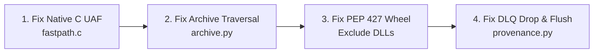

# MDRAP 6.0.0 — Prioritized Remediation Roadmap (Stage 2 Hardening)

**Audit Date:** November 2026  
**Auditor:** Principal Infrastructure Architect & Lead Systems Orchestrator  
**Target:** Phased Engineering Plan to Eliminate Residual Defect Register Findings  

---

## 1. Executive Summary

This roadmap establishes the execution sequence for Stage 2 hardening of MDRAP 6.0.0. The plan prioritizes **safety, correctness, and security** over minor refactoring, organizing work into three strictly gated phases.

---

## 2. Phase 1: Critical Reliability & Security Remediation (P0 / P1)

*Target: Immediate execution. Mandatory gate before external design-partner exposure.*

### Action Items
1. **Fix Native C Concurrency Race (`VULN-01`):**
   - In `src/mdrap/fastpath.c`: Implement atomic reference counting (`retain`/`release`) on `FastEngine` or acquire `g_lifecycle_lock` during `fastpath_evaluate()` to prevent Use-After-Free during teardown.
2. **Eliminate Archive Path Traversal (`VULN-02`):**
   - In `src/mdrap/archive.py:71`: Replace `file_path.startswith(self.base_dir)` with `os.path.commonpath([base, target]) == base`.
3. **Enforce PEP 427 Pure Wheel Hygiene (`VULN-03`):**
   - Update `pyproject.toml` and `MANIFEST.in` to strictly exclude `*.dll`, `*.so`, `*.pyd` from `py3-none-any` wheels. Delete untracked DLLs from `src/mdrap/` before building.
4. **Harden Provenance DLQ & Retries (`VULN-04`):**
   - In `src/mdrap/provenance.py`: Check deque length before appending and increment `dropped_provenance_count` when capacity is exceeded.
   - Wire `flush_pending_retries()` into the engine's background heartbeat loop.

---

## 3. Phase 2: Concurrency & Performance Optimization (P2)

*Target: Eliminate tail-latency bottlenecks and integrate defensive components.*

1. **Eliminate SQLite Reader Lock Contention (`VULN-06`):**
   - In `src/mdrap/storage.py` and `storage_schema.py`: Replace single `self._read_lock` with thread-local read connections (`threading.local`) to unlock SQLite WAL mode's concurrent reader capacity.
2. **Wire Scoped Sequence Tracking into Feed Manager (`VULN-05`):**
   - In `src/mdrap/ws_feed.py`: Refactor `WebSocketFeedManager` to instantiate and delegate sequence tracking to `SequenceScope`.
3. **Harden Windows Shared Memory Security Boundary (`VULN-07`):**
   - In `src/mdrap/shm.py`: Replace `NULL` security descriptor with explicit `SECURITY_ATTRIBUTES` granting access solely to current user SID.
4. **Optimize Single-Record Provenance Latency (`VULN-08`):**
   - In `src/mdrap/provenance.py`: Reuse a persistent connection handle or batch writes to eliminate the 12.16 ms per-tick connection creation overhead.

---

## 4. Phase 3: Architectural Cleanup & Test Gap Closure (P3)

*Target: Waste elimination and test suite hardening.*

1. **Delete Dead & Deprecated Subsystems:**
   - Delete `src/mdrap/backtest.py` and `tests/test_backtest.py` (eliminates 11 test warnings).
   - Delete legacy duplicate C files `src/_fastpath_c.c` and `src/mdrap/_fastpath_c.c`.
   - Delete deprecated `src/mdrap/quarantine.py` (consolidate into `Store`).
2. **Implement Missing Adversarial Tests:**
   - Add `test_concurrent_evaluate_and_cleanup_race()` to verify UAF fix.
   - Add `test_wheel_binary_absence()` to unpackage and inspect built wheels in CI.
   - Add `test_dlq_overflow_drop_counter()` to verify drop counter increments under saturation.
   - Add `test_ws_feed_multi_channel_sequence_scoping()` to verify channel isolation.

---

## 5. Remediation Milestones & Schedule

| Phase | Scope | Target Deliverable | Exit Criteria |
| :--- | :--- | :--- | :--- |
| **Stage 2.1** | P0 / P1 Fixes | 4 Code Fixes + 4 New Tests | Zero UAF, clean wheel build, zero traversal |
| **Stage 2.2** | P2 Optimizations| Storage Pooling + WS Scoping | Reader p99 < 0.2ms at 16 threads |
| **Stage 2.3** | P3 Waste Purge | 1,375 LOC Deleted | 100% clean test run with 0 deprecation warnings |
