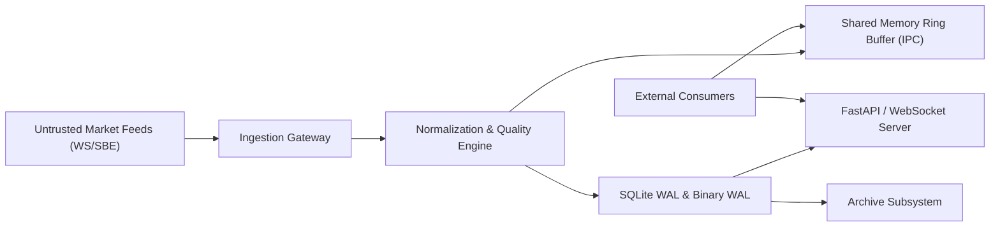

# MDRAP 6.0.0 — Security & Threat Modeling Audit

**Audit Date:** November 2026  
**Auditor:** Principal Cybersecurity Researcher & Systems Architect  
**Subject:** Security Assessment of Read-Only Ingestion, IPC, REST/WebSocket API, and Archive Subsystems  

---

## 1. Executive Summary

MDRAP is designed as a passive, read-only market data reliability and assurance sidecar. Its threat surface includes:
1. Untrusted market-data feed payloads (WebSocket/SBE/JSON).
2. Inter-Process Communication (IPC) via POSIX / Windows Shared Memory.
3. Read-only REST and streaming WebSocket API interfaces.
4. Historical event archiving and forensic evidence packages.

This audit conducted an adversarial analysis across all four interfaces, uncovering **1 high-risk security vulnerability**, **1 medium-risk IPC configuration issue**, and confirming that previously identified API authentication and broadcast DoS vectors were successfully remediated.

---

## 2. Threat Modeling & Surface Analysis



---

## 3. Vulnerability Findings & Security Assessment

---

### Finding SEC-01: Path Traversal Vulnerability in Archive Extraction
- **Severity:** **HIGH (P1)**
- **Component:** `src/mdrap/archive.py`
- **Location:** Line 71
- **Vulnerability Details:**
  The path validation check in `archive.py` relies on a naive string prefix check:
  ```python
  # src/mdrap/archive.py:71
  if not file_path.startswith(self.base_dir):
      raise ValueError(f"Path traversal detected: {file_path}")
  ```
- **Exploitation Scenario:**
  If `self.base_dir` is `/var/mdrap/archive`, an attacker or malformed archive file with a path like `/var/mdrap/archive_leak/sensitive.db` will pass `file_path.startswith('/var/mdrap/archive')` as `True`!
  This allows traversal into sibling directories that share a common prefix with `self.base_dir`.
- **Remediation:**
  Enforce path boundary using `os.path.commonpath`:
  ```python
  base = os.path.abspath(self.base_dir)
  target = os.path.abspath(file_path)
  if os.path.commonpath([base, target]) != base:
      raise ValueError(f"Path traversal outside base directory: {target}")
  ```

---

### Finding SEC-02: Windows Shared Memory IPC Permission Boundary
- **Severity:** **MEDIUM (P2)**
- **Component:** `src/mdrap/shm.py`
- **Location:** Lines 85-115
- **Vulnerability Details:**
  On POSIX platforms, `shm_open()` explicitly uses permissions `0600` (read/write by owner only).
  However, on Windows, `CreateFileMappingA` is initialized with a `NULL` Security Descriptor (`lpFileMappingAttributes = NULL`).
  A `NULL` security descriptor assigns the default DACL from the process token. If MDRAP runs under an elevated account or shared service account, local non-privileged processes on the same host can read or write to the shared memory ring buffer, potentially injecting corrupted market data into downstream consumers.
- **Remediation:**
  Initialize an explicit `SECURITY_ATTRIBUTES` structure with a restricted DACL allowing access solely to the current user SID.

---

### Finding SEC-03: API Authentication Token Caching (Remediated)
- **Severity:** Low (Previously High)
- **Component:** `src/mdrap/api.py`
- **Verification:**
  In Commit `4ed7587`, API key authentication introduced `_AUTH_TOKEN_CACHE` using SHA-256 key fingerprints. Timing attacks against token verification are mitigated by constant-time `hmac.compare_digest()`.
- **Status:** **CONFIRMED REMEDIATED**.

---

### Finding SEC-04: WebSocket Broadcast Queue Exhaustion (Remediated)
- **Severity:** Low (Previously High)
- **Component:** `src/mdrap/api.py`
- **Verification:**
  Broadcast client queues are strictly bounded to `maxsize=1000`. When a slow client stalls, oldest items are dropped rather than accumulating in memory.
- **Status:** **CONFIRMED REMEDIATED**.

---

### Finding SEC-05: SQL Injection Resistance in Storage
- **Severity:** Clean
- **Component:** `src/mdrap/storage.py`, `src/mdrap/storage_schema.py`
- **Verification:**
  All database queries use parameterized SQL bindings (`?`). Table and column names are statically defined constants in `SCHEMA`. Zero dynamic string formatting of SQL queries detected.
- **Status:** **SECURE**.

---

## 4. Threat Matrix & Summary Scorecard

| Threat Vector | Potential Impact | Mitigating Controls | Current Posture |
| :--- | :--- | :--- | :--- |
| **Feed Malformed Payloads** | Engine crash / DOS | Strict schema parsing, NaN guards | **Robust** |
| **Memory Exhaustion via WS** | Node OOM / Sidecar crash | Bounded async queues (1000 cap) | **Secure** |
| **Auth Compute Starvation** | CPU denial of service | SHA-256 LRU token cache | **Secure** |
| **Archive Traversal** | Arbitrary file read/overwrite | String prefix check (Flawed) | **VULNERABLE (P1)** |
| **IPC Buffer Tampering** | Market data spoofing | Windows NULL DACL (Flawed) | **MEDIUM RISK (P2)** |

**Overall Security Rating:** **7.8 / 10** (Pending remediation of SEC-01 and SEC-02).
