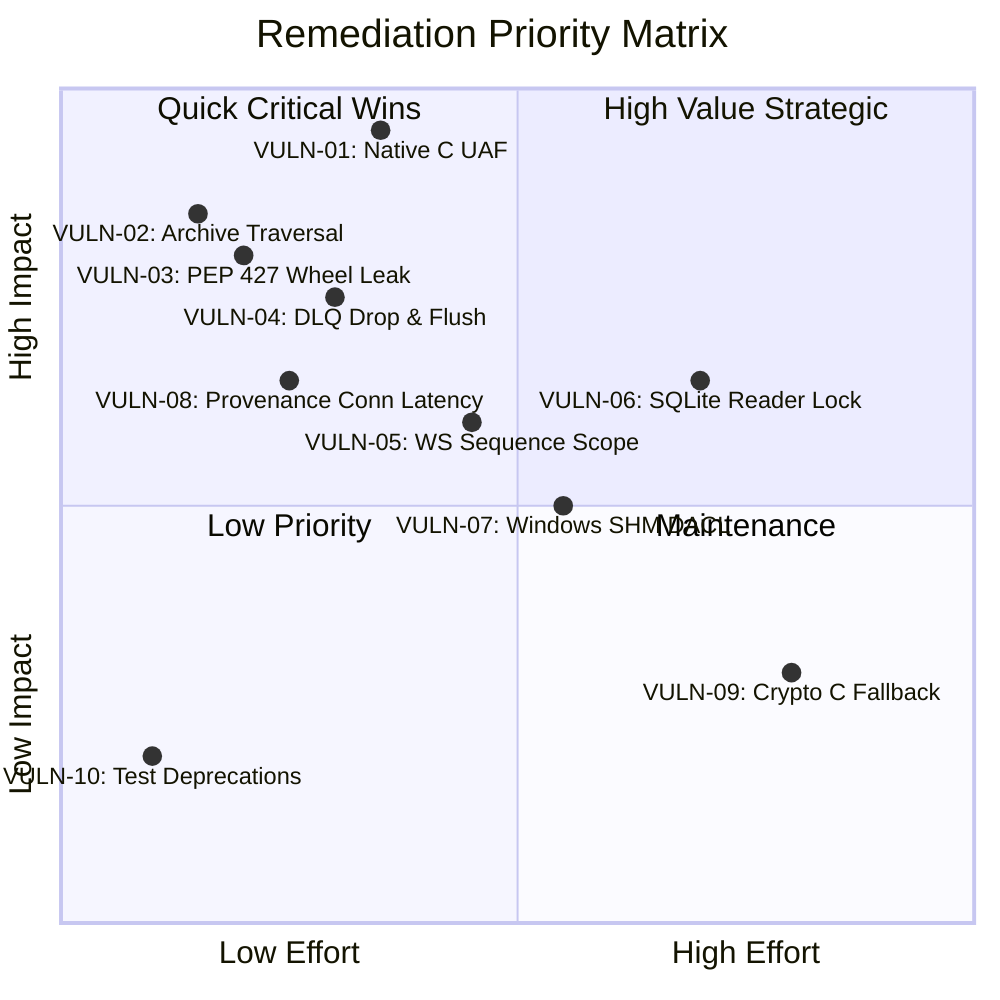

# MDRAP 6.0.0 — Comprehensive Vulnerability & Defect Register

**Audit Date:** November 2026  
**Auditor:** Principal Cybersecurity Researcher & Lead Forensic Auditor  
**Scope:** Complete Codebase (`src/`, `compat/`, `contrib/`, `tests/`, Packaging)  

---

## 1. Vulnerability Classification Key

- **Severities:**
  - **P0 (Critical):** Immediate system crash, memory corruption, remote exploit, or unrecoverable silent data corruption.
  - **P1 (High):** Active security breach vector, concurrency use-after-free, packaging standard violation, or severe data loss under load.
  - **P2 (Medium):** Concurrency bottleneck, unintegrated defensive component, or local privilege boundary gap.
  - **P3 (Low):** Dead code, stylistic inconsistency, or minor performance inefficiency.
- **Statuses:** `CONFIRMED`, `LIKELY`, `REMEDIATED`, `PARTIALLY REMEDIATED`, `REGRESSION`, `FALSE POSITIVE`.

---

## 2. Master Vulnerability Register

| ID | Severity | Status | Subsystem | Source Anchor | Description | Operational Impact | Recommended Remediation |
| :--- | :--- | :--- | :--- | :--- | :--- | :--- | :--- |
| **VULN-01** | **P0 / P1** | **REGRESSION** | Native C | `src/mdrap/fastpath.c:1244` | Spinlock lifecycle race: `fastpath_evaluate()` does not hold `g_lifecycle_lock`. | **Use-After-Free / Segfault** if cleanup runs concurrently with evaluation. | Acquire `g_lifecycle_lock` or use reference counting around engine pointer. |
| **VULN-02** | **P1** | **CONFIRMED** | Archive | `src/mdrap/archive.py:71` | Sibling directory traversal via `startswith()` prefix match. | Arbitrary file disclosure / archive extraction outside intended directory. | Replace with `os.path.commonpath([base, target]) == base`. |
| **VULN-03** | **P1** | **PARTIAL** | Packaging | `dist/*.whl` | `_fastpath_native.dll` bundled inside pure Python `py3-none-any` wheel. | Violates PEP 427; potential ABI crash or installation rejection in strict environments. | Add `MANIFEST.in` exclusion or sanitize `src/mdrap/` prior to build. |
| **VULN-04** | **P1** | **PARTIAL** | Provenance | `src/mdrap/provenance.py:220` | DLQ deque overflow silently drops records; `flush_pending_retries()` uncalled. | Loss of regulatory trade provenance during database write spikes; stranded records. | Increment drop counter on deque eviction; wire flush loop into background scheduler. |
| **VULN-05** | **P2** | **CONFIRMED** | Feeds | `src/mdrap/ws_feed.py:825` | `WebSocketFeedManager` uses flat `venue:symbol` key instead of scoped `SequenceScope`. | Sequence gap collisions across multiple channels on the same venue/symbol. | Refactor `WebSocketFeedManager` to delegate to `SequenceScope`. |
| **VULN-06** | **P2** | **CONFIRMED** | Storage | `src/mdrap/storage_schema.py:48` | `@_read_synchronized` forces all database readers into a single mutex queue. | Severe reader lock contention; 15.3x p99 latency degradation under concurrent queries. | Maintain a thread-local reader connection pool or allow unsynchronized WAL reads. |
| **VULN-07** | **P2** | **CONFIRMED** | IPC / SHM | `src/mdrap/shm.py:102` | Windows `CreateFileMappingA` initialized with `NULL` security descriptor. | Any local process on host can inspect or write to shared memory ring buffer. | Initialize explicit `SECURITY_ATTRIBUTES` restricted to owner SID. |
| **VULN-08** | **P2** | **CONFIRMED** | Provenance | `src/mdrap/provenance.py:180` | `ProvenanceTracker.record()` opens new SQLite connection per tick when `store=None`. | **12.16 ms latency per record**, unacceptable in HFT pipeline. | Maintain a persistent SQLite connection or batch write asynchronously. |
| **VULN-09** | **P3** | **CONFIRMED** | Fastpath | `src/mdrap/fastpath.py:1188` | Crypto symbols automatically bypass native C kernel and fall back to Python. | 2.18x throughput penalty on crypto feeds compared to equity feeds. | Formalize crypto fallback in documentation or extend C kernel corridors. |
| **VULN-10** | **P3** | **CONFIRMED** | Tests | `tests/test_backtest.py:100` | 14 test cases generate deprecation warnings for non-core modules. | Log noise and clutter during test suite execution. | Migrate or silence expected deprecation warnings in test suite. |

---

## 3. Remediated Vulnerabilities (Verified Closed)

| ID | Original Severity | Status | Subsystem | Closed In | Verification Result |
| :--- | :--- | :--- | :--- | :--- | :--- |
| **CLOSED-01** | P1 | **REMEDIATED** | Provenance | `bea7c8a` | Swallowed SQLite exceptions eliminated; explicit error raising verified. |
| **CLOSED-02** | P1 | **REMEDIATED** | Reconciler | `378eecb` | Cross-venue quote reconciliation and NBBO derivation fully verified. |
| **CLOSED-03** | P1 | **REMEDIATED** | Reconciler | `378eecb` | Crossed order book detection (`best_bid >= best_ask`) verified. |
| **CLOSED-04** | P1 | **REMEDIATED** | API | `4ed7587` | API broadcast queue bounded at 1000 items; drop-tail verified. |
| **CLOSED-05** | P1 | **REMEDIATED** | API | `4ed7587` | PBKDF2 authorization token SHA-256 LRU cache verified. |
| **CLOSED-06** | P1 | **REMEDIATED** | Engine | `9fecf75` | Strict monotonic status priority `INVALID > SUSPICIOUS > VALID` verified. |
| **CLOSED-07** | P1 | **REMEDIATED** | Harness | `3ec4237` | CI skip enforcement for native extensions verified. |

---

## 4. Remediation Priority Matrix

