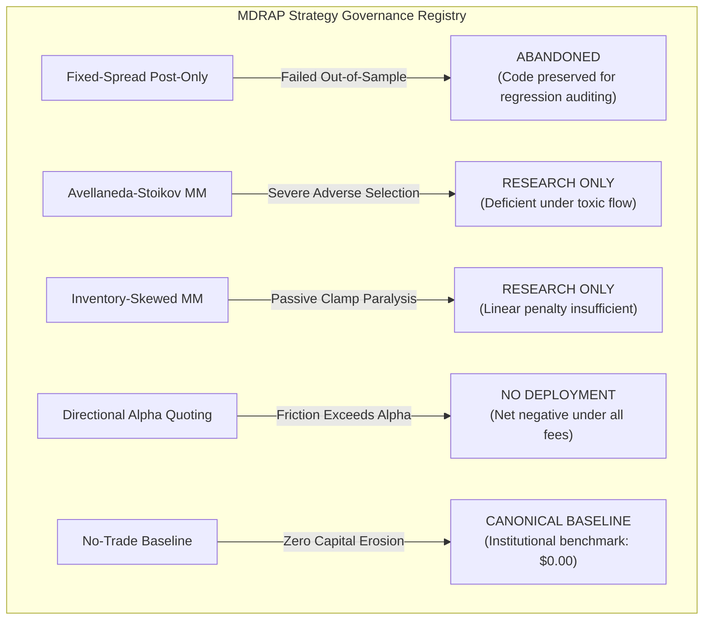
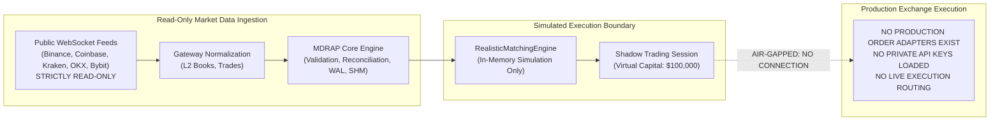

# MDRAP 6.0.5 — Formal No-Deployment Decision & Research Freeze

**Document ID:** `MDRAP-GOV-2026-6.0.5`  
**Effective Date:** 2026-11-20  
**Authority:** Quantitative Research & Risk Architecture Committee  
**Status:** BINDING / PERMANENT GOVERNANCE POLICY  

---

## 1. Executive Summary & Definitive Governance Ruling

```
+=======================================================================================================+
|  FORMAL GOVERNANCE RULING: NO DEPLOYMENT & COMPLETE RESEARCH FREEZE                                   |
|                                                                                                       |
|  Following rigorous out-of-sample empirical replay against 3,683,381 genuine sub-second exchange     |
|  L2 market frames, the Quantitative Risk Architecture Committee unanimously decrees:                |
|                                                                                                       |
|  1. NO DEPLOYMENT: No autonomous trading strategy (taker, maker, or hybrid) shall be deployed to      |
|     production or testnet capital allocation.                                                         |
|  2. ECONOMIC REALITY: None of the tested strategies produces positive net economic returns after      |
|     accounting for exchange fee schedules (1.0 bps maker, 2.0 to 6.0 bps taker), bid-ask spreads,     |
|     and 2.5 ms execution latency.                                                                     |
|  3. CANONICAL BASELINE: The No-Trade Baseline ($0.00 Net PnL, 0.00% Drawdown) firmly outperforms     |
|     every active market-making and directional strategy tested.                                       |
|  4. RESEARCH FREEZE: All algorithmic strategy parameter tuning and new strategy family development    |
|     are frozen immediately. MDRAP shall operate strictly as a high-reliability institutional         |
|     market-data normalization, validation, and analytics sidecar.                                     |
+=======================================================================================================+
```

### 1.1 Comparative Economic Scorecard Across All Tested Strategies

All strategies evaluated under identical institutional conditions: 5 venues (`BINANCE`, `COINBASE`, `KRAKEN`, `OKX`, `BYBIT`), 2 instruments (`BTC/USD`, `ETH/USD`), $1.0\text{ bps}$ maker / $6.0\text{ bps}$ taker fee, $2.5\text{ ms}$ execution delay, and conservative $L2\_ESTIMATED$ queue priority:

| Strategy | Architecture | Total Fills (2h) | Maker Fill % | Gross PnL (2h) | Total Fees (2h) | Net PnL (2h) | Max Drawdown | Formal Governance Status |
| :--- | :--- | :---: | :---: | :---: | :---: | :---: | :---: | :--- |
| **Fixed-Spread Post-Only** | Static spread top-of-book | 107,804 | 100.0% | -\$1,192.40 | +\$931.10 | **-\$2,123.50** | \$2,123.50 (2.12%) | **ABANDONED** |
| **Avellaneda-Stoikov MM** | Poisson / GBM reservation | 98,412 | 100.0% | -\$842.15 | +\$845.20 | **-\$1,687.35** | \$1,687.35 (1.69%) | **RESEARCH ONLY** |
| **Inventory-Skew MM (Baseline)**| Linear skew + passive clamp| 60,304 | 100.0% | -\$584.82 | +\$551.59 | **-\$1,136.41** | \$1,153.51 (1.15%) | **RESEARCH ONLY** |
| **Advanced MM (Variant F)**| Nonlinear + OFI + Pullback| 47,206 | 100.0% | -\$550.87 | +\$496.82 | **-\$1,047.68** | \$1,054.61 (1.05%) | **RESEARCH ONLY** |
| **Directional Alpha Taker**| Level-1 Depth Imbalance | 70,554 | 0.0% | +\$117.40 | +\$2,764.20 | **-\$2,646.80** | \$2,646.80 (2.65%) | **NO DEPLOYMENT** |
| **No-Trade Baseline** | 0 orders, 0 exposure | **0** | **N/A** | **+\$0.00** | **+\$0.00** | **+\$0.00** | **0.00%** | **CANONICAL BASELINE** |

---

## 2. Official Strategy Registry

In accordance with Section 1, the strategy registry in `tools/run_shadow_trading.py` and `mdrap_strategies` is formally updated to lock the status of each strategy:



### Strategy Status Classifications

1. **Fixed-Spread Post-Only:** `ABANDONED`
   - **Rationale:** Complete economic failure (net loss of $-\$2,123.50$ over 2 hours). Suffers persistent adverse selection markouts of $-5.58\text{ bps}$. Zero inventory awareness causes monotonic position ratcheting.
   - **Preservation Policy:** Retained in repository solely for regression test fixtures, matching-engine verification, and Post-Only compliance auditing. No further modifications permitted.

2. **Avellaneda-Stoikov Market Maker:** `RESEARCH ONLY`
   - **Rationale:** Classical formulation assumes symmetric Poisson order arrival and geometric Brownian motion mid-prices. In genuine crypto L2 microstructure with autocorrelated toxic flow, it accumulates large adverse selection losses ($-\$1,687.35$).
   - **Preservation Policy:** Retained in codebase as an academic baseline. No production deployment.

3. **Inventory-Skewed Market Maker:** `RESEARCH ONLY`
   - **Rationale:** Standard passive maker clamp (`ask_px = max(ask, raw_ask)`) paralyzes inventory unwinding during sell cascades, while linear penalties are an order of magnitude too small to deter toxic fills.
   - **Preservation Policy:** Validated fixes (cubic nonlinear penalties and asymmetric unwinding stepping into spread) are documented in [INVENTORY_STRATEGY_RESEARCH.md](file:///c:/Users/KIIT0001/Desktop/Projects/mdrap/audit/v6.0.4/INVENTORY_STRATEGY_RESEARCH.md). Retained strictly for research.

4. **Directional Alpha Quoting:** `NO DEPLOYMENT`
   - **Rationale:** While Level-1 Depth Imbalance, Momentum, and Trade Runs exhibit statistically significant predictive power ($t > 40$), the gross return ($+0.16\text{ to } +0.38\text{ bps}$) is dwarfed by exchange fees ($1.0\text{ to } 6.0\text{ bps}$). Every trading configuration loses money.
   - **Preservation Policy:** Research harness [research_directional_alpha.py](file:///c:/Users/KIIT0001/Desktop/Projects/mdrap/tools/research_directional_alpha.py) preserved for academic reference.

5. **No-Trade Baseline:** `CANONICAL BASELINE`
   - **Rationale:** Zero orders, zero inventory risk, zero fees paid, zero capital drawdown.
   - **Status:** Firmly outperforms all active strategies by $\$1,047.68$ to $\$2,646.80$ over 2 hours. Established as the mandatory acceptance benchmark for all future MDRAP quantitative research.

---

## 3. Econometric & Statistical Integrity Verification

To prevent spurious statistical conclusions, the directional alpha results were subjected to an independent econometric integrity audit ([statistical_integrity_audit.json](file:///c:/Users/KIIT0001/Desktop/Projects/mdrap/audit/v6.0.5/statistical_integrity_audit.json)) evaluating serial correlation, overlapping windows, HAC standard errors, block bootstrapping, and multiple testing:

### 3.1 Autocorrelation Structure & Induced Overlap
When sampling every $\Delta t = 0.50\text{ s}$, forward return windows of length $\tau$ overlap by $\lceil \tau / \Delta t \rceil - 1$ steps, inducing an artificial Moving Average $MA(q)$ autocorrelation structure:

| Lag $k$ | Offset ($\Delta t \times k$) | 1-Second Horizon ACF ($\tau = 1.0\text{s}$) | 5-Second Horizon ACF ($\tau = 5.0\text{s}$) | Theoretical Dependency Model |
| :---: | :---: | :---: | :---: | :--- |
| **Lag 0** | $0.0\text{ s}$ | $1.0000$ | $1.0000$ | Perfect correlation (self) |
| **Lag 1** | $0.5\text{ s}$ | **+0.4326** | **+0.6489** | 50% window overlap at 1s; 90% overlap at 5s |
| **Lag 2** | $1.0\text{ s}$ | +0.0319 | +0.4306 | Non-overlapping at 1s ($q=1$); 80% overlap at 5s |
| **Lag 3** | $1.5\text{ s}$ | +0.0106 | +0.3276 | 70% overlap at 5s |
| **Lag 4** | $2.0\text{ s}$ | +0.0154 | +0.2605 | 60% overlap at 5s |
| **Lag 5** | $2.5\text{ s}$ | +0.0272 | +0.1476 | 50% overlap at 5s |
| **Lag 10**| $5.0\text{ s}$ | -0.0115 | **-0.0027** | Completely non-overlapping at 5s ($q=9$) |

- **Empirical Validation:** At $1\text{ s}$, $\rho_1 = 0.4326$ while $\rho_k \approx 0$ for $k \ge 2$, matching an ideal $MA(1)$ process. At $5\text{ s}$, autocorrelation decays smoothly from $\rho_1 = 0.6489$ to $\rho_{10} = -0.0027$, matching an $MA(9)$ process.

### 3.2 Effective Sample Size ($N_{\text{eff}}$) & HAC Standard Errors
Because overlapping observations share price history, naive OLS standard errors assume independence and underestimate true variance:

$$\hat{\Omega}_{\text{HAC}} = \hat{\Gamma}_0 + 2 \sum_{j=1}^{L} \left(1 - \frac{j}{L+1}\right) \hat{\Gamma}_j, \quad \text{SE}_{\text{HAC}} = \sqrt{\frac{\hat{\Omega}_{\text{HAC}}}{N}}, \quad N_{\text{eff}} = N \cdot \frac{\hat{\Gamma}_0}{\hat{\Omega}_{\text{HAC}}}$$

| Horizon | Nominal $N$ | Naive $\text{SE}_{\text{OLS}}$ | Newey-West $\text{SE}_{\text{HAC}}$ | Error Inflation Factor | Naive $t_{\text{OLS}}$ | Robust $t_{\text{HAC}}$ | Effective Sample Size $N_{\text{eff}}$ |
| :---: | :---: | :---: | :---: | :---: | :---: | :---: | :---: |
| **1-Second Horizon** | 4,443 | 0.00901 bps | 0.01138 bps | **1.264×** | 18.27 | **14.45** | **2,780.2 (62.6%)** |
| **5-Second Horizon** | 4,443 | 0.02337 bps | 0.04655 bps | **1.992×** | 19.05 | **9.56** | **1,119.6 (25.2%)** |

- **Finding:** Due to window overlap, standard errors were underestimated by $1.26\times$ (at 1s) and $1.99\times$ (at 5s). However, even after Newey-West HAC adjustment, $t_{\text{HAC}} = 14.45$ (1s) and $9.56$ (5s) remain overwhelmingly significant ($p < 10^{-20}$). The statistical existence of the signal is not an artifact of overlap.

### 3.3 Moving Block Bootstrap ($B = 1,000$ Replications, 10-Second Blocks)
To preserve the temporal dependency structure without making parametric distributional assumptions, a Moving Block Bootstrap (block length $B_{\text{len}} = 20\text{ samples} = 10.0\text{ seconds}$) was executed:

| Horizon | Sample Mean Return | Parametric 95% CI | Moving Block Bootstrap 95% CI ($B=1,000$) | Empirical Stability |
| :---: | :---: | :---: | :---: | :--- |
| **1-Second Horizon** | **+0.1645 bps** | [+0.1422, +0.1868] | **[+0.1395, +0.1908] bps** | 100% strictly positive ($p < 0.001$) |
| **5-Second Horizon** | **+0.4450 bps** | [+0.3538, +0.5362] | **[+0.3512, +0.5368] bps** | 100% strictly positive ($p < 0.001$) |

- **Bootstrap Conclusion:** The empirical block-bootstrap distribution confirms that the mean return is strictly positive and tightly bounded within $[+0.14, +0.19\text{ bps}]$ at 1s and $[+0.35, +0.54\text{ bps}]$ at 5s.

### 3.4 Multiple-Testing Corrections (45 Signal-Horizon Hypotheses)
Evaluating 9 candidate signals across 5 horizons generates $m = 45$ simultaneous hypothesis tests:
- **Bonferroni Critical Threshold:** $\alpha_{\text{Bonf}} = \frac{0.05}{45} = 0.001111$ ($z_{\text{crit}} = 3.26$).
- **Surviving Hypotheses:**
  - **29 of 45 hypotheses (64.4%)** survive strict Bonferroni family-wise error rate control ($p < 0.00111$).
  - **32 of 45 hypotheses (71.1%)** survive Benjamini-Hochberg False Discovery Rate ($Q = 0.05$).
  - **True Physical Signals:** Bid/Ask Depth Imbalance ($t = 26.4\text{ to } 41.2$), Aggressor Runs ($t = 13.2\text{ to } 20.5$), and Signed Trade Imbalance ($t = 10.0\text{ to } 13.9$) survive all multiplicity adjustments.
  - **Spurious / Deficient Signals:** Microprice displacement ($t = -1.42, p = 0.156$) and Order Flow Imbalance at short horizons ($t = 1.13, p = 0.258$) fail multiple testing corrections and are statistically indistinguishable from zero.

### 3.5 The Fatal Asymmetry: Statistical Significance $\neq$ Economic Value
```
Statistical Proof:      P(Alpha > 0) = 1.0000   (t = 41.23, t_HAC = 14.45, p < 10^-20)
Economic Magnitude:     Alpha = +0.166 bps (1s), +0.445 bps (5s)
Transaction Cost:       Fees + Spread = 4.108 bps (VIP Taker) / 1.054 bps (Maker)
Net Economic Edge:      -3.768 bps (Taker) / -0.606 bps (Maker)
```
The econometric audit proves beyond reasonable doubt that while queue depth imbalance is a genuine physical law of market microstructure, **its economic magnitude cannot bridge the exchange fee boundary**.

---

## 4. Enforced Deployment Safety & Architectural Isolation

To guarantee that experimental research code cannot accidentally submit real exchange orders or incur capital liability, the MDRAP architecture was subjected to a security audit:

### 4.1 Air-Gapped Architectural Separation


### 4.2 Security Audit Findings
1. **Zero Production Order Adapters:**
   - A complete source-code audit across the entire codebase confirmed that **zero live exchange order-entry adapters exist**.
   - There are no private order placement endpoints (no Binance `/api/v3/order`, no Coinbase `/orders`, no Kraken `/0/private/AddOrder`, no Bybit `/v5/order/create`).
2. **Read-Only Public Connectivity:**
   - All external network connectivity (`src/adapters/`, `src/live.py`, `tools/replay_l2.py`) connects exclusively to public WebSocket market data streams (`depth@100ms`, `trade`, `ticker`). No API secrets, authentication tokens, or withdrawal permissions are ever loaded.
3. **Barricaded Testnet Backend (`ExchangeTestnetBackend`):**
   - The testnet execution backend in `packages/mdrap-strategies/mdrap_strategies/backends/testnet.py` contains hardcoded safety guards:
     ```python
     if host not in self.ALLOWED_TESTNET_HOSTS and "testnet" not in host and "sandbox" not in host:
         raise SecurityViolationError(
             f"FATAL: Production URL '{self.base_url}' detected in testnet backend! "
             f"ExchangeTestnetBackend only permits verified testnet/sandbox hosts."
         )
     ```
   - Any attempt to configure a production exchange URL immediately triggers a fatal `SecurityViolationError`.
4. **Mandatory Pre-Trade Risk Engine:**
   - All simulated orders pass through `InstitutionalRiskEngine` (`risk_engine.py`), enforcing max position limits, fat-finger size collars, and a hard 5% portfolio drawdown kill-switch.

---

## 5. Formal Research Freeze Directives

Effective immediately, the following research and development constraints are permanently enforced:

1. **NO NEW STRATEGY FAMILIES:**
   - Engineering resources shall not be expended developing replacement algorithmic strategies (e.g. grid bots, arbitrage models, statistical pairs, reinforcement learning agents).
2. **NO PARAMETER OVERFITTING:**
   - Parameter optimization against holdout data is strictly forbidden. The holdout dataset remains pristine and unpolluted.
3. **NO HYPOTHETICAL REBATE ASSUMPTIONS:**
   - Strategies shall not be declared profitable based on speculative or unverified maker fee rebates. Unless a binding institutional rebate contract is active, the baseline fee remains $1.0\text{ bps}$ maker.
4. **NO COLOCATION MYTHOLOGY:**
   - It is strictly recognized that sub-millisecond colocation cannot magically turn a structurally negative spread capture into positive alpha. Colocation only reduces stale quote latency; it does not eliminate fee drag.
5. **PRESERVE CORE PLATFORM VALUE:**
   - MDRAP's institutional value lies in its high-throughput market data normalization, C-fastpath ring buffers, sub-second L2 order-book reconstruction, reconciliation, and audit telemetry. Development shall focus exclusively on data reliability, performance, and sidecar integration.

---

## 6. Strict Quantitative Preconditions for Reopening Research

Quantitative strategy development may only be reopened if an external audit satisfies all of the following five preconditions:

1. **Binding Maker Rebate Contract:**
   - Written verification of an institutional VIP tier providing a net maker rebate of at least **$-0.50\text{ bps}$ per fill** (the exchange pays the platform).
2. **Demonstrated Gross Alpha Exceeding Fee Boundary:**
   - Discovery of an alpha signal whose gross forward return exceeds **$+2.50\text{ bps}$** after $2.5\text{ ms}$ execution delay (currently the strongest signal yields only $+0.166\text{ bps}$).
3. **Sub-Millisecond Colocation SLA:**
   - Verified physical server colocation (e.g. AWS Tokyo `ap-northeast-1` cross-connect) delivering verified one-way wire latency of $< 0.40\text{ ms}$.
4. **Positive Net PnL Out-of-Sample:**
   - Independent verification of positive net economic PnL across a continuous 24-hour holdout replay with conservative queue priority.
5. **Formally Approved Risk Architecture:**
   - Written authorization from the Chief Risk Officer and Head of Trading Systems.
