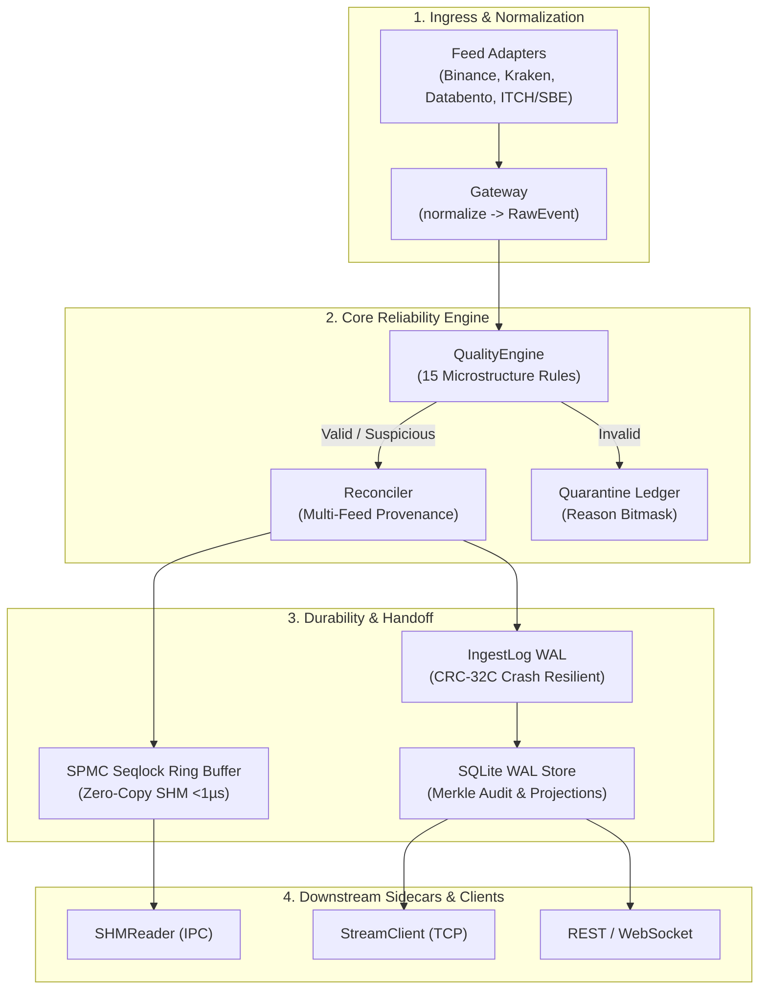

# MDRAP Architecture Map

This document serves as the canonical architectural map and module reference for the **Market Data Reliability & Acceleration Platform (MDRAP v6.0.8)**. 

MDRAP employs a modular package structure in `src/mdrap/` consisting of **93 Python modules** alongside native C acceleration kernels (`fastpath.c`, `mdrap_core.c`, `_fastpath_c.c`). The platform operates strictly as an institutional **read-only market-data reliability sidecar**, converting noisy, delayed, and duplicate feed events into validated, sequence-continuous, canonical streams.

---

## Architectural Principles & Invariants

1. **Strict Read-Only Infrastructure**: Zero live order routing, zero strategy execution, permanent **NO DEPLOYMENT** status.
2. **Quality Priority**: Strict non-downgradable quality states (`INVALID > SUSPICIOUS > VALID`).
3. **Quarantine Without Drops**: Bad or corrupted market data is never silently discarded; it is recorded into a queryable quarantine ledger with explicit reason bitmasks.
4. **Pure Python Fallback Parity**: Standalone Python stdlib engine matches the compiled C kernel's validation logic with 100% semantic parity.
5. **Separation of Concerns**: Clean isolation between Raw Ingress, Canonical Normalization, Provenance Reconciliation, and Low-Latency Delivery.

---

## Functional Module Layers (93 Modules)

### 1. Core Pipeline & Engine
Canonical data structures, schema validation, quality evaluation, and pipeline orchestration.

| Module | Purpose | Key Exports | Stability |
| :--- | :--- | :--- | :--- |
| [`models.py`](../src/mdrap/models.py) | Canonical data models & enums | `RawEvent`, `CanonicalEvent`, `EventType`, `QualityStatus`, `Reason` | `stable` |
| [`gateway.py`](../src/mdrap/gateway.py) | Ingestion and normalization | `ingest()`, `normalize()`, `SchemaError` | `stable` |
| [`quality.py`](../src/mdrap/quality.py) | 15-rule quality evaluation engine | `QualityEngine`, `QualityConfig` | `stable` |
| [`reconciliation.py`](../src/mdrap/reconciliation.py) | Multi-feed arbitration & reliability | `Reconciler`, `ReliabilityTracker` | `stable` |
| [`pipeline.py`](../src/mdrap/pipeline.py) | Stateful pipeline processing | `Pipeline`, `tuned_gc` | `stable` |
| [`engine.py`](../src/mdrap/engine.py) | High-level unified engine API | `Engine`, `EngineConfig`, `StepResult` | `stable` |
| [`metrics.py`](../src/mdrap/metrics.py) | Hardware latency & throughput metrics | `compute_latencies_us`, `RunMetrics`, `percentile` | `stable` |
| [`config.py`](../src/mdrap/config.py) | Configuration dataclasses | `PlatformConfig`, `QualityConfig`, `PipelineConfig` | `stable` |
| [`config_loader.py`](../src/mdrap/config_loader.py) | Hierarchical TOML/YAML loader | `load_config`, `resolve_config` | `stable` |
| [`rules.py`](../src/mdrap/rules.py) | Dynamic quality rule registration | `@register_rule`, `evaluate_user_rules` | `stable` |
| [`protocols.py`](../src/mdrap/protocols.py) | Structural extension protocols | `FeedAdapter`, `StorageBackend`, `OutputSink` | `stable` |
| [`runtime.py`](../src/mdrap/runtime.py) | Platform runtime environment inspection | `RuntimeProfile`, `get_runtime_profile` | `stable` |
| [`facade.py`](../src/mdrap/facade.py) | Simplified top-level developer interface | `MDRAPFacade` | `beta` |
| [`mdrap.py`](../src/mdrap/mdrap.py) | Primary engine lifecycle wrapper | `MDRAPEngine` | `stable` |
| [`quarantine.py`](../src/mdrap/quarantine.py) | Quarantined event models & factories | `QuarantineRecord` | `stable` |

### 2. Storage & Durability
Crash-resilient write-ahead logging (WAL), SQLite persistence, and columnar exports.

| Module | Purpose | Key Exports | Stability |
| :--- | :--- | :--- | :--- |
| [`storage.py`](../src/mdrap/storage.py) | Primary SQLite persistence store | `Store` | `stable` |
| [`storage_schema.py`](../src/mdrap/storage_schema.py) | Database DDL and indexing schema | `SCHEMA_DDL`, `INDEX_DDL` | `stable` |
| [`storage_audit.py`](../src/mdrap/storage_audit.py) | Database integrity verification queries | `verify_database_integrity` | `stable` |
| [`ingestlog.py`](../src/mdrap/ingestlog.py) | Append-only CRC-32C write-ahead log | `IngestLog`, `WALSegment` | `stable` |
| [`journal.py`](../src/mdrap/journal.py) | Undo transaction journal for rollback | `UndoJournal` | `stable` |
| [`projection.py`](../src/mdrap/projection.py) | Asynchronous WAL-to-SQLite projection | `SQLiteProjection`, `ProjectionWorker` | `stable` |
| [`archive.py`](../src/mdrap/archive.py) | Raw payload compressed archiving | `RawArchive`, `replay` | `stable` |
| [`historical.py`](../src/mdrap/historical.py) | Historical dataset partitioning | `HistoricalStorageEngine` | `beta` |
| [`columnar.py`](../src/mdrap/columnar.py) | Optional columnar storage queries | `ColumnarStore` | `beta` |
| [`chd.py`](../src/mdrap/chd.py) | Historical market data fetcher | `CHDClient`, `HistoricalRequest` | `beta` |
| [`export.py`](../src/mdrap/export.py) | Standard CSV and JSON event exporter | `export_data` | `stable` |

### 3. Ingestion, Protocol Dissectors & Adapters
Pluggable exchange feed decoders, binary dissectors, and network connectors.

| Module | Purpose | Key Exports | Stability |
| :--- | :--- | :--- | :--- |
| [`adapters/base.py`](../src/mdrap/adapters/base.py) | Feed adapter abstract base classes | `BaseFeedAdapter` | `stable` |
| [`adapters/binance.py`](../src/mdrap/adapters/binance.py) | Binance WebSocket spot/futures normalizer | `BinanceAdapter` | `stable` |
| [`adapters/kraken.py`](../src/mdrap/adapters/kraken.py) | Kraken WebSocket v2 normalizer | `KrakenAdapter` | `stable` |
| [`adapters/databento.py`](../src/mdrap/adapters/databento.py) | Databento DBN binary stream normalizer | `DatabentoAdapter` | `stable` |
| [`adapters/itch.py`](../src/mdrap/adapters/itch.py) | NASDAQ TotalView-ITCH normalizer | `ITCHAdapter` | `stable` |
| [`adapters/reference.py`](../src/mdrap/adapters/reference.py) | Synthetic reference validation adapter | `ReferenceAdapter` | `stable` |
| [`adapters/template.py`](../src/mdrap/adapters/template.py) | Developer skeleton for custom feeds | `TemplateAdapter` | `stable` |
| [`feed_handler.py`](../src/mdrap/feed_handler.py) | Streaming feed lifecycle coordinator | `StreamingFeedSupervisor` | `stable` |
| [`ws_feed.py`](../src/mdrap/ws_feed.py) | Asynchronous WebSocket feed manager | `WebSocketFeedManager` | `beta` |
| [`polygon_feed.py`](../src/mdrap/polygon_feed.py) | Polygon.io market data connector | `PolygonFeedManager` | `beta` |
| [`databento_feed.py`](../src/mdrap/databento_feed.py) | Databento live stream connector | `DatabentoFeedManager` | `beta` |
| [`itch.py`](../src/mdrap/itch.py) | ITCH 5.0 binary protocol parser | `ITCHParser`, `ITCHOrderBookTracker` | `stable` |
| [`sbe.py`](../src/mdrap/sbe.py) | Simple Binary Encoding (SBE) decoder | `SBEDecoder`, `SBEMessage` | `stable` |
| [`recovery.py`](../src/mdrap/recovery.py) | Sequence gap recovery state machine | `FeedRecoveryEngine` | `stable` |
| [`gap.py`](../src/mdrap/gap.py) | Gap detection and request tracking | `GapDetector`, `GapRequest` | `stable` |
| [`ingress.py`](../src/mdrap/ingress.py) | Multi-channel ingress sequencer | `IngressSequencer` | `stable` |
| [`simulator.py`](../src/mdrap/simulator.py) | Deterministic market feed generator | `FeedSimulator`, `SimulatorConfig` | `stable` |
| [`live.py`](../src/mdrap/live.py) | Live public market data connector | `LiveConnector` | `beta` |

### 4. IPC Delivery & Client Distribution
Shared memory ring buffers and streaming sockets for downstream sidecars.

| Module | Purpose | Key Exports | Stability |
| :--- | :--- | :--- | :--- |
| [`shm.py`](../src/mdrap/shm.py) | Zero-copy seqlock SHM ring buffer | `SHMWriter`, `SHMReader` | `stable` |
| [`shm_drainer.py`](../src/mdrap/shm_drainer.py) | Background ring buffer reader daemon | `SHMDrainer` | `beta` |
| [`service.py`](../src/mdrap/service.py) | Production TCP market data daemon | `MarketDataDaemon`, `StreamClient` | `stable` |
| [`protocol.py`](../src/mdrap/protocol.py) | Fixed-width binary wire protocol | `pack_tick_frame`, `unpack_tick_frame` | `stable` |
| [`client.py`](../src/mdrap/client.py) | Python REST & WebSocket client | `MDRAPClient` | `beta` |
| [`api.py`](../src/mdrap/api.py) | FastAPI REST & WebSocket streaming server | `create_app`, `AppState` | `beta` |

### 5. Order Book & Analytics
Real-time consolidated top-of-book (NBBO) and L2 market depth aggregation.

| Module | Purpose | Key Exports | Stability |
| :--- | :--- | :--- | :--- |
| [`bbo.py`](../src/mdrap/bbo.py) | Consolidated Best Bid & Offer (NBBO) | `BBOEngine`, `ConsolidatedBBO` | `stable` |
| [`depth.py`](../src/mdrap/depth.py) | Multi-venue Level-2 depth ladder | `ConsolidatedDepthEngine` | `stable` |
| [`analytics.py`](../src/mdrap/analytics.py) | Streaming OHLCV and volatility metrics | `MarketAnalytics`, `OHLCVAggregator`| `beta` |
| [`features.py`](../src/mdrap/features.py) | Microstructure feature indicators | `sma`, `ema`, `rsi`, `bollinger_bands` | `beta` |
| [`symbology.py`](../src/mdrap/symbology.py) | Symbol resolution & normalization | `resolve_symbol` | `stable` |
| [`venues.py`](../src/mdrap/venues.py) | Venue registry, phases & tick rules | `MarketVenue`, `TickSizeModel` | `stable` |
| [`clock.py`](../src/mdrap/clock.py) | Monotonic clock abstractions | `SystemClock`, `FixedClock` | `stable` |
| [`replay.py`](../src/mdrap/replay.py) | Deterministic historical replay | `HistoricalReplayEngine` | `stable` |

### 6. Security, Governance & Forensic Audit
Cryptographic Merkle proofs, HMAC authentication, and tamper verification.

| Module | Purpose | Key Exports | Stability |
| :--- | :--- | :--- | :--- |
| [`security.py`](../src/mdrap/security.py) | RBAC, HMAC auth, API key hashing | `SecurityManager`, `Role`, `HashedKeyStore` | `stable` |
| [`audit_format.py`](../src/mdrap/audit_format.py) | Merkle-chain audit hash calculation | `compute_audit_hash` | `stable` |
| [`provenance.py`](../src/mdrap/provenance.py) | End-to-end event lineage tracking | `EventProvenance`, `ProvenanceTracker` | `stable` |
| [`incidents.py`](../src/mdrap/incidents.py) | Quality incident lifecycle tracking | `IncidentManager`, `IncidentRecord` | `stable` |
| [`historical_verifier.py`](../src/mdrap/historical_verifier.py) | Replay state verification against store | `HistoricalVerifier` | `stable` |

### 7. Reliability, SRE & Observability
Watchdogs, alert sinks, Prometheus exposition, and chaos engineering.

| Module | Purpose | Key Exports | Stability |
| :--- | :--- | :--- | :--- |
| [`watchdog.py`](../src/mdrap/watchdog.py) | Feed silence & degradation monitor | `SourceWatchdog` | `stable` |
| [`alerts.py`](../src/mdrap/alerts.py) | Threshold & anomaly alert engine | `AlertEngine`, `Alert` | `beta` |
| [`alert_sinks.py`](../src/mdrap/alert_sinks.py) | Webhook and alert delivery workers | `AlertDeliveryWorker`, `WebhookAlertSink` | `stable` |
| [`prometheus.py`](../src/mdrap/prometheus.py) | Prometheus metrics scraping endpoint | `PrometheusExporter` | `stable` |
| [`telemetry.py`](../src/mdrap/telemetry.py) | Latency and throughput telemetry | `TelemetryCollector` | `stable` |
| [`supervisor.py`](../src/mdrap/supervisor.py) | Inlined SPSC queues & channel workers | `PySpscRingQueue`, `SpscRingQueue` | `stable` |
| [`chaos.py`](../src/mdrap/chaos.py) | Controlled fault & latency injection | `ChaosEngine`, `ChaosInjector` | `beta` |
| [`exceptions.py`](../src/mdrap/exceptions.py) | Typed platform exception hierarchy | `MDRAPException`, `SecurityError` | `stable` |
| [`log.py`](../src/mdrap/log.py) | Structured logging utilities | `get_logger` | `stable` |

### 8. CLI & Terminal Operations
Command-line tools, terminal displays, and interactive cockpit.

| Module | Purpose | Key Exports | Stability |
| :--- | :--- | :--- | :--- |
| [`cli/core.py`](../src/mdrap/cli/core.py) | Primary CLI subcommands (run, bench) | `cmd_run`, `cmd_benchmark`, `cmd_stress` | `stable` |
| [`cli/operations.py`](../src/mdrap/cli/operations.py) | Operational commands (wal, daemon, serve) | `cmd_daemon`, `cmd_serve`, `cmd_doctor` | `stable` |
| [`cli/market.py`](../src/mdrap/cli/market.py) | Market data queries (bbo, depth, live) | `cmd_bbo`, `cmd_depth`, `cmd_live` | `stable` |
| [`cli/security.py`](../src/mdrap/cli/security.py) | Security and audit verification | `cmd_audit`, `cmd_security` | `stable` |
| [`cli/integrations.py`](../src/mdrap/cli/integrations.py) | Out-of-scope companion notices | `cmd_strategy`, `cmd_vessel` | `stable` |
| [`cli/_common.py`](../src/mdrap/cli/_common.py) | Shared table formatters & palette | `_t`, `Console` | `stable` |
| [`term.py`](../src/mdrap/term.py) | Terminal cursor and screen controls | Screen abstractions | `stable` |
| [`terminal_display.py`](../src/mdrap/terminal_display.py) | ANSI formatting and tables | Terminal renderers | `beta` |
| [`dashboard.py`](../src/mdrap/dashboard.py) | Real-time terminal HUD display | `render` | `beta` |
| [`tui.py`](../src/mdrap/tui.py) | Interactive Text User Interface | TUI application | `beta` |
| [`profile.py`](../src/mdrap/profile.py) | CPU and memory profiler utilities | `profile_run` | `beta` |

### 9. Native Acceleration & Build
C FFI bindings and build utilities.

| Module | Purpose | Key Exports | Stability |
| :--- | :--- | :--- | :--- |
| [`fastpath.py`](../src/mdrap/fastpath.py) | Native C shared library loader & FFI | `FastQualityEngine`, `NativeReplayBuffer` | `stable` |
| [`build_fastpath.py`](../src/mdrap/build_fastpath.py) | Standalone C compiler harness | Compiler invocation script | `stable` |
| [`manifest.py`](../src/mdrap/manifest.py) | Package manifest and checksum audit | `generate_manifest` | `stable` |
| [`benchmark.py`](../src/mdrap/benchmark.py) | Reproducible benchmark harness | `run_benchmark` | `stable` |
| [`_version.py`](../src/mdrap/_version.py) | Authoritative canonical version string | `__version__ = "6.0.8"` | `stable` |

---

## Architecture Flow Diagram

