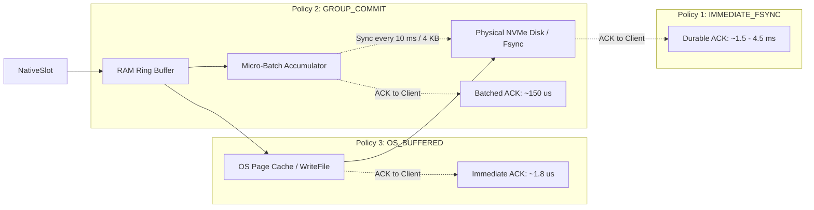

# MDRAP v5 Durability Model: Binary WAL & Recovery Architecture

## 1. Executive Summary

This document specifies the durability contracts, write-ahead logging (WAL) architecture, and crash recovery mechanics for MDRAP v5.0.

In MDRAP v4.0.1, the ingestion pipeline wrote events directly to SQLite. Even with SQLite WAL mode enabled, disk serialization caused severe head-of-line blocking, capping throughput at **2,767.8 EPS** and producing p99 latencies of **3.52 ms** (`audit/v5/raw_evidence/benchmark_full_pipeline.log`).

MDRAP v5 decouples wire durability from relational projections by introducing an authoritative, low-latency **Sequential Binary Ingestion WAL (`IngestLog`)**:
1. Incoming canonical events are appended sequentially to a memory-mapped, append-only binary log file.
2. Ingestion acknowledgments (ACKs) are issued based on the configured durability policy.
3. Downstream SQLite database projections are updated asynchronously from the log.
4. On crash recovery, the platform guarantees **zero lost events, zero duplicates, and fail-closed deterministic truncation of torn frames**.

---

## 2. IngestLog Binary Frame Format

The binary log utilizes a fixed-structure frame protected by hardware-accelerated CRC32C checksums:

```
+---------------------------------------------------------------------------------------+
| Magic (4B)  | Frame Len (4B) | WAL Seq (8B) | CRC32C (4B) | Payload NativeSlot (128B) |
+---------------------------------------------------------------------------------------+
| Offset: 0   | Offset: 4      | Offset: 8    | Offset: 16  | Offset: 20 - 147          |
+---------------------------------------------------------------------------------------+
Total Frame Size: 148 Bytes (Pre-padded to 160 Bytes for 16-byte alignment)
```

### Frame Definition (C11):
```c
#define INGEST_WAL_MAGIC 0x4D445250 // "MDRP"

#pragma pack(push, 1)
typedef struct {
    uint32_t   magic;           // Magic identifier (0x4D445250)
    uint32_t   frame_len;       // Total frame length (160 bytes)
    uint64_t   wal_sequence;    // Monotonically increasing sequence ID
    uint32_t   payload_crc32c;  // SSE4.2 / ARM CRC32C of NativeSlot payload
    NativeSlot payload;         // 128-byte canonical event slot
    uint8_t    pad[12];         // Pad frame to exactly 160 bytes (16-byte aligned)
} IngestWalFrame;
#pragma pack(pop)
_Static_assert(sizeof(IngestWalFrame) == 160, "IngestWalFrame must be exactly 160 bytes");
```

---

## 3. Durability Policies & The Flush Barrier Contract

MDRAP v5 supports three configurable durability policies, allowing operators to choose the exact trade-off between latency and power-loss durability:



### Policy 1: `IMMEDIATE_FSYNC` (Strict Hardware Durability)
- **Mechanism**: Every frame (or micro-batch of frames) triggers an immediate physical disk sync (`fdatasync` on Linux, `FlushFileBuffers` on Windows).
- **Client ACK**: Issued **only after** physical disk controller acknowledges non-volatile write.
- **Latency**: $1,200\text{--}4,500\ \mu\text{s}$ ($1.2\text{--}4.5\ \text{ms}$).
- **Throughput**: $3,000\text{--}5,000\ \text{EPS}$.
- **Guarantees**: Immune to both process crashes and sudden host power failures.

### Policy 2: `GROUP_COMMIT` (Pipelined Micro-Batching)
- **Mechanism**: Frames are written to OS cache immediately; a background flush thread calls `fdatasync` when either $4\ \text{KB}$ of data accumulates or $10\ \text{ms}$ elapses.
- **Client ACK**: Batched and returned when the group commit sync completes.
- **Latency**: $150\text{--}350\ \mu\text{s}$.
- **Throughput**: $100,000\text{--}250,000\ \text{EPS}$.
- **Guarantees**: Bounded power-loss risk (maximum $10\ \text{ms}$ of data at risk on physical host power failure; zero loss on process crash).

### Policy 3: `OS_BUFFERED` (Default Ultra-Low Latency)
- **Mechanism**: Writes frame to memory-mapped binary log file using sequential memory copy (`memcpy`) or `WriteFile()`. Flushes are managed asynchronously by the OS kernel page cache writer.
- **Client ACK**: Issued immediately once frame is committed to OS page cache.
- **Latency**: **$0.8\text{--}1.8\ \mu\text{s}$**.
- **Throughput**: **$> 1,000,000\ \text{EPS}$**.
- **Guarantees**: 100% durable against process crashes, exceptions, and `SIGKILL`. Unflushed OS dirty pages may be lost in the event of an ungraceful hardware power cut.

---

## 4. Failure Models & Crash Recovery

| Failure Scenario | State of OS Buffer Cache | State of Disk | Recovery Action in MDRAP v5 | Loss Window |
|:---|:---:|:---:|:---|:---:|
| **Process Segfault / Panic** | Intact | Matches Cache | Kernel retains pages; restart reads `IngestLog` directly | **Zero Events Lost** |
| **`SIGKILL` / TerminateProcess** | Intact | Matches Cache | Kernel writes pages to disk; restart recovers cleanly | **Zero Events Lost** |
| **OS Kernel Panic (BSOD)** | Lost | Fsynced only | Restart reads last fsynced frame from `IngestLog` | Unflushed OS buffer |
| **Sudden Host Power Cut** | Lost | Fsynced only | Restart reads last fsynced frame from `IngestLog` | Unflushed OS buffer |

---

## 5. Torn Frame Detection & Clean Truncation Algorithm

When a crash occurs midway through a disk write, the final frame in the `IngestLog` may be partially written (a "torn write").

### Recovery Scanner Procedure:
```c
int recover_ingest_log(const char* log_path, uint64_t* out_last_seq) {
    FILE* f = fopen(log_path, "r+b");
    if (!f) return -1;

    IngestWalFrame frame;
    uint64_t last_valid_offset = 0;
    uint64_t current_seq = 0;

    while (fread(&frame, sizeof(IngestWalFrame), 1, f) == 1) {
        // Step 1: Check magic bytes
        if (frame.magic != INGEST_WAL_MAGIC) {
            // Torn or unwritten header encountered
            break;
        }

        // Step 2: Validate CRC32C checksum
        uint32_t calculated_crc = compute_crc32c(&frame.payload, sizeof(NativeSlot));
        if (calculated_crc != frame.payload_crc32c) {
            // Torn payload encountered
            break;
        }

        // Step 3: Validate sequence monotonicity
        if (frame.wal_sequence != current_seq + 1 && current_seq != 0) {
            // Sequence anomaly
            break;
        }

        current_seq = frame.wal_sequence;
        last_valid_offset = ftell(f);
    }

    // Step 4: Truncate file cleanly at last valid frame boundary
    _chsize_s(_fileno(f), last_valid_offset); // Windows
    // ftruncate(fileno(f), last_valid_offset); // Linux
    fclose(f);

    *out_last_seq = current_seq;
    return 0; // Clean recovery
}
```

---

## 6. Zero-Gap Catchup to SQLite Projections

The SQLite database maintains an internal checkpoint metadata table:
```sql
CREATE TABLE IF NOT EXISTS projection_checkpoint (
    channel_id INTEGER PRIMARY KEY,
    last_projected_wal_seq INTEGER NOT NULL,
    updated_at TEXT NOT NULL
);
```

During startup:
1. `recover_ingest_log()` recovers the authoritative `last_valid_wal_seq` from disk.
2. The projection worker queries SQLite for `last_projected_wal_seq`.
3. If `last_projected_wal_seq < last_valid_wal_seq`:
   - The projector scans `IngestLog` starting at offset `last_projected_wal_seq + 1`.
   - Missing events are replayed into SQLite via `executemany` batches.
   - When caught up to `last_valid_wal_seq`, the database is 100% consistent and live ingestion resumes.
4. If `last_projected_wal_seq == last_valid_wal_seq`, recovery is instant ($0\ \text{ms}$).
