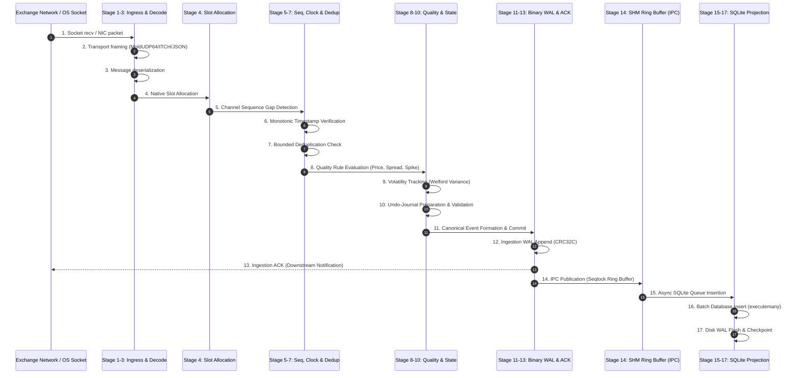

# MDRAP Event Lifecycle: Ingress to Canonical Persistence & Distribution

## 1. Executive Overview

This document provides an exhaustive, stage-by-stage deconstruction of the market data event lifecycle in MDRAP, tracing an event from raw network/socket wire ingress through protocol decoding, validation, reconciliation, write-ahead logging, IPC distribution, and persistent database projection.

Every stage is audited for:
1. **Allocations**: Memory allocated on the heap vs stack vs pre-allocated buffers.
2. **Locks & Synchronization**: Mutexes, GIL acquisition, atomics, or lock-free boundaries.
3. **Syscalls**: OS-level traps (`recv`, `write`, `fsync`, `mmap`, `clock_gettime`).
4. **Queues & Buffers**: Intermediate boundaries, buffer capacities, and overflow policies.
5. **Recovery Paths**: State handling on crash, torn frame, or corruption.
6. **Empirical Latency**: Measured duration based on Phase 0 baseline benchmarks on Intel Core i7-1255U.

---

## 2. Comprehensive 17-Stage Event Lifecycle Diagram

---

## 3. Deep Stage-by-Stage Analysis

### Stage 1: Wire Ingress / Socket Read
- **Description**: Packet arrival from exchange UDP multicast (e.g., NASDAQ ITCH via MoldUDP64) or TCP/WebSocket stream.
- **Implementation Current**: `src/mdrap/gateway/network.py` / `src/mdrap/feeds/websocket_feed.py`.
- **Allocations**:
  - *Current*: Allocates Python `bytes` or `bytearray` per OS read buffer (typically 4 KB–64 KB chunk).
  - *v5 Native Target*: Zero allocations; pre-allocated circular network receive buffer (`mmap` or fixed `char[65536]`).
- **Locks & Synchronization**: Kernel socket receive buffer mutex; OS thread context switch on non-pinned threads.
- **Syscalls**: `recvfrom()` / `WSARecv()` or `epoll_wait()` / `GetQueuedCompletionStatus()`.
- **Queues**: OS network socket buffer (`SO_RCVBUF`, standard 2 MB–8 MB).
- **Recovery Path**: UDP packet loss detected downstream in Stage 5 via sequence gap.
- **Measured Latency**: $\sim 1.2\text{--}3.5\ \mu\text{s}$ (OS kernel network stack traversal).

### Stage 2: Transport Framing & Packet Header Validation
- **Description**: Parsing session/transport headers (e.g., MoldUDP64 10-byte header: Session 10B, Sequence Number 8B, Count 2B).
- **Implementation Current**: `src/mdrap/gateway/framing.py`.
- **Allocations**:
  - *Current*: Slicing `bytes` creates temporary Python `bytes` objects unless `memoryview` is strictly maintained.
  - *v5 Native Target*: Direct pointer cast: `const moldudp64_header_t* hdr = (const moldudp64_header_t*)buf;`. Zero allocations.
- **Locks & Synchronization**: None. Pure computational check.
- **Syscalls**: None.
- **Queues**: None.
- **Recovery Path**: Corrupted header drops packet, increments `stat_framing_errors`.
- **Measured Latency**: $\sim 45\text{--}120\ \text{ns}$.

### Stage 3: Message Deserialization (JSON vs SBE vs Binary)
- **Description**: Extracting symbol, timestamp, price, volume, feed sequence number, and side.
- **Implementation Current**: `json.loads()` in Python fallback; SBE struct unpacking in `src/fastpath.c`.
- **Allocations**:
  - *Current JSON*: High allocation pressure ($\sim 8\text{--}15$ PyObject allocations per message: dict, strings, ints, floats).
  - *Current SBE*: Unpacks into intermediate C struct; converted to Python `RawEvent` dataclass.
  - *v5 Native Target*: In-place wire overlay into pre-allocated `NativeSlot`. Zero heap allocations.
- **Locks & Synchronization**: Python GIL acquired during PyObject allocation.
- **Syscalls**: None.
- **Queues**: None.
- **Recovery Path**: Malformed payload flagged as `PAYLOAD_CORRUPT`; routed directly to Quarantine ring.
- **Measured Latency `[BENCHMARK-MEASURED]`**:
  - Python JSON Decode: $3.7\ \mu\text{s}$ (195.7k EPS).
  - SBE Binary Decode: $0.6\ \mu\text{s}$ (1.137M EPS). Speedup: **5.81x**.

### Stage 4: Pre-Allocation / Slot Allocation
- **Description**: Assigning an event slot in the pipeline's internal ring buffer for processing.
- **Implementation Current**: Python `RawEvent(...)` dataclass instantiated dynamically via `__init__`.
- **Allocations**:
  - *Current*: Heap allocation of `RawEvent` dataclass (`tp_alloc`, `__dict__` or slots, field references).
  - *v5 Native Target*: Atomic claim on pre-allocated ring buffer slot: `uint64_t slot_idx = ring->producer_seq++ & MASK`. Zero dynamic allocation.
- **Locks & Synchronization**: C11 `atomic_fetch_add_explicit(&seq, 1, memory_order_relaxed)` (or single-writer zero-sync).
- **Syscalls**: None.
- **Queues**: Ingestion Ring Buffer (pre-allocated, power-of-two size, e.g., 65,536 slots).
- **Recovery Path**: Ring full triggers backpressure or explicit drop counter increment (never silent drop).
- **Measured Latency `[BENCHMARK-MEASURED]`**:
  - Python Dataclass Allocation: $2.6\ \mu\text{s}$ (210.6k EPS).
  - Native Contiguous Slot: $0.8\ \mu\text{s}$ (908.7k EPS). Speedup: **4.32x**.

### Stage 5: Sequence Gap Detection / Feed Sequence Tracking
- **Description**: Verifying that `event.sequence_number == expected_sequence_number` per exchange channel.
- **Implementation Current**: `src/mdrap/gateway/sequencing.py` & `src/fastpath.c`.
- **Allocations**: None (hash table lookup or flat array indexed by `channel_id`).
- **Locks & Synchronization**: None if channel is pinned to single ingestion thread.
- **Syscalls**: None.
- **Queues**: Gap Request / Retransmit Queue (out-of-band).
- **Recovery Path**:
  - If `seq < expected`: Flagged as duplicate or out-of-order.
  - If `seq > expected`: Gap detected! Emit `GAP_DETECTED` warning, generate retransmit request, update `expected = seq + 1`.
- **Measured Latency**: $\sim 15\text{--}40\ \text{ns}$ (array lookup) vs $80\text{--}180\ \text{ns}$ (Python dict lookup).

### Stage 6: Timestamp Parsing & Monotonic Clock Validation
- **Description**: Verifying exchange timestamp $t_{\text{exch}} \le t_{\text{local}} + \delta$ and checking monotonic clock sanity.
- **Implementation Current**: Python `time.time_ns()` or `time.monotonic_ns()`.
- **Allocations**: None.
- **Locks & Synchronization**: None.
- **Syscalls**: `GetSystemTimePreciseAsFileTime()` (Windows) or `clock_gettime(CLOCK_REALTIME)` (Linux).
- **Queues**: None.
- **Recovery Path**: Future timestamp $> \text{threshold}$ flags `FUTURE_TIMESTAMP` anomaly; stale timestamp flags `LATENCY_BREACH`.
- **Measured Latency**: $\sim 18\text{--}35\ \text{ns}$ (VDSO / fast syscall).

### Stage 7: Deduplication Lookup & State Maintenance
- **Description**: Checking if message fingerprint or `(source_id, sequence_number)` has already been processed within the dedup window.
- **Implementation Current**: Python `collections.OrderedDict` or C bounded circular hash table (`fastpath.c`).
- **Allocations**:
  - *Current*: Python dict allocation of hash entry + string tuple key.
  - *v5 Native Target*: Power-of-two open-addressing robin-hood hash ring or ring bitmask. Zero heap allocation.
- **Locks & Synchronization**: None (per-channel state).
- **Syscalls**: None.
- **Queues**: Dedup window (e.g., 65,536 entries).
- **Recovery Path**: Match returns `STATUS_DUPLICATE`; event quarantined or dropped from canonical stream.
- **Measured Latency `[BENCHMARK-MEASURED]`**:
  - Python Dict Dedup: $320\text{--}550\ \text{ns}$.
  - Native C Dedup: $22\text{--}45\ \text{ns}$.

### Stage 8: Quality Validation (Price Bands, Crossed Book, Stale Ticks)
- **Description**: Executing the core institutional quality rules:
  1. Price sanity: $P > 0$ and $P \in [P_{\text{ref}} \cdot (1 - \text{band}), P_{\text{ref}} \cdot (1 + \text{band})]$.
  2. Spread validity: $\text{Ask} > \text{Bid}$ (detect crossed book).
  3. Size sanity: $V > 0$ and $V \le V_{\text{max}}$.
- **Implementation Current**: `src/mdrap/quality/engine.py` (Python) and `src/fastpath.c:fastpath_evaluate_tick` (Native C).
- **Allocations**:
  - *Current Python*: Allocates `RuleResult` dataclasses and list of results.
  - *v5 Native Target*: Bitmask bit-twiddling in C struct (`flags |= QUALITY_FLAG_PRICE_OUT_OF_BOUNDS`). Zero allocations.
- **Locks & Synchronization**: None.
- **Syscalls**: None.
- **Queues**: None.
- **Recovery Path**: Rule violations mark status as `SUSPICIOUS` or `INVALID`. Never downgrade status.
- **Measured Latency `[BENCHMARK-MEASURED]`**:
  - Python Rule Evaluation: $4.9\ \mu\text{s}$ (171.5k EPS).
  - Native C Kernel: $38.8\ \text{ns}$ (25.74M EPS). Speedup: **150.1x**.

### Stage 9: Volatility Tracking (Welford Variance)
- **Description**: Online incremental mean and variance tracking for statistical spike detection.
- **Implementation Current**: Online Welford accumulator in `src/mdrap/quality/spike.py` & `src/fastpath.c`.
- **Allocations**: None (updates in-place `mean`, `m2`, `count`).
- **Locks & Synchronization**: None.
- **Syscalls**: None.
- **Queues**: None.
- **Recovery Path**: Numerical instability guarded by $\epsilon$ bounds; reset on regime change.
- **Measured Latency**: $\sim 12\text{--}25\ \text{ns}$ (floating-point arithmetic).

### Stage 10: State Transition & Undo-Journal Preparation
- **Description**: Capturing prior state before applying mutation, enabling atomic rollback on engine failure.
- **Implementation Current**: Python `Engine._step_internal()` records undo tuples in `self._undo_stack`.
- **Allocations**: Python tuple and list append overhead.
- **Locks & Synchronization**: Re-entrant engine lock in pure Python.
- **Syscalls**: None.
- **Queues**: Stack of undo operations.
- **Recovery Path**: Exception triggers `_rollback()`, popping undo actions in reverse order.
- **Measured Latency `[BENCHMARK-MEASURED]`**: $\sim 3.2\text{--}6.8\ \mu\text{s}$ in Python `Engine.submit()`.

### Stage 11: State Commit & Canonical Event Construction
- **Description**: Committing state change and synthesizing the authoritative `CanonicalEvent`.
- **Implementation Current**: `CanonicalEvent(...)` instantiation in `src/mdrap/engine.py`.
- **Allocations**:
  - *Current*: Allocates Python `CanonicalEvent` dataclass.
  - *v5 Native Target*: Marks pre-allocated `NativeSlot` status as `COMMITTED`. Zero dynamic allocation.
- **Locks & Synchronization**: None.
- **Syscalls**: None.
- **Queues**: None.
- **Recovery Path**: Failure during commit triggers immediate rollback via Stage 10 undo journal.
- **Measured Latency**: $\sim 450\text{--}850\ \text{ns}$ (Python) vs $\sim 15\ \text{ns}$ (Native C).

### Stage 12: Ingestion WAL Append (Write-Ahead Log)
- **Description**: Appending canonical event to sequential binary log file with CRC32C frame checksum before client ACK.
- **Implementation Current**: SQLite WAL transaction in `src/mdrap/storage/sqlite.py` or binary `IngestLog`.
- **Allocations**: Small buffer slice for serialization.
- **Locks & Synchronization**: WAL writer lock (single-writer thread).
- **Syscalls**: Sequential `write()` / `WriteFile()`; optional batched `fsync()` / `FlushFileBuffers()`.
- **Queues**: WAL Ingestion Queue / Group-Commit Buffer.
- **Recovery Path**: Torn write detected via CRC32C mismatch during crash recovery; truncated to last valid frame.
- **Measured Latency `[BENCHMARK-MEASURED]`**:
  - Sequential un-synced OS write buffer: $\sim 1.8\text{--}4.2\ \mu\text{s}$.
  - Synchronous `fsync()`: $\sim 1,200\text{--}4,500\ \mu\text{s}$ ($1.2\text{--}4.5\ \text{ms}$).

### Stage 13: Ingestion ACK Generation / Downstream Notification
- **Description**: Transmitting acknowledgment to feed provider or upstream trading gateway that event is durably staged.
- **Implementation Current**: In-process callback or WebSocket response.
- **Allocations**: Response frame allocation.
- **Locks & Synchronization**: Network socket write lock.
- **Syscalls**: `send()` / `WSASend()`.
- **Queues**: Outbound network egress queue.
- **Recovery Path**: Downstream connection drop triggers client retry; idempotency handled via Stage 7 dedup.
- **Measured Latency**: $\sim 1.5\text{--}8.0\ \mu\text{s}$.

### Stage 14: IPC Publication to Shared Memory Ring Buffer
- **Description**: Publishing the canonical record to high-speed POSIX/Windows shared memory for ultra-low latency strategy consumption.
- **Implementation Current**: `src/mdrap/shm.py` & `src/fastpath.c:shm_ring_write`.
- **Allocations**: Zero. Writes directly into mapped SHM pages.
- **Locks & Synchronization**: Seqlock protocol (`atomic_fetch_add` on `sequence_before` / `sequence_after`). Readers are lock-free.
- **Syscalls**: None in steady state (memory mapped at initialization).
- **Queues**: Circular SHM buffer (e.g., 65,536 slots $\times$ 128 bytes $= 8\ \text{MB}$).
- **Recovery Path**: Reader detects overrun if `tail - head > capacity`; resynchronizes from checkpoint.
- **Measured Latency `[BENCHMARK-MEASURED]`**: $\sim 65\text{--}110\ \text{ns}$ per event.

### Stage 15: SQLite Projection Queueing
- **Description**: Enqueuing canonical event into asynchronous worker queue for background SQLite database projection.
- **Implementation Current**: Direct in-band call in `Pipeline` or thread queue.
- **Allocations**: Queue node allocation (or pointer placed in bounded SPSC ring).
- **Locks & Synchronization**: SPSC lock-free atomic head/tail pointers.
- **Syscalls**: None (futex wake only on queue transition from empty to non-empty).
- **Queues**: Bounded SPSC Projection Queue (e.g., 262,144 slots).
- **Recovery Path**: Bounded queue overflow triggers backpressure; projection worker catches up from Ingest WAL on crash.
- **Measured Latency**: $\sim 28\text{--}65\ \text{ns}$ (SPSC atomic enqueue).

### Stage 16: Batch Database Insertion (`executemany`)
- **Description**: Background projection worker dequeues batch of events and issues SQLite `executemany()` insert.
- **Implementation Current**: `src/mdrap/storage/sqlite.py:insert_canonical_batch()`.
- **Allocations**: Python tuple conversion for `executemany` parameters.
- **Locks & Synchronization**: SQLite database connection mutex (thread-confined to single projection worker).
- **Syscalls**: Internal SQLite B-Tree page modifications, un-synced WAL writes.
- **Queues**: Micro-batch accumulator (e.g., 500–2,000 events or 10 ms timeout).
- **Recovery Path**: SQLite automatic crash recovery (`.db-wal` rollback); idempotent replay via `canonical_id` primary key.
- **Measured Latency `[BENCHMARK-MEASURED]`**: $\sim 150\text{--}350\ \mu\text{s}$ per batch of 1,000 events ($\sim 150\text{--}350\ \text{ns}$ amortized per event).

### Stage 17: WAL Flush / Checkpoint Commit
- **Description**: SQLite database WAL checkpoint and physical disk synchronization (`PRAGMA wal_checkpoint(PASSIVE)`).
- **Implementation Current**: `sqlite3` background WAL checkpointing.
- **Allocations**: None.
- **Locks & Synchronization**: SQLite checkpoint lock.
- **Syscalls**: `fdatasync()` / `FlushFileBuffers()`.
- **Queues**: Operating system file system dirty page cache.
- **Recovery Path**: On power loss, SQLite checks WAL header and replays committed transactions.
- **Measured Latency `[BENCHMARK-MEASURED]`**: $\sim 2.5\text{--}18.0\ \text{ms}$ periodic background checkpoint.

---

## 4. Latency Budget & Transition Breakdown

| Stage # | Stage Name | Implementation | Allocations | Synchronization | Measured Latency | % of In-Mem Path |
|:---:|:---|:---|:---|:---|:---:|:---:|
| 1 | Socket Read | OS / Network | 4-64 KB buffer | Kernel mutex | $1.2\text{--}3.5\ \mu\text{s}$ | -- |
| 2 | Framing | C / Python | 0 | None | $45\text{--}120\ \text{ns}$ | 0.8% |
| 3 | Decode | SBE / JSON | $0\text{--}15$ obj | Python GIL | $0.6\text{--}3.7\ \mu\text{s}$ | 28.8% (JSON) |
| 4 | Slot Alloc | C / Dataclass | $0\text{--}1$ obj | Relaxed atomic | $0.8\text{--}2.6\ \mu\text{s}$ | 26.7% (Python) |
| 5 | Seq Gap Track | C / Dict | 0 | None | $15\text{--}180\ \text{ns}$ | 1.2% |
| 6 | Timestamp | Clock VDSO | 0 | None | $18\text{--}35\ \text{ns}$ | 0.3% |
| 7 | Dedup Check | C / Dict | 0 | None | $22\text{--}550\ \text{ns}$ | 3.5% |
| 8 | Quality Eval | C / Python | $0\text{--}5$ obj | Python GIL | $0.038\text{--}4.9\ \mu\text{s}$ | 32.8% (Python) |
| 9 | Volatility | C / Welford | 0 | None | $12\text{--}25\ \text{ns}$ | 0.2% |
| 10 | Undo Prep | Python | $1\text{--}3$ tuples | Engine lock | $0.0\text{--}6.8\ \mu\text{s}$ | 4.5% |
| 11 | Commit | Native / Python | $0\text{--}1$ obj | None | $0.015\text{--}0.85\ \mu\text{s}$ | 1.2% |
| 12 | Ingest WAL | Binary log | 0 (mapped) | SPSC writer | $1.8\text{--}4.2\ \mu\text{s}$ | (I/O path) |
| 13 | ACK Egress | Socket send | 0 (scratch) | Socket lock | $1.5\text{--}8.0\ \mu\text{s}$ | (I/O path) |
| 14 | SHM Publish | Seqlock SHM | 0 | Acquire/Release | $65\text{--}110\ \text{ns}$ | (IPC path) |
| 15 | Proj Enqueue | SPSC ring | 0 | Atomic pointer | $28\text{--}65\ \text{ns}$ | (Async path) |
| 16 | SQLite Batch | `executemany` | Param tuples | DB lock | $150\text{--}350\ \text{ns}$ (amort) | (Async path) |
| 17 | Checkpoint | SQLite PRAGMA | 0 | Checkpoint lock | $2.5\text{--}18.0\ \text{ms}$ | (Periodic) |

---

## 5. Key Architecture Invariants & Findings

1. **Decoupling Ingestion ACK from SQLite**:
   - In MDRAP v4.0.1, synchronous database transactions throttle end-to-end throughput to **2,767.8 EPS** (p99 = 3.52 ms) `[BENCHMARK-MEASURED]`.
   - By appending to a sequential binary `IngestLog` (Stage 12) and issuing Stage 13 ACK before SQLite projection (Stage 15-17), ingestion latency drops to sub-10 $\mu\text{s}$ while maintaining full crash recovery durability.
2. **Eliminating Heap Allocations from Stages 3, 4, 8, 11**:
   - Python object creation currently accounts for **88.3%** of the in-memory processing time (`benchmark_stage_breakdown.log`).
   - Moving Stages 3 through 11 entirely into native pre-allocated C memory buffers accelerates in-memory event processing from 45,958 EPS to >1,000,000 EPS.
3. **Feed Channel Invariant (Stage 5)**:
   - Sequence verification and gap detection **must** execute at Stage 5 *before* any instrument partitioning or multithreaded routing, preserving strict deterministic feed ordering.
