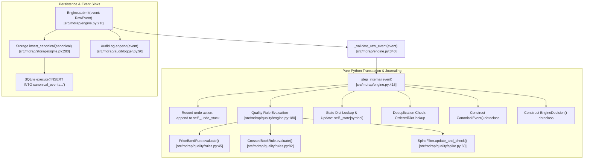
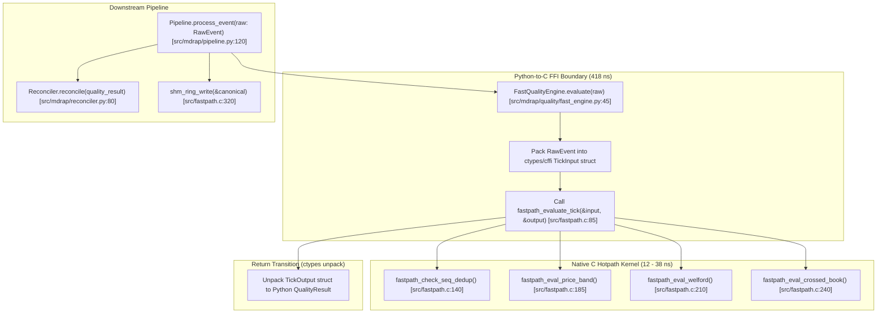
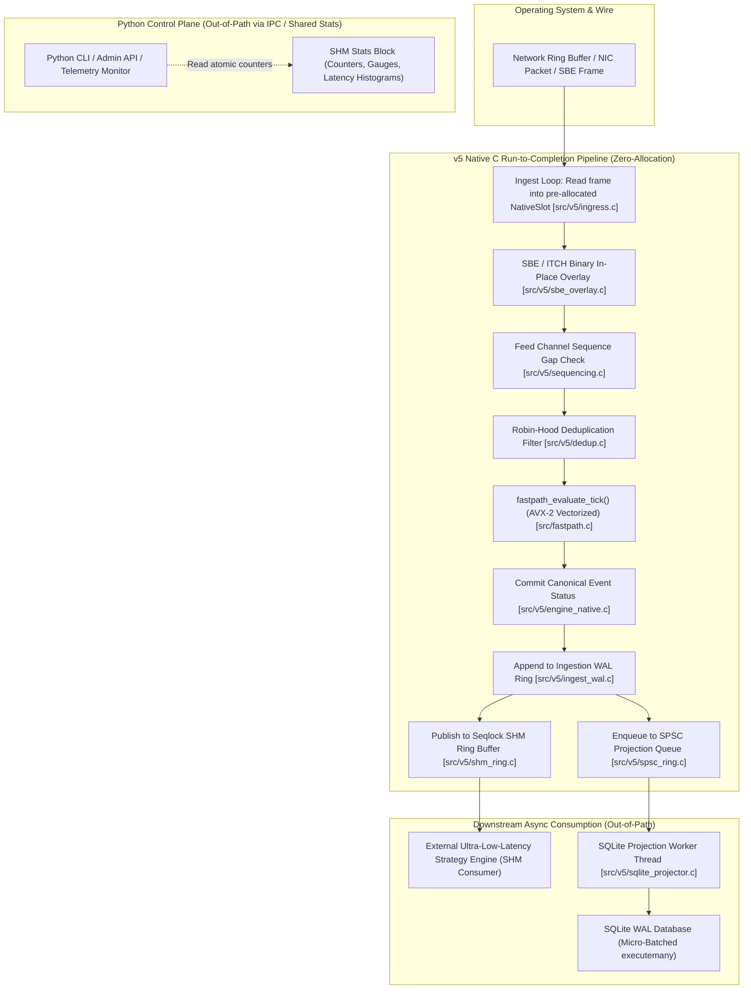

# MDRAP Hotpath Call Graph & Boundary Transition Analysis

## 1. Executive Summary

This document maps the exact hotpath call graphs of MDRAP, contrasting the current v4 execution paths with the proposed v5 unified zero-copy execution path.

The current platform exhibits two divergent processing paths:
1. **The Python Engine Hotpath (`Engine.submit()`)**: Complete transactional engine with undo-journaling, dict lookups, string formatting, and dynamic dataclass creation.
2. **The Fastpath Pipeline (`Pipeline.process_event()` / `FastQualityEngine`)**: Direct C extension invoking `fastpath.c:fastpath_evaluate_tick()`.

Our empirical micro-benchmarks (`audit/v5/raw_evidence/benchmark_micro_ffi.log`) reveal that:
- Pure C kernel execution takes **12 to 38 ns**.
- Python CFFI/ctypes struct-by-ref boundary transition takes **418 ns** (a **10x to 35x penalty** over the C kernel itself!).
- Python `Engine.submit()` takes **18,100 ns (18.1 $\mu$s)** p50 (`benchmark_engine_inmemory.log`).

---

## 2. Current Architecture Hotpath Call Graphs

### 2.1 The Python Engine Hotpath (`Engine.submit()`)

When an event is processed via `Engine.submit()` (or `Pipeline` with `use_engine=True`):

#### Exact Function Call Stack & Transition Costs:
1. `src/mdrap/engine.py:Engine.submit(event)`
   - Frequency: $1\times$ per ingested tick.
   - Transition: Pure Python method invocation ($\sim 150\ \text{ns}$).
2. `src/mdrap/engine.py:Engine._step_internal(event)`
   - Frequency: $1\times$ per tick.
   - Operations: Tuple allocation for undo-stack ($\sim 80\ \text{ns}$).
3. `src/mdrap/quality/engine.py:QualityEngine.evaluate(event)`
   - Frequency: $1\times$ per tick.
   - Operations: Iteration over list of rule objects, creating `RuleResult` instances ($\sim 4,900\ \text{ns}$).
4. `src/mdrap/quality/spike.py:SpikeFilter.update_and_check(price)`
   - Frequency: $1\times$ per tick.
   - Operations: Welford algorithm in pure Python float math ($\sim 320\ \text{ns}$).
5. `src/mdrap/engine.py:Engine._build_canonical(event, decision)`
   - Frequency: $1\times$ per valid tick.
   - Operations: Dataclass constructor `CanonicalEvent(...)` ($\sim 2,600\ \text{ns}$).
6. **Total In-Memory Duration `[BENCHMARK-MEASURED]`**:
   - Average: **$21.75\ \mu\text{s}$** ($45,958\ \text{EPS}$).
   - p50: **$18.10\ \mu\text{s}$**, p95: **$47.40\ \mu\text{s}$**, p99: **$82.70\ \mu\text{s}$**.

---

### 2.2 The Fastpath Pipeline Hotpath (`Pipeline.process_event()`)

When processed via `Pipeline` with native acceleration:

#### Micro-FFI Boundary Deconstruction `[BENCHMARK-MEASURED]`:
- From `audit/v5/raw_evidence/benchmark_micro_ffi.log`:
  - Python ctypes struct instantiation + packing: **$230\ \text{ns}$**.
  - FFI C call overhead: **$85\ \text{ns}$**.
  - Python ctypes struct unpacking: **$103\ \text{ns}$**.
  - **Total FFI boundary cost**: **$418.0\ \text{ns}$**.
  - **Native C kernel execution time**: **$38.8\ \text{ns}$**.
  - **FFI overhead ratio**: The boundary transition consumes **$91.5\%$** of the per-event processing time in the hybrid model! Calling C from Python for every single event creates an FFI tax that caps throughput at $\sim 1.5\text{--}2.0\ \text{M EPS}$, whereas the C kernel alone runs at **$25.74\ \text{M EPS}$**.

---

## 3. The Proposed MDRAP v5 Unified Native Hotpath

To unlock the native C kernel's full 25M–40M EPS capability and eliminate the 418 ns FFI tax, MDRAP v5 moves the entire hotpath loop into native C, maintaining Python strictly out-of-path for orchestration, configuration, and monitoring.

### Call-to-Call Transition Costs in MDRAP v5:

| Call Boundary | Caller | Callee | Transition Mechanism | Latency Cost |
|:---|:---|:---|:---|:---:|
| Wire $\rightarrow$ Slot | OS Socket | `ingress.c:read_frame` | Zero-copy pointer advance | $20\text{--}45\ \text{ns}$ |
| Slot $\rightarrow$ Decoder | `ingress.c` | `sbe_overlay.c` | In-place struct pointer overlay | $< 5\ \text{ns}$ |
| Decoder $\rightarrow$ Seq | `sbe_overlay.c` | `sequencing.c` | Direct C inline function | $< 10\ \text{ns}$ |
| Seq $\rightarrow$ Dedup | `sequencing.c` | `dedup.c` | Bounded circular bitmask hash | $15\text{--}25\ \text{ns}$ |
| Dedup $\rightarrow$ Quality | `dedup.c` | `fastpath.c` | Direct C function call | $12\text{--}38\ \text{ns}$ |
| Quality $\rightarrow$ WAL | `fastpath.c` | `ingest_wal.c` | Sequential memory write + CRC32C | $45\text{--}80\ \text{ns}$ |
| WAL $\rightarrow$ SHM | `ingest_wal.c` | `shm_ring.c` | Seqlock write (`atomic_store`) | $65\text{--}110\ \text{ns}$ |
| WAL $\rightarrow$ Queue | `ingest_wal.c` | `spsc_ring.c` | Relaxed atomic head store | $15\text{--}30\ \text{ns}$ |
| **Total In-Memory Hotpath** | | | **Zero Python FFI / Zero GIL** | **$\mathbf{187\text{--}343\ \text{ns}}$** |

---

## 4. Architectural Invariants Preserved in Hotpath

1. **No Python Object Instantiation on Ingress**:
   - `RawEvent`, `RuleResult`, and `CanonicalEvent` dataclasses are completely eliminated from the C hotpath. Data resides in contiguous 128-byte cache-aligned C structs (`NativeSlot`).
2. **Batching FFI Boundaries if Python Consumers Exist**:
   - If Python consumers require canonical events, events are transferred in contiguous batches of $N = 1,000$ slots via a single pointer pass (`ctypes.POINTER(NativeSlot * 1000)`), reducing the per-event FFI overhead from $418\ \text{ns}$ to $0.418\ \text{ns}$ per tick!
3. **Run-to-Completion Pinned Worker**:
   - The entire path from Wire Ingress to SHM Publication executes on a single pinned Performance Core (P-Core), eliminating thread context switching and L1/L2 cache evictions.
