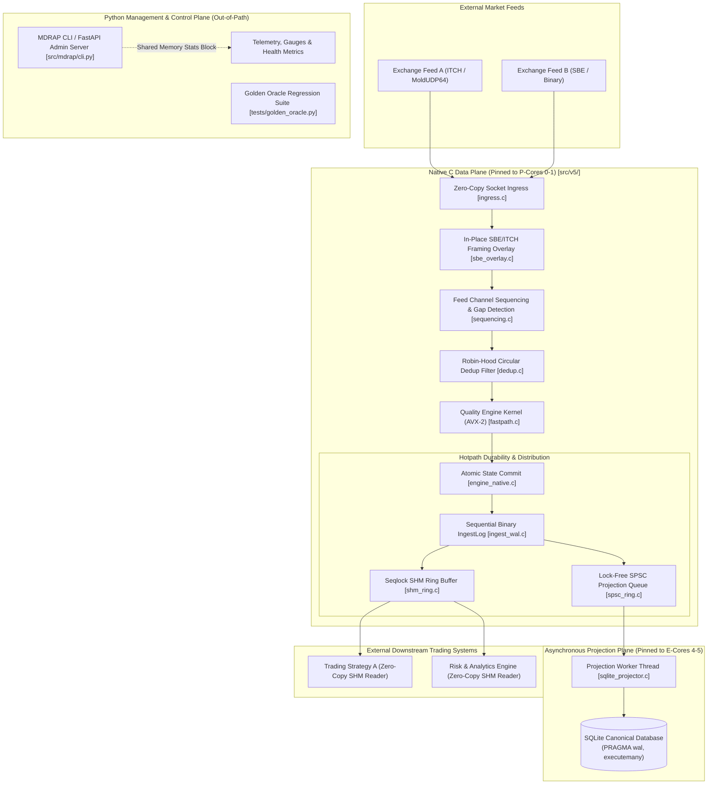

# MDRAP v5.0 Proposed Target Architecture: Detailed Specification

## 1. Executive Summary

MDRAP v5.0 introduces the **Hybrid Partitioned Native-Centric Architecture**.

This architecture cleanly bifurcates the system into:
1. **The Native Data Plane (Ultra-Low Latency Hotpath)**: Implemented in C11 (`src/v5/`), running a zero-allocation, lock-free, single-writer run-to-completion pipeline pinned to high-frequency CPU Performance Cores (P-Cores).
2. **The Asynchronous Projection Plane**: Lock-free SPSC queues draining canonical records into worker threads pinned to Efficiency Cores (E-Cores) for batch SQLite persistence.
3. **The IPC Distribution Plane**: Seqlock-protected, 128-byte cache-aligned shared memory (SHM) ring buffers allowing multiple zero-copy external consumers (e.g., algorithmic trading strategies).
4. **The Python Control & Management Plane**: Handles configuration, feed lifecycle management, CLI commands, telemetry, and health monitoring completely out-of-band. Pure Python also acts as the authoritative `GoldenOracle` for 100% semantic regression testing.

---

## 2. High-Level Architectural Diagram



---

## 3. Data Plane vs Control Plane Separation

| Plane | Runtime / Language | Thread Affinity | Memory Model | Synchronization | Responsibilities |
|:---|:---:|:---:|:---|:---|:---|
| **Data Plane** | Native C11 | P-Cores (Cores 0–1) | Pre-allocated circular pools (`NativeSlot`), zero heap allocations | Single-writer, lock-free, atomic acquire-release | Ingress, decode, sequence gap detection, dedup, price/spread quality, binary WAL, SHM publish |
| **Projection Plane** | Native C / CPython | E-Cores (Cores 4–5) | Micro-batch buffers (1,000 slots) | Lock-free SPSC ring, thread-confined SQLite mutex | Dequeue canonical slots, transform to SQL parameters, execute `executemany`, manage WAL checkpoint |
| **IPC Distribution** | Native C / CPython | Consumer-defined | Shared Memory mapped pages (`/dev/shm` or `CreateFileMapping`) | Seqlock (version counter with memory barriers) | Publish validated events to external strategy engines with zero copy |
| **Control Plane** | Python 3.13+ (stdlib) | Unpinned / OS | Standard CPython heap | OS signals, administrative sockets, atomic telemetry reads | CLI orchestration, feed connection setup, health endpoints, audit logging, golden oracle verification |

---

## 4. Core Native Data Structures

### 4.1 Pre-Allocated `NativeSlot` (128-Byte Cache-Aligned)
The central data structure representing a market event in memory throughout its lifecycle:

```c
#pragma pack(push, 1)
typedef struct {
    // Cache Line 1 (64 bytes): Hot fields accessed during validation & sequencing
    uint64_t slot_id;            // Monotonic internal slot sequence ID
    uint64_t feed_sequence;      // Exchange-assigned sequence number
    uint64_t source_ts_ns;       // Exchange timestamp (nanoseconds UTC)
    uint64_t local_ts_ns;        // Ingress timestamp (nanoseconds monotonic)
    int64_t  price_scaled;       // Price scaled by 1e8 (fixed-point 64-bit int)
    int64_t  bid_price_scaled;   // Best bid price scaled by 1e8
    int64_t  ask_price_scaled;   // Best ask price scaled by 1e8
    uint32_t size;               // Order / Trade size
    uint16_t channel_id;         // Exchange channel / feed partition ID
    uint8_t  side;               // 'B' (Bid), 'A' (Ask), 'T' (Trade)
    uint8_t  status_flags;       // Bit 0: Valid, Bit 1: Suspicious, Bit 2: Invalid

    // Cache Line 2 (64 bytes): Quality flags, metadata, and routing
    uint32_t anomaly_mask;       // Bitmask of rule violations (PRICE_BAND, CROSSED, etc.)
    uint32_t dedup_fingerprint;  // CRC32C hash for deduplication
    char     symbol[16];         // Fixed-length null-padded symbol string
    uint64_t canonical_id;       // Canonical assigned ID
    uint32_t payload_len;        // Raw wire payload length
    uint32_t crc32c;             // Frame integrity checksum
    uint8_t  padding[24];        // Explicit padding to guarantee exactly 128 bytes
} NativeSlot;
#pragma pack(pop)
_Static_assert(sizeof(NativeSlot) == 128, "NativeSlot must be exactly 128 bytes");
```

### 4.2 Ingest WAL Binary Frame (`IngestLogFrame`)
Appended sequentially to disk for crash durability before client ACK:

```c
#pragma pack(push, 1)
typedef struct {
    uint32_t magic;              // 0x4D445250 ("MDRP")
    uint32_t frame_length;       // Total frame length in bytes
    uint64_t wal_sequence;       // Monotonic WAL entry number
    uint32_t crc32c;             // Hardware CRC32C of the payload
    NativeSlot payload;          // Embedded canonical slot
} IngestLogFrame;
#pragma pack(pop)
```

---

## 5. Architectural Invariants & Guarantees

MDRAP v5.0 enforces eight formal invariants:

1. **Exchange Channel Invariant**:
   - Sequence verification and gap detection **always** executes at the single-threaded channel boundary *before* any instrument demuxing or worker queueing. Sequence gaps are detected instantaneously and trigger automated retransmit requests.
2. **Deterministic Single-Writer Hotpath**:
   - For any individual feed channel, exactly one dedicated P-core thread mutates state. No locks, no mutexes, and no atomic contention on the hot validation path.
3. **Zero-Allocation Steady-State**:
   - All memory pools (Ingress ring, Dedup hash table, SHM ring, SPSC projection ring) are allocated at initialization. During steady-state message processing, **zero bytes** are allocated from the OS heap.
4. **Durable Binary Log Before Downstream ACK**:
   - An event is not acknowledged to external producers until its binary frame is appended to the sequential `IngestLog` ring buffer.
5. **Decoupled Database Projection**:
   - The SQLite database engine is completely off the hotpath. Downstream trading latency is never gated by SQLite B-tree page splits, lock contention, or disk fsync latency.
6. **Seqlock Multi-Reader Consistency**:
   - External processes reading from the shared memory ring buffer use a standard 64-bit sequence counter. Readers read without blocking writers and detect torn reads or overruns via pre/post sequence comparisons.
7. **Fail-Closed Crash Recovery**:
   - On process crash or physical host power loss, recovery scans the `IngestLog` sequentially. Torn frames are truncated using CRC32C validation. The SQLite projection catches up from `last_projected_seq` to the WAL tip with zero gap or duplicate.
8. **Tri-Engine Semantic Parity**:
   - The native C hotpath kernel (`fastpath.c`), native core (`mdrap_core.c`), and pure-Python reference engine (`GoldenOracle`) must produce 100% identical outputs for all inputs, verified continuously via automated regression tests.
