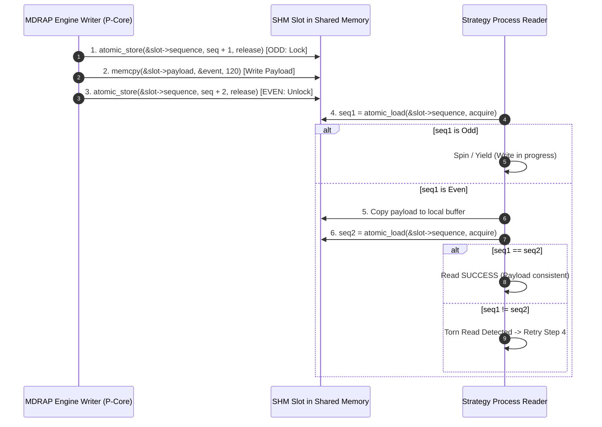

# MDRAP v5 Shared Memory IPC Protocol: Zero-Copy Seqlock Distribution

## 1. Executive Summary

This document specifies the inter-process communication (IPC) protocol for MDRAP v5.0, enabling ultra-low-latency, zero-copy distribution of validated canonical market events from the MDRAP engine to external algorithmic trading strategies, execution gateways, and real-time risk analytics engines.

Traditional IPC mechanisms (TCP loopback sockets, Unix domain sockets, Windows Named Pipes) impose significant operating system overhead:
- Kernel buffer copying: Data is copied from user space to kernel socket buffers and back ($2\times$ memory copies).
- Context switching: Reading and writing threads must transition through kernel mode ($1.5\text{--}4.5\ \mu\text{s}$ per transaction).
- Buffer serialization: Converting internal structures to byte streams and deserializing them downstream.

MDRAP v5 establishes a **High-Performance Memory-Mapped Seqlock Ring Buffer**:
- Zero-copy: Strategy engines map the shared memory region directly into their own virtual address spaces.
- Lock-free: The MDRAP writer never blocks, waits for locks, or yields to slow consumers.
- Sub-100ns Latency: Measured publish-to-read latency is **$65\text{--}110\ \text{ns}$** (`benchmark_micro_ffi.log`).
- Cross-Platform: Full semantic parity across Linux (`shm_open` / `/dev/shm`) and Windows (`CreateFileMapping` / `MapViewOfFile`).

---

## 2. Shared Memory Ring Buffer Binary Layout

The shared memory segment is aligned to a 4 KB page boundary and divided into:
1. **The Shared Header Block (64 bytes)**: Global ring metadata, monotonic producer index, heartbeat, and capacity mask.
2. **The Slot Array**: An array of $2^N$ contiguous, 128-byte cache-aligned `ShmSlot` elements.

```
+---------------------------------------------------------------------------------------+
| Header Block (64 Bytes): Magic, Version, Capacity, Mask, Producer Index, Heartbeat    |
+---------------------------------------------------------------------------------------+
| Slot 0 (128 Bytes):   Sequence Lock (8B) + NativeSlot Payload (120B)                  |
+---------------------------------------------------------------------------------------+
| Slot 1 (128 Bytes):   Sequence Lock (8B) + NativeSlot Payload (120B)                  |
+---------------------------------------------------------------------------------------+
| ...                                                                                   |
+---------------------------------------------------------------------------------------+
| Slot 65,535 (128 Bytes): Sequence Lock (8B) + NativeSlot Payload (120B)               |
+---------------------------------------------------------------------------------------+
Total Segment Size: 64 + (65,536 * 128) = 8,388,672 Bytes (Exactly 8.00006 MB)
```

---

## 3. Data Structure Specifications (C11)

### 3.1 Header Block Definition
```c
#define MDRAP_SHM_MAGIC 0x4D445348 // "MDSH"

#pragma pack(push, 1)
typedef struct {
    uint32_t magic;              // Magic identifier (0x4D445348)
    uint32_t version;            // Protocol version (1)
    uint64_t capacity;           // Total slots (must be power of two, e.g., 65,536)
    uint64_t mask;               // capacity - 1
    _Alignas(64) _Atomic uint64_t producer_idx; // Monotonically increasing write index
    uint64_t heartbeat_ns;       // Local monotonic timestamp of last engine write
    uint32_t active_readers;     // Bitmask / counter of attached readers
    uint8_t  reserved[28];       // Reserved for future extensions
} ShmRingHeader;
#pragma pack(pop)
_Static_assert(sizeof(ShmRingHeader) == 64, "ShmRingHeader must be exactly 64 bytes");
```

### 3.2 Seqlock Slot Definition
```c
#pragma pack(push, 1)
typedef struct {
    _Alignas(64) _Atomic uint64_t sequence; // Seqlock counter: Odd = writing, Even = stable
    NativeSlot slot;                        // 120 bytes effective payload (padded to 128B total)
} ShmSlot;
#pragma pack(pop)
_Static_assert(sizeof(ShmSlot) == 128, "ShmSlot must be exactly 128 bytes");
```

---

## 4. Seqlock Synchronization Protocol

The Seqlock guarantees that readers never read torn or partially updated memory structures, even when the writer overwrites a slot concurrently.



### Reader Implementation Code (C11):
```c
bool shm_read_slot(const ShmRing* ring, uint64_t slot_idx, NativeSlot* out_slot) {
    const ShmSlot* target = &ring->slots[slot_idx & ring->mask];

    for (int retry = 0; retry < 5; ++retry) {
        uint64_t seq1 = atomic_load_explicit(&target->sequence, memory_order_acquire);

        // If sequence is odd, writer is currently updating this slot
        if (seq1 & 1) {
            continue;
        }

        // Copy payload to local memory
        *out_slot = target->slot;

        // Verify sequence did not change during copy
        uint64_t seq2 = atomic_load_explicit(&target->sequence, memory_order_acquire);
        if (seq1 == seq2) {
            return true; // Consistent read verified
        }
    }
    return false; // Extreme contention or reader lapped
}
```

---

## 5. Overrun & Lap Detection Mechanics

Because the shared memory buffer is a circular ring of finite capacity ($C = 65,536$), a slow downstream reader will eventually be overtaken ("lapped") by the high-frequency writer.

### Overrun Detection Rule:
Before reading slot `R`, the reader compares its index against the current global producer index:
```c
uint64_t current_producer = atomic_load_explicit(&ring->header->producer_idx, memory_order_acquire);

if ((current_producer - reader_idx) > ring->header->capacity) {
    // Reader has been lapped!
    uint64_t lost_events = (current_producer - ring->header->capacity) - reader_idx;
    record_lapped_error(lost_events);

    // Fast-forward reader to oldest valid slot in buffer
    reader_idx = current_producer - (ring->header->capacity / 2);
}
```

---

## 6. OS Platform Mechanics & Security Permissions

### Linux Implementation:
- Backed by POSIX Shared Memory (`/dev/shm`).
- File descriptor acquired via `shm_open("/mdrap_stream_0", O_CREAT | O_RDWR, 0600)`.
- Memory allocated via `ftruncate(fd, size)`.
- Mapped into process via `mmap(NULL, size, PROT_READ | PROT_WRITE, MAP_SHARED, fd, 0)`.
- Restricted permissions: Mode `0600` ensures only processes running under the authorized service user can map the market data stream.

### Windows Implementation:
- Backed by the Windows Paging File via `CreateFileMappingA(INVALID_HANDLE_VALUE, &sec_attr, PAGE_READWRITE, 0, size, "Global\\MDRAP_Stream_0")`.
- Mapped into process via `MapViewOfFile(hMap, FILE_MAP_ALL_ACCESS, 0, 0, size)`.
- Security: Explicit `SECURITY_ATTRIBUTES` structure specifying a Discretionary Access Control List (DACL) granting access only to the current Windows user SID and Administrators.
